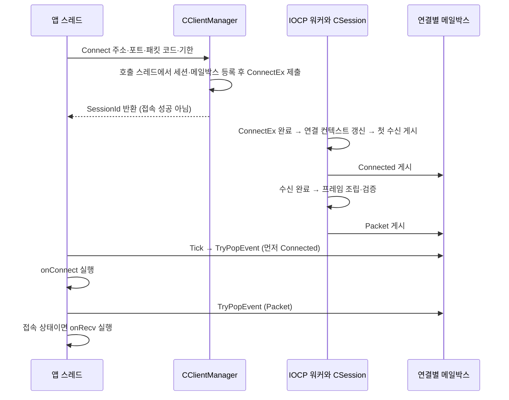
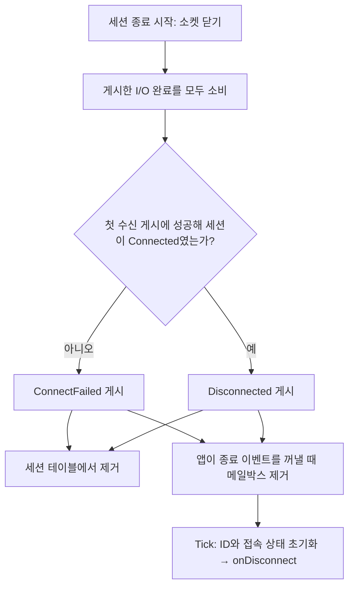

# 클라이언트 네트워크와 이벤트 처리

`ClientNetworkLib`는 TCP 연결과 IOCP 완료를 관리한다. 앱은 소켓 완료를 직접 받지 않고, 연결별 메일박스에서 이벤트를 꺼내 콘텐츠 콜백을 실행한다. 이 문서는 현재 `ChatClient`·`ChatDummyClient`가 사용하는 경로를 다룬다.

전송 계층을 공유하는 것과 별도로, 두 앱은 패킷 검증·상태 갱신까지 공통 `Handle*()` 구현을 사용한다. [공용 프로토콜과 앱 콜백](003_콘솔_채팅과_더미_클라이언트.md#1-공용-프로토콜과-앱-콜백)에 중복을 줄이는 설계와 실제 호출 예를 정리했다.

## 1. 접속 요청과 접속 완료

| 구성 요소 | 책임 |
| --- | --- |
| [`CClientManager`](../../Client/ClientNetworkLib/CClientManager.cpp) | Winsock·IOCP·워커와 세션/메일박스 테이블을 관리한다. 여러 연결을 `SessionId`로 구분한다. |
| [`CSession`](../../Client/ClientNetworkLib/CSession.cpp) | 연결마다 소켓, 수신 링 버퍼, 송신 큐·진행 중 배치, `OVERLAPPED`, 미소비 I/O 완료 수를 갖는다. |
| [`CClientMailbox`](../../Client/ClientNetworkLib/CClientMailbox.cpp) | 연결 이벤트, 수신 패킷 FIFO, 종료 이벤트를 따로 보관한다. 워커에서 앱으로 넘기는 경계다. |
| [`CClient`](../../Client/ClientNetworkLib/CClient.cpp) | 연결 ID와 앱에서 본 접속 상태를 보관하고, 앱이 호출한 `Tick()`에서 콜백을 실행한다. |

`CClientManager::Connect()`는 로컬 바인드와 IOCP 연결을 마치고 세션과 메일박스를 등록한 뒤 `ConnectEx`를 제출한다. `CClient::Connect()`의 `true`는 0이 아닌 ID를 받았다는 뜻이지 접속 완료가 아니다. 주소 검증이나 제출이 즉시 실패하면 ID가 없고 종료 콜백도 없다. 제출 이후의 거절·타임아웃·취소는 종료 이벤트로 확인한다. 지정 워커가 미접속 세션의 기한을 주기적으로 확인하며, 연결 완료를 처리할 때도 기한을 확인한다.

## 2. 수신·송신과 앱 처리 순서

- **수신:** `WSARecv`는 세션 링 버퍼의 빈 구간에 건다. 완성되지 않은 프레임은 남겨 두고, 완성된 패킷만 `CSerializableBuffer`로 복사한다. 코드·길이를 검사하고 Net 모드에서만 복호화·체크섬 검증을 한다. 패킷 버퍼는 `shared_ptr`로 이벤트에 전달되며, 앱 콜백에는 참조로 전달된다. 이 참조를 콜백 밖에서 보관하는 계약은 아니다. 패킷 큐는 연결당 최대 512개이며, 추가할 수 없으면 수신 경로가 연결을 닫는다.
- **송신:** `SendPacket()`은 힙 패킷 버퍼를 세션 큐로 넘긴다. 세션이 패킷을 전송 형식으로 준비하고 FIFO 순서로 `WSASend` 배치를 구성한다. 진행 중 배치의 버퍼는 완료 처리까지 보관한다. `true`는 전송 경로에 접수됐다는 뜻이지 상대가 받았다는 뜻은 아니다.
- **소비:** 한 번의 `Tick()`은 최대 64개를 꺼낸다. 같은 연결에서 `Connected` → 대기 패킷 FIFO → 종료 이벤트 순서다. 연결·종료 이벤트는 패킷 큐의 512개 한도와 별개다. 패킷을 꺼낸 시점에 앱 접속 상태가 참일 때만 `onRecv()`를 호출한다. `onRecv()`가 거부하면 `onRecvRejected()`를 부르고 종료를 요청한다.
- **스레드:** 콘솔은 [메인 스레드](../../Tests/Chatting/Client/Main.cpp)에서, 더미는 [해당 연결을 담당하는 앱 워커](../../Tests/Chatting/DummyClient/CDummyRunner.cpp)에서 `Tick()`을 호출한다. 콜백은 IOCP 워커에서 실행되지 않는다. 언리얼 연동은 현재 구현 범위가 아니며, [클라이언트 작업 규칙](../Rule/003_클라이언트_작업규칙.md)은 연동 시 게임 스레드에서 `Tick()`을 호출하도록 정한다.

## 3. 종료와 재접속 경계

`Disconnect()`는 앱의 접속 상태를 내리고 종료를 요청하지만 즉시 ID를 비우지는 않는다. 이미 게시된 `Connected`가 남아 있다면 다음 `Tick()`에서 상태가 다시 올라가 `onConnect()`가 호출되고, 대기 패킷도 처리될 수 있다. `Tick()`이 `ConnectFailed` 또는 `Disconnected`를 소비한 뒤에야 같은 `CClient`가 다시 접속할 수 있다. 종료 분류는 앱 콜백 실행 여부가 아니라 세션이 `Connected`에 도달했는지로 결정한다. `ConnectEx`가 성공해도 연결 컨텍스트 갱신이나 첫 수신 게시가 실패하면 `ConnectFailed`다. 종료 이벤트 게시 후 세션 제거와 앱의 이벤트 소비는 별도 경로이므로 어느 쪽이 먼저 끝나는지는 보장하지 않는다.

매니저의 `Stop()`은 새 접속·송신 접수를 막고 모든 세션의 종료와 테이블 제거를 기다린 뒤 IOCP 워커와 Winsock을 정리한다. 앱 콜백까지 실행하는 함수는 아니다. 매니저가 살아 있다면 남은 메일박스 이벤트는 `Stop()` 뒤에도 꺼낼 수 있다. 종료 이벤트를 꺼내지 않으면 메일박스가 남고, `CClient` 소멸자 자체는 연결을 끊거나 이벤트를 소비하지 않는다.

## 4. 검증 범위

[`ClientLifecycleTests.cpp`](../../Tests/ClientLifecycle/ClientLifecycleTests.cpp)는 동시 연결과 메일박스 격리, 접속 거절·기한 만료·취소, 재접속과 `Stop()` 뒤 종료 이벤트를 확인한다. 링 버퍼 순환과 헤더·본문 분할, Lan/Net 송수신, Net 체크섬 거부, 콜백 실행 스레드와 순서도 검사한다. 이 테스트는 언리얼 통합이나 장기 부하를 검증하지 않는다.
