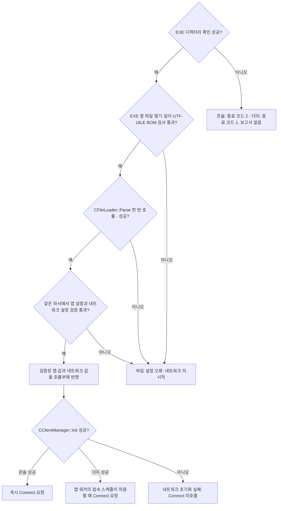

# 클라이언트 설정 소유권과 초기화

`ChatClient`와 `ChatDummyClient`는 각자의 EXE 옆에 있는 설정 파일을 파싱한다. 앱은 파일 경로와 접속·시험 정책을, `ClientNetworkLib`는 공통 네트워크 값의 타입과 검증을 소유한다. 실행 중인 `CClientManager`는 설정 파일을 읽지 않는다.

## 1. 파일과 설정의 소유자

| 설정 | 소유자 | 사용 위치 |
| --- | --- | --- |
| [`ClientConfig.conf`](../../Tests/Chatting/Client/ClientConfig.conf)의 `Client:` | 콘솔의 [`SChatClientConfig`와 `LoadClientConfig()`](../../Tests/Chatting/Client/ClientConfig.cpp) | 접속 주소·포트·기한, 로그인 계정·이름, 최초 섹터 좌표 |
| [`DummyClientConfig.conf`](../../Tests/Chatting/DummyClient/DummyClientConfig.conf)의 `DummyClient:` | 더미의 [`SDummyConfig::Load()`](../../Tests/Chatting/DummyClient/SDummyConfig.cpp) | 접속값과 계정 범위, 클라이언트 수, 앱 워커와 시험 스케줄 |
| 두 파일의 `ClientNetwork:` | [`SClientNetworkSettings::Load()`](../../Client/ClientNetworkLib/SClientNetworkSettings.cpp) | 매니저의 IOCP 워커 수, 세션 수신 링 크기와 패킷 모드 |

`ClientNetwork:`의 세 값은 모두 필수다. 구조체 멤버의 초기값은 파일 키 누락 시 사용하는 기본값이 아니다.

| 필수 키 | 파일 검증 범위 | 두 샘플의 값 |
| --- | --- | --- |
| `WORKER_COUNT` | 정수 `1..16` | `1` |
| `RECV_BUFFER_BYTES` | 패킷 최대 크기(`1024`) 이상, 링 커서 범위 상한(`kMaxRecvBufferBytes`, `0x3fffffff`) 이하 | `4096` |
| `PACKET_MODE` | `Net` 또는 `Lan`. Net은 암호화·체크섬을 사용하고 Lan은 사용하지 않는다. 접속할 서버와 모드를 맞춘다. | `Net` |

- **콘솔:** `IP`는 `127.0.0.1`만 허용한다. `PORT`, `ACCOUNT_NO`, `NICKNAME`, `SECTOR_X/Y`는 필수다. `ACCOUNT_NO = 0`이면 프로세스 ID를 쓴다. `CONNECT_TIMEOUT_MS`가 없으면 `5000`을 쓴다. 섹터 좌표는 네트워크 설정이 아니라 첫 입장 요청에 쓰는 값이다.
- **더미:** `IP`는 IPv4 루프백(`127.*`), `PORT`는 `1..65535`, `ACCOUNT_BASE`는 양수이고 마지막 더미 계정까지 `INT64`에 들어가야 한다. 이 세 키는 필수다. `CLIENT_COUNT`, `SECTOR_X/Y`, 각종 시간·가중치 등은 생략 시 [`SDummyConfig` 멤버 기본값](../../Tests/Chatting/DummyClient/SDummyConfig.h)을 유지한다. `APP_WORKER_COUNT`는 `Tick()`을 실행하는 앱 워커 수의 상한으로, IOCP `WORKER_COUNT`와 별개다. `SCENARIO` 키는 허용하지 않는다.

## 2. 파싱과 실행의 경계

1. 콘솔은 [`LoadConfigFile()`](../../Tests/Chatting/Common/Config.cpp)이 경로 확인부터 파싱까지 호출한다. 더미는 러너가 EXE 디렉터리를 구하고 `SDummyConfig::Load()`에 파일 경로를 넘긴다. 두 경로 모두 `CheckConfigFile()`로 사전 검사한 뒤 파서가 파일을 다시 열어 `Parse()`를 한 번 수행한다. 사전 검사나 파싱 성공만으로 필수 키가 유효해지는 것은 아니다.
2. 콘솔은 접속 주소·포트 → 네트워크 값 → 나머지 콘솔 값을 검사한다. 더미는 루프백·폐기된 키 `SCENARIO` → 네트워크 값 → 나머지 더미 값을 검사한다. 각 단계에서 실패하면 반환하고, 모든 검증이 끝났을 때만 네트워크와 앱 설정 결과를 넘긴다.
3. [`Init(networkSettings)`](../../Client/ClientNetworkLib/CClientManager.cpp)는 파일을 다시 읽지 않고 Winsock·IOCP와 워커를 준비한다. 수신 링 크기와 패킷 모드는 매니저가 보관해 세션 생성에 쓰고, 워커 수는 초기화 시 사용한다. 파일 검증의 `WORKER_COUNT <= 16`은 `Load()`의 계약이다. `Init()`의 방어 검사는 워커 수 0, 중복 초기화, 수신 버퍼 범위와 모드 오류에 적용된다.
4. `Connect()`에는 연결마다 IP·포트·패킷 코드·접속 기한(ms)을 넘긴다. 패킷 코드와 암호화 키는 채팅 프로토콜 정의에서 오며 `.conf`에 넣지 않는다. 접속이 비동기로 진행되는 방식은 [네트워크와 이벤트 처리](001_클라이언트_네트워크와_이벤트_처리.md)를 참고한다.

## 3. 실패 진단과 검증 범위

| 실패 지점 | 콘솔 `ChatClient` | `ChatDummyClient` |
| --- | --- | --- |
| 파일/파싱/설정 검증 | `CONFIG ERROR`와 파일명·사유를 남기고 종료 코드 `2` | `RunSummary.json`에 `config_parse_failed`, `config_packet_mode_invalid`, `config_network_limits_invalid` 등 해당 사유를 기록하고 종료 코드 `2` |
| `Init()` 실패 | 접속 실패와 같은 `CONNECT FAILED`, 종료 코드 `1` | `network_init_failed`, 종료 코드 `1` |

더미는 설정을 읽기 전에 결과 디렉터리를 만든다. EXE 경로 확인, 결과 디렉터리 생성, 결과 파일 쓰기 자체가 실패하면 종료 코드 `1`이며 보고서가 보장되지 않는다.

[`test_server_event_input.py`](../../Tests/Chatting/test_server_event_input.py)의 `client-network`는 콘솔의 공통 키 누락과 범위·형식 오류를 확인한다. [`test_dummy_runner.py`](../../Tests/Chatting/test_dummy_runner.py)는 더미의 공통 키 누락, 모드 오류, 앱 스케줄 설정 실패와 구조화된 결과를 확인한다. 이 시험들은 `Init()`이나 결과 파일 I/O의 실패를 주입하지 않는다. 서버 쪽 설정과 기동은 [서버 설정 소유권과 기동 순서](../Server/006_서버_설정_소유권과_기동_순서.md)에서 다룬다.
