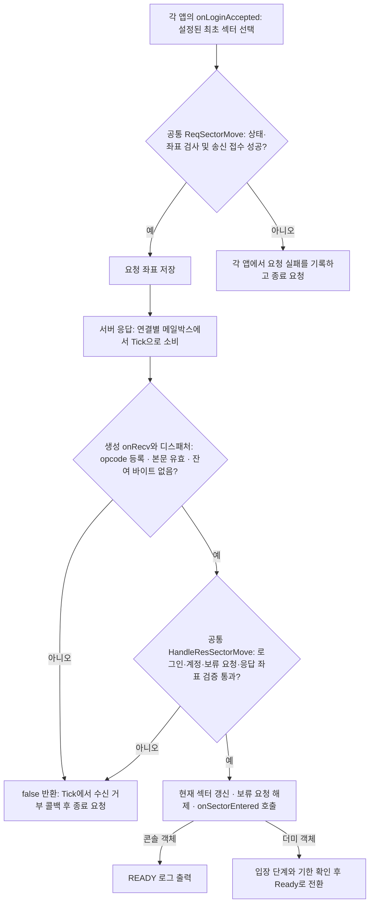
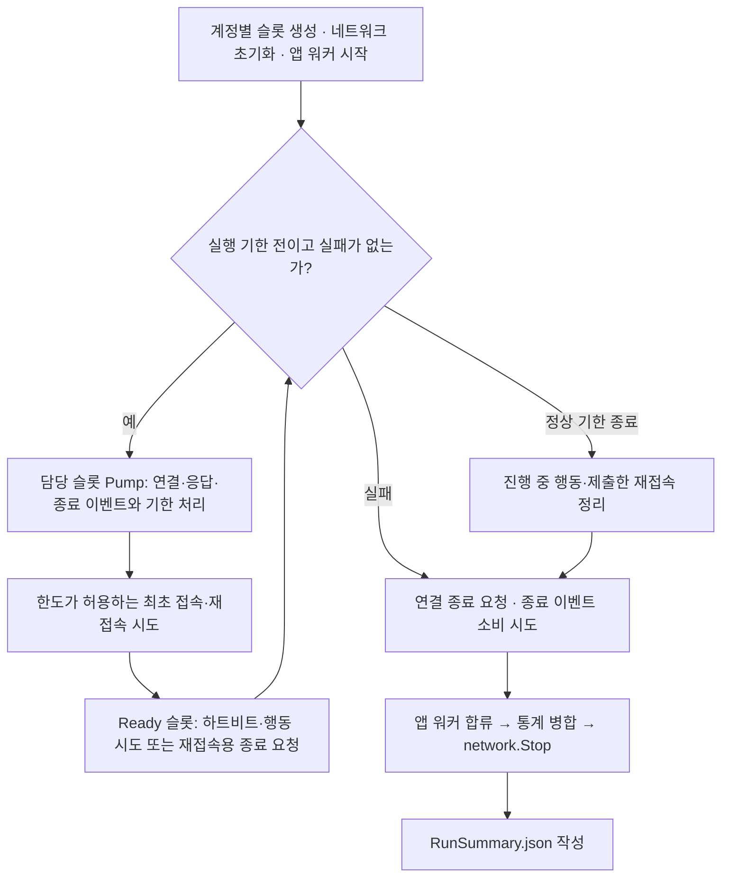

# 콘솔 채팅과 더미 클라이언트

`ChatClient`는 사람이 같은 섹터의 채팅을 확인하는 콘솔 앱이다. `ChatDummyClient`는 한 프로세스에서 `CLIENT_COUNT`개의 연결을 다루며 채팅·섹터 이동·재접속을 검증한다. 두 앱은 채팅 프로토콜 코드를 공유하지만 입력과 결과 처리 정책은 각자 갖는다. 둘 다 루프백 시험용이며 운영 인증이나 언리얼 클라이언트 구현은 아니다.

## 1. 공용 프로토콜과 앱 콜백

이 구조의 주된 설계 목적은 **일반 클라이언트와 더미에 같은 패킷 처리 코드를 두 번 작성하지 않는 것**이다. 소켓과 IOCP만 공유하면 각 앱이 응답을 해석하고 검증하는 코드, 로그인·입장 상태를 갱신하는 코드는 여전히 중복된다. 그래서 패킷을 받아 공통 상태를 갱신하는 지점까지 한 구현을 사용하고, 그 결과를 화면에 표시할지 자동으로 검사할지만 앱 콜백에서 나눈다. 공통 응답 규칙을 고치면 두 앱이 같은 수정본을 사용하므로 한쪽만 옛 규칙으로 동작하는 일을 줄인다.

### 무엇을 공유하고 무엇을 분리하는가

| 계층 | 책임 |
| --- | --- |
| `ClientNetworkLib` | 연결·송수신과 메일박스를 관리한다. `CClient::Tick()`에서 수신을 넘기지만 로그인이나 섹터의 의미는 알지 않는다. |
| [`CChatNetClient` 생성 코드](../../Common/Packet/Chatting/Generated/Client/CChatNetClient.g.h)와 [패킷 디스패처](../../Common/Packet/Chatting/Generated/Client/ClientPacketDispatch.g.cpp) | `SendReq*()`로 패킷을 구성하고, 수신 opcode에 따라 본문을 타입이 있는 패킷으로 역직렬화한다. 본문이 유효하고 남은 바이트가 없을 때 현재 클라이언트 객체의 `Handle*()`를 호출한다. |
| [`CChatNetClientHandlers.cpp`](../../Tests/Chatting/Client/CChatNetClientHandlers.cpp) · [`CChatNetClientMembers.inc`](../../Tests/Chatting/Client/CChatNetClientMembers.inc) | 수동 `ReqLogin()`·`ReqSectorMove()`는 요청 전 상태를 확인하고 접수된 요청을 기억한다. 수동 `Handle*()`는 계정·진행 상태·요청 좌표 등 패킷별 규칙을 검사하고, 필요한 공통 상태를 갱신한 뒤 앱 콜백을 호출한다. 연결이 끝나면 공통 로그인·섹터 상태를 먼저 초기화한다. |
| [`CConsoleChatClient`](../../Tests/Chatting/Client/CConsoleChatClient.cpp) | 최초 섹터 진입을 요청하고 로그인·입장·메시지 결과를 콘솔에 표시한다. |
| [`CChatDummyClient`](../../Tests/Chatting/DummyClient/CChatDummyClient.cpp) | 최초 섹터 진입, 단계별 기한, 진행 중 행동, 자기 메시지 응답 검증과 통계를 관리한다. |

현재 이 설계를 사용하는 일반 클라이언트는 콘솔 `ChatClient`다. `CConsoleChatClient`와 `CChatDummyClient`는 모두 `CChatNetClient`를 상속한다. [`ChatClient.vcxproj`](../../Tests/Chatting/Client/ChatClient.vcxproj)와 [`DummyClient.vcxproj`](../../Tests/Chatting/DummyClient/DummyClient.vcxproj)는 **같은 생성 코드와 같은 `CChatNetClientHandlers.cpp`**를 각각 컴파일한다. 이름이나 인터페이스만 같은 복제본이 아니다. `Handle*()`는 `final`이라 각 앱이 공통 처리를 덮어쓰지 않고, `CChatNetClientMembers.inc`에 선언된 앱 콜백을 구현한다. 공유하는 것은 코드이며, 계정·로그인 상태·요청한 섹터·현재 섹터는 각 클라이언트 객체가 따로 가진다.

### 최초 섹터 입장으로 보는 공통 처리 흐름

두 앱 모두 접속 이벤트를 처리하는 `onConnect()`에서 로그인 요청을 보내고, 공통 `HandleResLogin()`이 승인한 뒤 앱 콜백에서 최초 섹터를 요청한다. 아래는 그 섹터 요청과 응답을 앱 스레드에서 처리하는 흐름이다.

채팅 응답도 같은 원칙을 따른다. 공통 `HandleResMessage()`는 입장 상태, 자기 계정, 문자열 규칙을 확인한다. 그 뒤 `onChatMessageEcho()`에서 콘솔은 `CHAT`을 출력하고, 더미는 방금 보낸 본문과 일치하는지 확인해 행동 완료와 RTT를 기록한다. 더미가 실제 응답 검증과 상태 갱신 코드를 거치므로 공통 경로의 회귀를 발견하는 데 쓸 수 있지만, 콘솔 출력이나 향후 언리얼 화면 동작까지 검증하는 것은 아니다. 상대 메시지 통지(`MessageNoti`)를 포함한 서버 왕복은 [채팅 패킷 송수신 흐름](../Server/002_채팅_패킷_송수신_흐름.md)을 참고한다.

**언리얼 `GameClient` 연동은 계획이다.** [OOP 기반 플레이어 이동 동기화 계획](../Plan/Client/001_OOP_기반_플레이어_이동_동기화_계획.md)도 같은 경계를 따른다. 게임의 `Req*()`·`Handle*()`와 서버 응답으로 갱신하는 공통 상태는 언리얼과 더미에 한 번만 구현한다. 언리얼은 게임 스레드에서 `Tick()`을 호출하고 UI·Actor 표시를, 더미는 담당 앱 워커에서 `Tick()`을 호출하고 자동 입력·결과 검증을 맡는다. 공통 핸들러에는 두 앱의 전용 동작을 넣지 않는다. 현재 채팅 코드의 공유 사례가 언리얼 빌드나 런타임 연동까지 확인됐다는 뜻은 아니다.

## 2. 콘솔 채팅

[`Main.cpp`](../../Tests/Chatting/Client/Main.cpp)의 메인 스레드가 `Tick()`을 호출해 접속·로그인·입장 응답을 소비한다. 접속 후 로그인과 최초 입장에 합계 5초의 대기 시간을 둔다. 채팅이 준비되면 콘솔 입력을 폴링하면서 `Tick()`을 이어 간다. 앱이 준비 상태, UTF-8 변환, 길이(UTF-16 코드 단위 1~256)를 검사하고 생성된 `SendReqMessage()`를 직접 호출한다. 검증 또는 송신 요청이 실패하면 `MESSAGE REJECTED`를 출력하며, 이 분기 자체에서 연결을 닫지는 않는다. 자기 응답과 다른 사용자 통지를 모두 `CHAT`으로 표시하고, 준비 상태에서 주기적으로 하트비트를 보낸다.

`/exit` 또는 입력 끝에서는 정상 종료한다. 접속이나 입장에 실패하거나 실행 중 연결이 끊기면 재접속하지 않고 실패로 끝낸다. 종료 시 `Disconnect()` → `network.Stop()` → `Tick()` 순으로 정리한다.

## 3. 더미의 N개 연결과 실행 종료

[`CDummyRunner`](../../Tests/Chatting/DummyClient/CDummyRunner.cpp)는 `CClientManager` 하나를 공유한다. 계정은 `ACCOUNT_BASE + index`로 할당하고, `min(CLIENT_COUNT, APP_WORKER_COUNT)`개의 앱 워커에 슬롯을 인덱스 기준으로 순환 분배한다. 담당 워커가 각 슬롯의 `Pump()`를 실행해 `Tick()`과 앱 단계 기한을 처리한다. 앱 워커 수와 IOCP 워커 수는 별개다. 값과 초기화 경계는 [클라이언트 설정 소유권과 초기화](002_클라이언트_설정_소유권과_초기화.md), 세션과 메일박스 수명은 [네트워크와 이벤트 처리](001_클라이언트_네트워크와_이벤트_처리.md)에 정리돼 있다.

- **접속 한도:** 모든 앱 워커가 주기별 `CONNECT_ATTEMPTS_PER_INTERVAL`을 공유한다. 최초 접속과 재접속이 같은 한도를 사용한다. 실제 접속 요청 제출은 공유 한도 안에서 직렬화하지만 `Tick()`과 응답 대기는 한도를 보호하는 락 밖에서 진행한다.
- **행동과 재접속:** Ready 상태인 슬롯은 가중치에 따라 채팅이나 현재와 다른 섹터로의 이동을 선택하고, 행동 응답 대기는 슬롯당 한 건이다. 이동은 요청 좌표와 일치하는 응답으로, 채팅은 자기 계정·본문이 일치하는 응답으로 완료한다. 완료된 행동을 기준으로 `RECONNECT_PROBABILITY_BPS`를 적용한다. 선택되면 연결을 닫고 종료 이벤트를 소비한 뒤, 같은 계정으로 새 연결을 요청해 다시 로그인·입장한다. 예기치 않은 단절에 대한 자동 복구 정책은 아니다.
- **기한과 정리:** 실행 기한은 프로세스 시작 시각 기준이다. 기한 또는 실패 때문에 운영 루프를 나오면 새 접속과 행동을 시작하지 않는다. 정상 기한 종료에서는 대기 중 행동이나 이미 제출된 재접속을 `실행 기한 + DRAIN_TIMEOUT_MS`까지 처리한다. 아직 제출하지 않은 재접속은 새로 시작하지 않는다. 작업 정리 기한까지 별다른 실패 없이도 진행 중인 작업이 남으면 담당 워커가 `work_drain_timeout`을 기록한다. 이어 연결 종료를 요청하고 별도의 `DRAIN_TIMEOUT_MS` 동안 종료 이벤트를 소비한다. 이 기한에도 활성 슬롯이 남으면 `terminal_timeout`을 기록한다.

## 4. 결과와 검증 범위

정상적으로 보고서를 저장하면 `DummyReports/<run_id>/RunSummary.json`이 EXE 디렉터리 아래에 생긴다. `stages`는 단계 진입 횟수이고, `app_workers`는 워커별 할당 슬롯·최초 Ready·종료 이벤트·행동 완료를 보여 준다. `actions`는 제출과 완료를, `reconnects`는 요청·제출·Ready를 구분한다. `message_rtt_ms`는 자기 메시지 제출 직전부터 앱이 일치하는 응답을 검증할 때까지의 시간으로, 네트워크 전송 시간만을 뜻하지 않는다. `peer_received`는 실행 표식과 더미 계정 범위에 맞는 상대 통지 횟수다. 모든 메시지의 상대 전달을 보장하는 지표는 아니다.

보고서의 `failure_count`와 `failures`에서 실패 집계와 원인 예시를 확인한다. 저장에 성공했다면 실패 집계가 없을 때 종료 코드 `0`, 실행 실패면 `1`, 설정 실패면 `2`다. `0`만으로 모든 슬롯이 Ready에 도달했거나 충분한 행동을 수행했다고 판단하지 않고 단계·행동 수를 함께 확인한다.

[`test_dummy_runner.py`](../../Tests/Chatting/test_dummy_runner.py)는 루프백에서 다중 연결·앱 워커, 접속 간격과 실행 기한, 채팅·이동, 재접속 도중 종료 정리, 실패 보고를 확인한다. 장시간 하트비트 사례는 `--long-heartbeat` 옵션 범위다. Jenkins의 실행·보고서 수집 경로는 [채팅 서버 Jenkins 문서](../Infra/001_채팅서버_젠킨스.md)를 참고한다.
