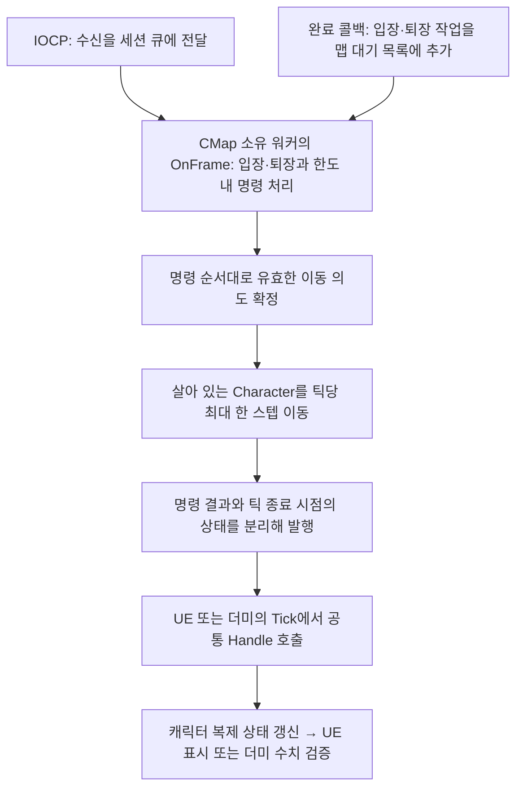

# OOP 기반 플레이어 이동 동기화 계획

**확정: `GameServer`·`GameClient`·게임 더미의 게임플레이는 모두 OOP로 구현한다.** 아래 시작·정지 이벤트 프로토콜은 앞선 토론을 반영한 **1차 작업안**이다. 필드와 거절 규칙은 게임 패킷 생성 전에 확인한다. OOP 확정과 패킷 규격 확정은 별개다. 논의 과정은 문서 끝의 [설계 결정 이력](#설계-결정-이력)에 정리했다.

## 목표와 현재 상태

`GameClient` 2개와 `CLIENT_COUNT`로 지정한 콘솔 더미 N개가 같은 맵에서 서로의 입장·이동·정지·퇴장을 확인한다. 첫 지형은 쿼터뷰 평면 한 장과 정적 장애물 하나다. 운영 인증·DB, 맵 간 이동, 전투, 광역 AOI, 본인 이동 예측은 1차 범위에 넣지 않는다.

- 기존 IOCP 전송·메일박스, 패킷 생성기, `ContentsRuntimeLib`를 재사용한다. `Chatting`은 공통 핸들러의 선례이고, `FixedMaps`의 `ReqMove`는 같은 맵 보행이 아닌 **맵 간 이전**이다. 두 시험의 기존 프로토콜과 제품 라이브러리를 이 계획 때문에 변경하지 않는다.
- [Phase 0 게임 데이터 생성·판독](../Common/001_게임데이터_생성기_계획.md#phase-0--작은-단위의-선행-작업)은 완료됐다. `GameServer`·`GameClient`에서의 데이터 적재 및 실제 소비는 미착수다. Phase 1의 진행 상태는 아래 체크 항목을 따른다.

## OOP 소유권과 호출 경계

| 객체 | 소유와 책임 |
| --- | --- |
| 서버 `CMap` (`IContents`) | 서버 `Character`를 단독 소유한다. 세션과 캐릭터의 매핑, 맵 틱·정적 지형, 명령 판정과 객체 갱신 순서, 결과 발행을 관리한다. 맵 상태는 [현재 담당 콘텐츠 워커](../../Server/004_콘텐츠_런타임과_워커_인계.md#1-콘텐츠-등록과-담당-워커)만 바꾼다. |
| 서버 `Character` | 현재 좌표·방향과 활성 목적지 등 자신의 이동 상태를 소유한다. 이동 메서드가 이 원본만 갱신한다. 좌표·이동 상태에 값 타입과 순수 계산 함수를 써도 객체 소유권은 유지한다. IOCP·패킷 발행·UE에는 의존하지 않는다. |
| 공통 게임 클라이언트 | 기존 `ClientNetworkLib` 위에서 동일한 `Req*()`·`Handle*()`와 `NetEntityId`별 캐릭터 상태 객체를 두 앱이 함께 쓴다. 서버 이벤트로만 복제 상태를 바꾼다. [현재 콘솔·더미의 공용 핸들러](../../Client/003_콘솔_채팅과_더미_클라이언트.md#1-공용-프로토콜과-앱-콜백)가 선례다. |
| 언리얼 `GameClient` / 게임 더미 | UE 게임 스레드는 입력과 `NetEntityId → Actor` 매핑, 표시·보간을 맡고 더미의 앱 워커는 자동 입력과 수치 검증을 맡는다. 둘 다 자기 스레드에서 `CClient::Tick()`을 호출한다. Actor 위치를 공통 클라이언트 상태나 서버에 되쓰지 않는다. |

- **서버 현재 좌표의 원본은 `Character`에 하나만 둔다.** 이동은 갱신하고 후속 스킬은 같은 값을 읽는다. 목적지, 시전 시점에 고정된 지점, 클라 표시 좌표는 각각 다른 의미를 가진 값이다. `CMap`에 두 번째 현재 좌표를 만들지 않는다.
- 지속되는 참조는 ID로 관리한다. `NetEntityId`는 세션 ID·서버 객체 주소·UE Actor 포인터와 분리하고, 1차는 서버 실행 중 재사용하지 않는다. 지연된 명령은 처리 시 `CMap`에서 ID를 다시 조회한다. 퇴장한 대상은 접근하지 않고, 네트워크·타 워커에는 ID와 값만 넘긴다.
- 서버·클라이언트 모두 ECS, 엔티티 registry, EnTT, UE Mass, ECS 교체용 래퍼를 도입하지 않는다. OOP는 깊은 상속 계층이나 모든 필드의 공개를 뜻하지 않는다. 계측이 필요해져도 객체 경계를 유지한 채 실제 병목부터 본다.
- [클라이언트 작업 규칙](../../Rule/003_클라이언트_작업규칙.md)을 유지한다. UE 네트워크 동기화(RPC·Replication 포함)를 병행하지 않고 공통 핸들러에 UE/UI·더미 검증 로직을 넣지 않는다. 기존 네트워크 라이브러리 수정은 별도 승인 사안이다.

## 이동·동기화 작업안

### 맵 틱과 권위

좌클릭으로 목적지를 지정하고, 재클릭은 목적지를 교체하며 수동 정지를 지원한다. 이동은 서버의 현재 `Character` 위치에서 시작하고 서버 XY 평면, 패킷 부호 있는 정수 cm, 내부 소수 좌표를 사용한다. 반올림 규칙은 송신·검증에서 통일하고 UE 축·높이 변환은 표현 경계에 둔다. 첫 검증의 맵 틱은 기존 계획의 20 Hz를 실행 설정으로 사용한다. `OnFrame()`마다 엔티티를 최대 한 스텝만 움직이고, 네트워크나 콘텐츠 런타임의 프레임 처리 방식을 변경하지 않는다.

수신과 완료 큐 사이에 공통 FIFO는 없다. 입장·퇴장 완료 콜백은 ID와 작업 종류를 맵의 대기 목록에 남긴다. `OnFrame()`은 시작 전에 그 목록에 들어온 작업만 명령보다 먼저 반영한다. 런타임에 완료가 게시된 시점과 맵에서 작업을 확정한 틱은 다르다. 퇴장이 확정된 대상의 명령은 실행하지 않는다. 서버 종료에서는 마지막 `OnFrame()`을 가정하지 않고, 워커 합류 뒤 `CMap`의 소멸로 남은 캐릭터와 매핑을 정리한다.

같은 틱 여러 명령은 연결의 `cmdSeq` 순으로 판정하되 유효한 마지막 의도만 이동에 사용한다. 거절은 이전 유효 의도를 바꾸지 않는다. 틱당 처리량·대기열 상한을 두고, 아직 소비하지 않은 명령을 처리 완료로 집계하지 않는다. 초과·정체로 연결을 닫으면 이유를 남기고 기존 퇴장 경로로 정리한다.

서버는 캐릭터 반경과 맵 경계를 반영해 시작 위치부터 목적지까지의 직선 전체를 검사한다. 막힌 요청은 거절하고 기존 이동을 유지한다. 각 스텝은 남은 거리를 넘기지 않는다. 우회·동적 충돌은 이번 범위가 아니다. 수동 정지는 처리 틱의 이동 스텝 전에 반영하고, 클라 정지 좌표로 서버 값을 덮지 않는다. 과거 틱에 소급하지 않는다.

### 패킷 후보와 표시

| 메시지 | 작업안 |
| --- | --- |
| `ReqMoveStart` | `cmdSeq`, 목적지 `X/Y`. 이동 방향은 서버가 현재 위치와 목적지로 계산한다. |
| `ReqMoveStop` | `cmdSeq`. 필요할 경우 바라보는 방향만 별도 필드로 검토한다. 정지 좌표는 받지 않는다. |
| `ResMoveStart` | `ReqMoveStart`를 보낸 본인에게만 `cmdSeq`, 판정 틱, 승인 여부와 거절 시 사유를 보낸다. |
| `ResMoveStop` | `ReqMoveStop`를 보낸 본인에게만 같은 판정 필드를 보낸다. 정지 좌표를 확정하는 응답은 아니다. |
| `MoveStartNoti` | 본인과 같은 맵 관찰자에게 `NetEntityId`, `serverTick`, 틱 종료 권위 좌표, 승인 목적지, 표시용 남은 이동 시간을 보낸다. 재클릭으로 경로가 바뀌면 새 기준을 보낸다. |
| `MoveStopNoti` | 본인과 같은 맵 관찰자에게 ID·틱·확정 정지 좌표·방향·사유를 보낸다. 수동 정지뿐 아니라 서버가 도착 또는 이동 종료를 확정한 때에도 발행한다. |
| 입장·스폰·준비·디스폰 | 처음 보이는 캐릭터는 스폰이 첫 상태다. 스폰은 틱 종료 시의 `serverTick`·권위 좌표·이동 상태와, 이동 중이면 목적지·남은 이동 시간을 담는다. 이동 프로필 ID로 클라 표시용 데이터를 찾는다. 최초 목록 뒤 준비를 알리고, 퇴장 시 디스폰한다. |

- 요청자는 판정된 요청마다 대응하는 응답을 하나 받는다. 승인은 해당 의도가 유효했다는 뜻이지 이동 스텝을 실행했다는 뜻은 아니다. 응답으로 좌표나 이동 상태를 바꾸지 않는다. 같은 틱에 `Stop → Start`가 모두 승인되면 본인은 `ResMoveStop`과 `ResMoveStart`를 모두 받지만, 최종 상태가 이동 중이면 본인과 관찰자는 `MoveStartNoti`만 받는다. 여기서 통지하는 것은 중간 정지가 아니라 틱 종료 시점의 상태다.
- 이동 상태 통지는 본인과 관찰자에게 틱의 **최종 상태**만 캐릭터당 한 번 발행한다. `Stop → 유효 Start`라도 새 목표에 바로 도착하면 `MoveStopNoti`다. 위치·방향이 모두 그대로인 정지 재요청은 소유자에게 명령 결과만 보낸다. 새 관찰자는 스폰의 틱 종료 상태를 초기값으로 쓰므로 같은 틱의 중복 이동 통지는 필요 없다. 이전 틱의 갱신이나 이미 디스폰된 ID의 이동은 적용하지 않는다.
- 1차는 시작·정지 이벤트를 기본으로 한다. `GameClient`는 클릭 즉시 목적지 마커만 표시하고, 서버 승인 전 본인 좌표를 예측하지 않는다. `MoveStartNoti`를 받으면 그 기준점에서 목적지까지 표시만 움직인다. 이동 중인 상태의 남은 시간은 직렬화할 때 0으로 줄이지 않는다. 표시 진행은 수신 시점에 시작하므로 네트워크 지연을 숨기지 못한다. 정지 통지가 오면 표시 이동을 끝내고 서버 좌표에 수렴시킨다. 표시 경로 계산은 UE 표현에만 필요하며, 더미는 표시를 재현하지 않고 같은 공통 핸들러가 저장한 권위 상태를 검증한다.
- 기존 10 Hz 주기 전송은 기본안에서 뺀다. 긴 이동의 표시 오차, 송신 대기량과 정지 수렴 시간을 첫 통합에서 기록한다. 필요하면 이동 중인 대상에만 저빈도 상태 보정을 후속 비교한다. 본인 예측을 따로 붙일 경우 서버 상태와 같은 처리 입력 경계를 사용하고, 미처리 입력만 재실행한다. 작은 오차의 부드러운 보정도 표시용이며 서버가 클라 좌표를 채택하는 방식은 아니다.

## 빌드·데이터·더미 경계

- `Client/MMO_Client/MMO_Client.sln`의 `GameClient`와 `Server/MMO_Server.sln`의 `GameServer`는 별도 솔루션이다. 게임 더미는 Phase 1.3에서 `MMO_Client.sln`에 등록한다. 실제 디렉터리와 필터가 일치하고 UE 프로젝트 갱신 후에도 유지되는지 확인한다. 기존 솔루션은 그대로 둔다.
- 속도·반경, 맵·스폰·장애물 및 표시 수치는 Excel 원본에서 생성한 서버/클라별 바이너리에서 읽는다. 서버 속도·충돌 반경을 클라이언트용 데이터에 복제하지 않고, 통지에는 표시용 시간만 전달한다. 필수 데이터가 없으면 하드코딩한 값으로 대체하지 않는다.
- 게임 더미는 한 프로세스에서 `CClientManager` 하나와 `CLIENT_COUNT`개의 독립 연결·상태 객체를 운용한다. `APP_WORKER_COUNT`로 분배하고 더미마다 스레드를 만들지 않는다. 각 더미는 준비된 뒤 자동으로 이동·재클릭·정지를 실행한다. 실제 입장·이동·정지·퇴장 수와 실패를 따로 기록한다.

## 구현 순서와 완료 기준

Phase 번호를 유지한다. 한 번에 체크 항목 하나를 작업하고, 변경 파일·읽을 순서·검증 결과를 사용자에게 확인받은 뒤 다음으로 넘어간다.

### Phase 1.1 — GameClient 기반과 네트워크 연동

- [x] **Phase 1.1.1 — 프로젝트 등록:** 기존 C++ Top Down 기본형을 유지하고 게임 타깃을 `GameClient`로 등록했다. `MMO_Client.uproject`와 게임플레이 모듈 `MMO_Client`, 에디터 타깃 `MMO_ClientEditor`의 이름은 그대로다. `Lvl_TopDown`의 Standalone PIE 실행·종료, 프로젝트 재생성 후 `MMO_Client.sln`의 게임 프로젝트 이름과 C++ 소스 필터를 확인했다.
  - **새 체크아웃:** `Client/MMO_Client/` 기준 `Config/UnrealBuildTool/BuildConfiguration.xml`을 `Saved/UnrealBuildTool/BuildConfiguration.xml`로 복사한 뒤 `.uproject`에서 Visual Studio 프로젝트를 재생성한다. 대상 파일이 이미 있으면 덮어쓰지 말고 `VCProjectFileGenerator`의 `bMakeProjectPerTarget` 값만 `true`로 병합한다. 이 옵션이 없으면 UBT가 게임·에디터를 `.uproject` 이름 하나로 묶는다. 생성 솔루션과 `Saved/`는 커밋하지 않는다.
- [x] **Phase 1.1.2 — 라이브러리 링크:** `ClientNetworkLib`와 `NetworkCommonLib`를 `Build.cs`에서 연결했다. UBT의 v145 툴체인·Release DLL CRT·STL 설정과 분리된 PCH를 확인했다. `GameClient Win64 Development` 링크와 에디터의 `MMO.ClientNetwork.InitStopNoConnect` 테스트가 통과했다. 서버 접속 없이 같은 매니저의 초기화·해제를 두 번 확인했다.
- [x] **Phase 1.1.3 — 한 번의 패킷 왕복:** 실제 `Lvl_TopDown` 월드에서 `-MMOChatLogin`을 지정했을 때만 로컬 `ChatServer`에 로그인했다. UE 게임 스레드의 `Tick()`에서 공용 `HandleResLogin()`을 거쳐 요청 계정과 일치하는 승인 응답 1건을 확인했다. 같은 설정에서 옵션을 빼면 접속하지 않는다. 검증: `Tests/Chatting/test_ue_login.py`.
- [x] **Phase 1.1.4 — 재실행:** 같은 에디터에서 연결 중인 PIE를 종료하고 서버의 세션 퇴장과 연결 해제를 확인한 뒤 PIE를 다시 시작했다. 두 회차는 다른 서버 세션이었으며, 각 회차의 게임 스레드에서 로그인 승인 응답이 정확히 한 번 관측됐다. `Tests/Chatting/test_ue_login.py --pie`로 검증했고 기존 Release 콘솔 두 클라이언트의 채팅 송수신도 통과했다.

### Phase 1.2 — GameServer와 캐릭터 이동

- [ ] **Phase 1.2.1 — 서버 프로젝트 등록:** `MMO_Server.sln`에 `GameServer`를 등록하고 필터를 맞춘다. 시작·정상 종료만 확인한다. 리스너와 맵은 붙이지 않는다.
- [ ] **Phase 1.2.2 — 순수 이동 한 스텝:** 소켓 없이 0거리, 대각선의 동일 속도, 목표 도착과 초과 방지를 확인한다.
- [ ] **Phase 1.2.3 — 맵 한 곳에서 이동:** [데이터 계획](../Common/001_게임데이터_생성기_계획.md#실제-소비로-이어지는-작업)에 따라 먼저 최소 `Map` 데이터(경계·스폰)를 추가해 생성·판독을 검증한다. `CMap`은 `Character`를 단독 소유하고 맵·스폰·이동 프로필을 바이너리에서 읽는다. 필수 데이터 누락 시 맵을 시작하지 않는다. 리스너나 패킷 없이 **시험에서 `CMap`의 명령 경로에 값 입력을 주고** 담당 워커의 틱을 확인한다. 같은 입력에서 게임 재빌드 없이 데이터 재생성·서버 재시작 후 한 틱 이동량이 달라져야 한다.
- [ ] **Phase 1.2.4 — 재클릭과 정지:** 같은 소켓 없는 시험 경로로 같은 틱의 여러 입력이 이동 횟수를 늘리지 않는지, `Stop → Start` 이후 최종 상태가 맞는지, 자동 도착과 수동 정지가 서버에서 확정되는지 확인한다.
- [ ] **Phase 1.2.5 — 장애물 거절:** `Map` 데이터에 정적 장애물 정의를 추가해 생성·판독한다. 같은 시험 경로에서 캐릭터 반경을 적용한 직선 전체를 검사한다. 장애물 뒤의 목적지를 거절해도 직전 유효 의도가 유지되어야 한다.
- [ ] **Phase 1.2.6 — 서버 리스너:** 기존 서버 라이브러리로 로컬 접속·해제만 확인한다. 아직 세션을 맵에 입장시키지 않는다.

### Phase 1.3 — 콘솔 더미 루프백

- [ ] **Phase 1.3.1 — 한 세션 입장:** 게임 패킷의 입장 계약과 공통 핸들러를 연결한다. 더미 한 개의 입장·준비·종료를 실제 IOCP 루프백에서 확인한다. `FixedMaps` 프로토콜은 유지한다.
- [ ] **Phase 1.3.2 — 두 세션의 이동 복제:** 시작·정지 계약을 확인한 뒤 게임 패킷을 생성한다. 더미 둘이 서로의 스폰·이동·정지·퇴장을 확인한다. 시작 위치와 정지 좌표를 같은 서버 틱으로 비교하고 명령 승인과 좌표 갱신이 혼동되지 않는지 확인한다.
- [ ] **Phase 1.3.3 — 늦은 입장과 재접속:** 이동 중인 캐릭터를 현재 상태로 한 번만 스폰하는지, 디스폰·재접속 뒤 이전 갱신이 되살아나지 않는지 확인한다. 지연을 넣고 큐 체류와 정지 수렴을 따로 관찰한다. 명령 상한 시험에서 처리 한도를 넘긴 미소비 요청은 완료로 집계되지 않고, 초과로 연결을 닫을 때는 종료 이유와 정상 퇴장 정리가 확인되어야 한다.
- [ ] **Phase 1.3.4 — 설정 기반 N개:** 더미 2개와 2보다 큰 설정(첫 검증 예: 8개)을 여러 앱 워커에서 실행해 실제 입장·이동·정지·퇴장 수를 확인한다. 접속 실패는 누락하지 않는다.

### Phase 1.4 — GameClient·더미 통합

- [ ] **Phase 1.4.1 — Actor 생성과 제거:** UE에 공통 핸들러를 붙이고 클라 바이너리의 표시 데이터를 연결한다. 스폰·디스폰이 Actor 생성·제거로 이어지는지와 데이터 경로·패키징을 확인한다.
- [ ] **Phase 1.4.2 — 클릭 이동과 권위 상태:** UE 클릭·정지를 더미와 같은 `Req*()`로 보내고, 두 앱이 같은 `Handle*()`를 통해 이동·정지 상태를 받는지 확인한다. 본인 예측은 넣지 않는다.
- [ ] **Phase 1.4.3 — Actor 이동 표시:** 서버가 확정한 시작·목적지를 사용해 표시 좌표만 진행하고, 정지 통지에서 종료한다. 지연된 정지에도 표시가 마지막 권위 좌표에 수렴하는지 확인한다.
- [ ] **Phase 1.4.4 — UE 2개 + 더미 N개:** N ≥ 2로 입장·재클릭·정지·늦은 입장·퇴장을 확인한다. **같은 `NetEntityId`·`serverTick`에서 서버 `Character` 소수 좌표의 규약상 정수값, 송신 좌표, 수신 후 공통 핸들러가 저장한 좌표**를 대조한다. UE Actor가 같은 지점으로 수렴했는지는 맵 좌표로 역변환해 별도로 확인한다. 맵 틱 비용·패킷 수/바이트·큐 체류·정지 수렴을 기록하되 최대 동접 검증으로 보지 않는다.

## 이번 구현 이후

1. 실측을 보고 본인 예측·보정과 지형 확장을 별도 설계한다.
2. 몬스터 한 종류가 기존 캐릭터 이동 규칙을 재사용하게 하고 AOI를 검토한다. 객체 저장 방식은 OOP를 유지한다.
3. 기본 공격·HP·사망은 서버 맵이 이동 이후 판정한다. 스킬은 해당 시점의 좌표를 읽고 퇴장 대상은 ID를 다시 확인한다. 배틀패스·경매장은 맵 틱과 다른 수명·저장 규칙을 가진 별도 OOP 도메인으로 남긴다. 맵은 확정한 처치 같은 사실만 값으로 넘기며, 재전달·거래·영속화 구현을 1차 이동에 넣지 않는다.

## 설계 결정 이력

아래는 논의 과정과 채택 이유이며, 현행 구현 순서는 위 Phase 체크리스트를 따른다.

| 논의 | 검토한 내용과 결론 |
| --- | --- |
| 이동 시작과 정지 | 최초 제안은 `MoveStart`의 좌표·방향을 받아 서버 현재 위치에서 이동하고 주변에 통지하며, `MoveStop` 좌표 차이가 작으면 서버가 클라 위치를 채택하고 크면 보정하는 방식이었다. 옆 세션 토론에서는 허용 오차가 반복 정지 때 누적될 수 있고, 벽 반대편이 거리상 가까울 수 있으며, 비교하는 시점 차이에 전송 지연이 섞인다고 지적했다. 서버가 정지 위치를 확정하고 작은 오차는 클라 표시에서만 부드럽게 맞추는 쪽을 권고했다. |
| 이벤트와 주기 상태 | 시작·정지 이벤트를 기본으로 하고 자동 도착·서버 강제 정지도 서버가 통지하는 안을 제안했다. 늦게 입장한 클라에는 현재 위치와 진행 중 이동을 스폰에 담는다. 10 Hz 상시 스냅샷 대신 저빈도 보정은 측정 후 검토하고, 명령 결과와 권위 상태를 분리한다. 이는 본문의 작업안이며 패킷 세부 규격까지 확정한 것은 아니다. |
| 부분 ECS 후보 | `Map` 객체 안의 이동·전투만 ECS로 처리하고 배틀패스·경매장은 OOP 도메인으로 분리하는 안을 검토했다. 값 컴포넌트와 시스템 순회부터 시작하는 안, EnTT 도입, 고정 객체 저장을 비교했다. 같은 현재 좌표는 여러 기능이 공유하되 원본은 하나여야 하고, 맵 밖에는 포인터가 아니라 ID와 값만 넘긴다는 원칙을 남겼다. |
| 메모리 배치와 가독성 | 객체 배열, 별도 배열, 고정 블록 배열을 비교했다. 필요한 값을 여러 엔티티에서 연속으로 읽는 이점은 저장 배치에서 오며 ECS만의 것이 아니다. 전투처럼 한두 캐릭터의 여러 상태를 함께 읽는 경로도 있다. 성능 차이는 계측하지 않았고, ECS 교체를 전제로 한 추상화나 컨테이너를 미리 만들지 않기로 했다. |
| 최종 결정 | 사용자는 서버와 클라이언트 모두 **완전히 OOP 기반**으로 구현하기로 결정했다. 맵의 캐릭터 소유권, 변경 순서, 코드 가독성을 우선한다. ECS·EnTT·UE Mass와 ECS 전환용 경계는 구현 범위에서 제외한다. |
