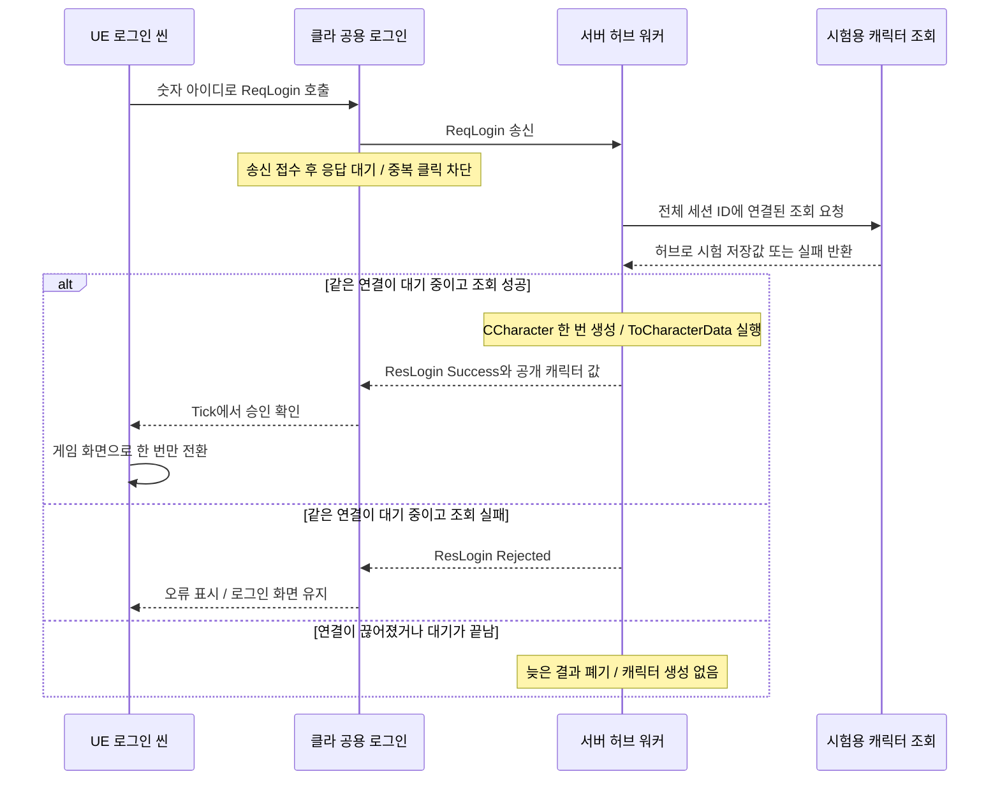

# 002 게임 로그인 계획

## 목표와 현재 상태

**완료 조건:** UE 로그인 씬에서 아이디에 숫자(예: `123`)를 입력하고 비밀번호를 비운 채 로그인한다. 클라이언트가 서버의 성공 `ResLogin`을 받아 공개 캐릭터 정보를 저장한 뒤 게임 화면으로 한 번만 전환하면 통과다. 실패하거나 응답이 없으면 로그인 화면에 남는다.

- **합의한 범위:** 아이디·비밀번호 입력칸과 로그인 버튼을 만든다. 이번에는 숫자 아이디로 시험하며 비밀번호 검증, 실제 계정 인증, MySQL 조회·저장, 캐릭터 선택, `ReqWorldMove`, 서버 맵 입장·스폰은 구현하지 않는다. 여기서 게임 화면 진입은 로컬 화면 전환이다.
- **이미 검증한 것:** `Game::SCharacterData`와 `ToCharacterData()`, 공용 enum을 참조하는 게임 `ReqLogin`·`ResLogin`의 C++ 코덱 왕복이다. 네트워크가 연결된 게임 로그인과 UE 로그인 씬은 미구현이다.
- **확정 형식과 제안 구분:** `ResLogin.result`는 `GameData::EResultCode` 타입이다. 아래 opcode와 열거값 번호는 첫 시험 계약에 사용하며, 아이디 길이와 앱·콘텐츠 클래스 배치는 첫 구현 제안이다.

## 게임 패킷 계약

패킷 원본은 `Common/Packet/Game/Schema/Login/Login.yaml`이다. 결과 코드는 `GameData/Excel/Enum.xlsx`의 `EResultCode` 시트에서 `GameDataGenerator`로 `Enum.csv`와 `GameDataEnums.h`를 만들고, 패킷 YAML에서는 `type: 'enum:EResultCode', wire: uint8`로 참조한다. 기존 `Player/CharacterData.yaml`은 그대로 참조한다. 채팅의 `ReqLogin`·`ResLogin`이나 고정 맵 프로토콜은 수정하지 않는다.

| 방향 | 패킷 | `Game` opcode | 본문 순서 |
|---|---|---:|---|
| 클라 → 서버 | `ReqLogin` | `1` | `login_id: utf16` |
| 서버 → 클라 | `ResLogin` | `2` | `result: EResultCode` → `character_data: CharacterData` |

- `login_id`는 DB의 `account_id`나 `character_id`가 아닌 **입력 문자열**이다. 시험에서 유효한 입력은 ASCII 숫자 `0`~`9`만 1~20자다(제안). 예: `0`, `00123`도 유효하며 숫자로 변환하지 않아 앞의 `0`을 보존한다. 공백·빈 값·문자·길이 초과는 거절한다. UI에서 먼저 검사하고 시험 서버에서도 독립적으로 검사한다.
- 비밀번호 입력칸은 마스킹한다. 이번 구현에서는 값을 검사하거나 수집·전송·기록하지 않는다. 패킷에 `password`, `account_id`, `session_id`, 채널 ID, 좌표를 넣지 않는다. 서버는 현재 연결의 전체 `sessionId`를 네트워크 계층에서 받는다.
- `character_data`는 포함 여부가 바뀌지 않는 `Game::SCharacterData` 값 멤버다. 내부 순서는 기존 YAML 그대로 `character_id: uint64` → `last_logout_map: uint32`다. 중첩 타입 자체에는 opcode나 별도 길이 필드가 없다.

### 결과 코드와 전송 형식

| `GameData::EResultCode` | 전송값 | `character_data`와 클라 처리 |
|---|---:|---|
| `Success` | `0` | `ToCharacterData()`가 만든 값. 캐릭터 ID는 0이 아니어야 한다. 저장 맵이 없으면 맵 값만 `0`. 로그인 대기 중인 클라가 이 값을 받았을 때만 로그인 완료 처리한다. |
| `Rejected` | `1` | 두 필드를 모두 `0`으로 전송한다. 클라는 캐릭터 값을 채택하지 않고 로그인 화면에서 오류를 표시한다. 정상 거절은 역직렬화 실패가 아니다. |

`GameDataGenerator`가 기존 규칙대로 `enum class EResultCode : std::uint32_t`를 생성한다. DTO와 `SendResLogin(sessionId, result, characterData)`는 그 enum을 사용하되, 코덱만 `uint8` 한 바이트로 전송한다. `PacketGenerator`는 `Enum.csv`를 읽어 값이 전송 범위에 있는지 확인하고 enum 선언을 다시 만들지 않는다. 미정의 열거값은 송신·수신 양쪽에서 거절한다. 성공 여부는 기본 초기화에 맡기지 않는다. 중첩 구현을 검증할 때 사용했던 `suffix`는 실제 게임 패킷에 넣지 않는다.

| 패킷 | opcode를 포함한 페이로드(전송 헤더 제외) |
|---|---|
| `ReqLogin` | `uint16` opcode 2바이트 + 기존 `utf16`의 `uint32` 코드 유닛 수 4바이트 + 원소당 2바이트. 위 입력 범위에서 8~46바이트. |
| `ResLogin` | `uint16` opcode 2바이트 + 결과 1바이트 + 캐릭터 ID 8바이트 + 마지막 맵 4바이트. 성공·거절 모두 15바이트. |

기존 버퍼의 정수·UTF-16 전송 형식과 프레임 처리를 그대로 쓴다. 디스패처는 잘린 본문, 남는 바이트, 미등록 opcode를 거절한다. 형식이 정상인 아이디가 정책상 유효하지 않은 경우에는 `Rejected`로 응답한다. `SCharacterData`의 맵 값은 기록일 뿐 맵 입장 지시가 아니다.

## 클래스와 소유권

아래는 구현 구조 제안이다. 기존 생성 코드와 수동 정책 코드를 나눈다.

| 구분 | 클래스·경로 | 책임 |
|---|---|---|
| 공용 생성 | `Game::SReqLogin`, `Game::SResLogin`, `GameData::EResultCode`, `Game::SCharacterData` | DTO는 패킷 YAML에서, 결과 enum은 `Enum.xlsx`에서 생성한다. DB 헤더와 UE 타입에 의존하지 않는다. `GeneratePackets.bat Game`의 `Generated/Common`, `Server`, `Client`를 각각 소비한다. |
| 서버 네트워크 연결 | `CGameServer` (제안), 기존 `ServerNetworkLib::CServer` 사용 | 연결·단절을 Hub 워커로 전달하고, Hub가 관리하는 연결의 수신과 응답 송신을 기존 라이브러리에 연결한다. `CSession`의 소유권은 네트워크 계층에 둔다. |
| 서버 콘텐츠 | `CWorldHubContents`, 생성 `Game::IServerPacketHandler` 구현 | `OnFrame()`에서 수신 View를 생성 디스패처에 넘긴다. `HandleReqLogin()`에서 전체 `sessionId`와 아이디 값을 `ReqLogin()`에 전달한다. 세션당 대기·성공 상태와 성공한 `CCharacter`를 단독 소유한다. 상태 변경과 결과 반영은 `ContentsRuntime`의 Hub 워커에서만 한다. |
| 서버 캐릭터 | `CCharacter` | `std::unique_ptr<SDbCharacter>`를 인수한다. `ToCharacterData()`의 반환값만 응답에 담는다. 저장 행, 실행 객체와 공개 값은 서로 다른 타입이다. |
| 서버 시험 실행 | `Tests/GameServer`의 별도 로그인 시험 타깃 | 설정된 `127.0.0.1` 포트에서만 수신한다. 유효한 숫자 아이디에 시험용 `SDbCharacter`를 제공하고, 실패·지연도 재현한다. 생성 디스패처와 같은 Hub 구현을 사용하되 제품 실행 파일에 이 시험용 승인 처리를 링크하거나 활성화 옵션을 만들지 않는다. |
| 클라 공용 | 생성 `Game::GameClient`와 수동 `ReqLogin()`·`HandleResLogin()` | `ClientNetworkLib` 위에서 한 연결의 로그인 상태와 성공으로 확정한 `SCharacterData` 값을 보유한다. `ReqLogin()`은 생성 `SendReqLogin()`을 호출하고 송신 접수 뒤 대기 상태가 된다. 응답을 검증해 상태를 확정한 뒤 앱에 알린다. 구현 소스와 `GameClientMembers.inc`를 UE와 더미가 공용으로 소비한다. `Game::GameClient`는 UE 빌드 타깃 `GameClient`와 별개다. |
| UE 앱 | `UGameLoginSubsystem` (`UGameInstanceSubsystem`, 이름 제안), 네이티브 연결 어댑터, `UGameLoginWidget` (이름 제안) | 서브시스템이 연결 어댑터를 소유하고 UE 게임 스레드에서 `Tick()`을 호출한다. 위젯은 입력·대기 표시·오류 표시만 맡는다. 성공 후 앱이 게임 화면을 연다. 위젯을 닫거나 화면을 바꿔도 연결 소유자는 유지되며, PIE 종료 시 연결·콜백을 정리한다. |
| 더미 앱 | 게임 콘솔 더미 시험 타깃 | 자체 앱 워커에서 같은 `Game::GameClient::Tick()`을 호출한다. 화면 전환 대신 승인 횟수와 공개 ID·맵 값을 확인한다. 공용 핸들러에 UE 코드나 더미 전용 분기를 넣지 않는다. |

`Game` BAT는 현재 `GameClientMembers.inc`의 생성 위치를 `Tests/GameServer`로 설정한다. 공용 구현 연결 때 제품 클라가 시험 디렉터리에 의존하지 않도록, 수동 `.cpp`와 `.inc`를 함께 둘 클라 공용 경로를 먼저 정하고 BAT의 목적지만 맞춘다. 기존 `UEChatLogin`·채팅 더미 연결은 유지한다. 생성 파일은 직접 수정하지 않는다.

## 로그인 흐름과 실패 처리

- **서버:** 미로그인 → 로그인 대기 → 로그인 완료(맵 없음) 순으로 진행한다. 조회 결과를 워커에서 동기 대기하지 않는다. 대기 중 또는 완료 후 중복 요청은 새 조회·캐릭터·응답을 만들지 않는다. 조회가 실패하면 `Rejected`로 해당 요청을 끝내고 미로그인으로 돌아간다. 대기 중 단절 뒤 늦은 결과는 전체 `sessionId`와 상태가 맞지 않으므로 폐기한다.
- **송신 실패:** 응답을 준비할 수 없거나 실제 큐 접수가 실패하면 성공 상태를 남기지 않고 연결을 정리한다. 필요하면 `MakePacket()`으로 먼저 준비하고 게임 서버 어댑터에서 기존 `CServer::SendPacket()`의 `bool`을 확인한다. 생성 `SendResLogin()` 호출 성공이나 송신 큐 접수를 상대 수신 완료로 간주하지 않는다. 네트워크 라이브러리는 수정하지 않는다.
- **클라:** 현재 연결이 응답 대기 중일 때만 응답을 채택한다. 정상 `Rejected`는 로그인 씬에서 다시 입력할 수 있게 한다. 타임아웃·단절은 대기를 해제하고 이전 연결의 콜백을 폐기한다. 타임아웃 후에는 같은 연결로 다시 보내지 않고 새 연결을 쓴다. 요청 번호를 추가하지 않으므로 이전 응답과 다음 시도를 혼동하지 않아야 한다. 화면 로드 실패는 UE 앱이 처리하며 공용 패킷 핸들러의 프로토콜 실패로 처리하지 않는다.

## 구현 순서와 완료 기준

1. [x] **공용 패킷 먼저:** `GameDataGenerator`로 `EResultCode`를 생성하고 `PacketGenerator`에서 참조해 게임 `ReqLogin`·`ResLogin` DTO와 양쪽 송수신 코드를 만들었다. C++ 코덱 시험에서 요청의 UTF-16 값과 응답의 15바이트 길이, `ToCharacterData()`의 정상 맵·`NULL → 0` 값, 거절 응답 및 미정의 결과 코드 거절을 확인했다. 실제 소켓과 Hub·UE 연결은 후속 단계다.
2. [ ] **서버와 클라 병렬 구현:** 1번 계약을 양쪽에서 고정한 뒤 서버는 `ReqLogin → Hub → CCharacter → ResLogin`과 시험 실행 파일을 만든다. 클라는 공용 핸들러·상태와 로그인 씬을 만든다. 서버가 완성되기 전에는 클라의 시험 응답으로 승인·거절을 확인해도 되지만, 이를 통합 완료로 보지 않는다.
3. [ ] **통합 완료:** 먼저 더미로 로컬 시험 서버에 붙어 로그인 승인 횟수와 공개 캐릭터 값을 확인한다. 그다음 UE 로그인 씬에서 숫자 아이디와 빈 비밀번호로 승인 응답을 받은 뒤 게임 화면으로 한 번만 전환한다. 서버와 클라가 관측한 캐릭터 ID가 같고 서버의 맵 예약·인계·스폰 수가 모두 0이어야 한다.
4. [ ] **실패·재실행:** 공백·미입력·문자·길이 초과, 정상 `Rejected`, 응답 없음, 대기 중 단절, 늦은 이전 세션 응답에서는 게임 화면으로 전환되지 않아야 한다. 중복 클릭은 송신을 추가하지 않고, 중복 요청을 서버에 보내도 원래 요청만 한 번 처리해야 한다. 같은 에디터에서 PIE를 종료·재실행했을 때 새 연결에서만 성공이 한 번 관측돼야 한다.

월드 입장 계약은 [014 월드 이동과 초기 동기화](../Server/014_월드_이동과_초기_동기화.md#맵-없는-접속과-대상-마을-확보), 저장·조회 및 DDL은 [015 캐릭터 저장 구조와 DBGenerator 계획](../Server/015_캐릭터_저장_구조와_DBGenerator_계획.md)을 따른다.
