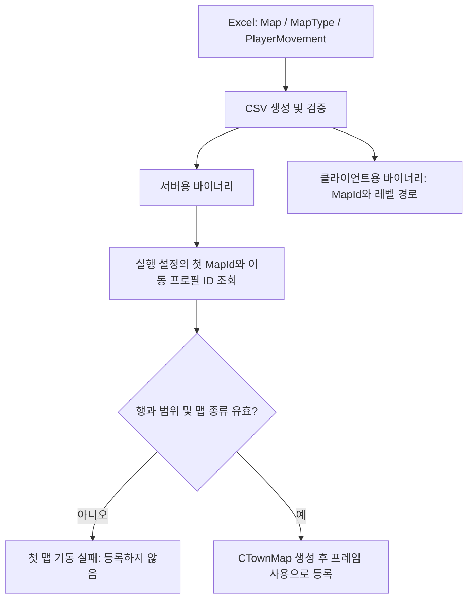

# 013 맵 콘텐츠와 첫 마을 이동 계획

[이동 계획의 Phase 1.2.3](../Client/001_OOP_기반_플레이어_이동_동기화_계획.md) 상세안. **아직 구현하지 않았다.** 이번 목표는 첫 마을 하나에서 데이터가 정한 위치에 캐릭터가 스폰되고 담당 워커의 한 틱만큼 이동하는 것이다. 마을 수를 늘릴 때는 Excel 행을 추가하고, 행동 규칙이 다른 종류를 구현할 때만 파생 클래스를 추가한다.

## 1. 정의·종류·실행 인스턴스

| 이름 | 소유자와 의미 | 예 |
|---|---|---|
| `MapId` | Excel 행의 숫자 PK. 어느 지형·스폰·레벨 정의인지 식별한다. | 시작 마을과 항구 마을은 서로 다른 ID지만 둘 다 `Town`이다. |
| `MapType` | `Enum.xlsx`의 게임 데이터 enum. 서버가 생성할 클래스의 종류를 선택한다. | `Town` → `CTownMap`, 이후 `Battlefield` → `CBattlefieldMap`, `Dungeon` → `CDungeonMap` |
| `ContentsInstanceId` | `IContents`가 보관하는 실행 인스턴스 ID. 등록할 때 실행 측에서 정하며 Excel에 저장하지 않는다. | 두 파티가 같은 던전 정의를 사용해도 명령을 보낼 인스턴스는 다르다. |

서버는 생성 시점 한 곳에서 `MapType`으로 분기한다. 1.2.3은 `CTownMap`만 실제 생성한다. 타입이 정의되어 있어도 생성이 미구현이면 등록을 거부한다. 매 틱의 타입 분기, 빈 파생 클래스, 별도 팩토리 계층은 만들지 않는다.

## 2. Excel과 서버 기동

기존 [게임 데이터 계약](../Common/001_게임데이터_생성기_계획.md)을 사용한다. `World.xlsx`의 `Map` 시트와 `Enum.xlsx`의 `MapType` 시트를 사용한다. 첫 구현에는 `Town`만 필요하며 나머지 멤버는 해당 기능을 만들 때 추가한다. `Map` 시트의 대상은 Shared이며 컬럼별 소유 범위는 아래와 같다. `MapType`의 열 타입은 `enum:MapType`이다. 다음 값은 코드 기본값이 아니다.

| 컬럼 | 타입 / 범위 | 읽는 쪽과 검증 |
|---|---|---|
| `MapId` | `uint32`, Shared | 필수, 양수, 중복 금지. 양쪽 행의 동일 키 |
| `MapType` | enum, Server | 필수. 멤버명 검증과 서버의 생성 가능 여부 검증은 별개 |
| `LevelAssetPath` | `string`, Client | 필수 UE 레벨 패키지 경로. 예: `/Game/TopDown/Lvl_TopDown`. 서버는 `.umap`을 읽지 않는다. |
| `MinXCm`, `MinYCm`, `MaxXCm`, `MaxYCm` | `int32`, Server | 축마다 최솟값 < 최댓값. 음수 좌표 허용 |
| `SpawnXCm`, `SpawnYCm` | `int32`, Server | 기본 스폰 한 곳. 양 축 모두 경계 안(끝점 포함)이어야 한다. |

생성기는 필드 타입·필수값·enum 멤버·PK를 검증한다. 파일이 없을 때만 생성기가 한 번 만드는 수기 `CMapTable` 골격의 `Validate()`는 기본 실패이므로, 서버용에는 모든 행의 경계·스폰 관계를, 클라이언트용에는 필수 레벨 경로 형식을 검증하도록 작성한다. 실패한 값을 보정하거나 테이블 일부를 공개하지 않는다. 앱은 `CGameDataTables::Load()` 성공 후 설정 ID 두 개를 각각 조회하고 생성 가능한 맵 종류인지 확인한다. `Map`에 캐릭터 이동 프로필 FK를 중복 저장하지 않는다.

서버는 필수 바이너리 누락·판독 실패·선택 ID 미존재·잘못된 경계·경계 밖 스폰을 기본값으로 덮지 않는다. 속도와 충돌 반경은 기존 `PlayerMovement` 행에서만 읽는다. 1.2.3에서는 반경으로 장애물 판정을 하지 않는다. 클라이언트 경로가 출력에 보존되는 것과 UE 패키지에 레벨이 실제 포함되는 것은 별도 검증이다.

## 3. 누가 상태를 바꾸는가

`ContentsRuntimeLib::IContents` → `CMap` → `CTownMap` 순서로 상속한다. `CContentsRuntime::RegisterContents`에 맵 소유권을 넘기고 프레임을 사용하도록 등록한다. `CMap`이 캐릭터를 단독 소유하고, 서버의 현재 좌표는 캐릭터에 한 벌만 둔다. 외부에서는 인스턴스 ID·캐릭터 ID·목적지 값으로 요청하지, 캐릭터 포인터로 직접 쓰지 않는다. 검증에 필요한 좌표도 담당 워커에서 읽어 값으로 전달한다.

`CMap::OnFrame()`은 `final`로 공통 순서를 보호한다. 파생 클래스는 실제 고유 규칙이 생길 때만 좁은 지점을 확장한다. 예컨대 던전이 입장 가능 여부를 판단할 수는 있어도 캐릭터를 두 번 등록하거나 이동 틱을 다시 실행하지 않는다. 첫 마을에는 가상의 확장 훅을 만들지 않는다.

첫 마을의 제어 순서는 `RegisterContents(…, true)` → `GetContentsHandle(instanceId)` → `Start()` → `PostCompletion(handle, …)`이다. 등록과 핸들 획득은 워커 시작 전에 한다. 게시 성공은 실행 완료가 아니다. 콜백은 담당 워커에 입력값을 넘겨 대기시키고, 프레임 시작 전 반영된 입력만 해당 프레임에서 소비한다. 시험은 게시 시각이 아니라 **명령을 실제 적용한 틱**을 기준으로 전후 좌표를 기록한다.

명령 접수 그 자체는 좌표를 바꾸지 않는다. 맵 소유 워커가 `CalculateMovementStep()`의 결과를 적용한다. 서로 다른 큐 사이에 공통 FIFO를 가정하지 않고 이미 퇴장한 대상의 명령은 실행하지 않는다. 종료 시 마지막 `OnFrame()`을 전제하지 않는다.

## 4. 섹터는 위치의 원본이 아니라 검색 인덱스다

**1.2.3에서는 섹터를 구현하지 않는다.** 필요해지면 파생 맵마다 붙이지 않고 `CMap`의 공통 처리에 둔다. 입장 확정 시 등록 → 이동 결과가 확정된 뒤 이전·새 섹터가 다를 때만 인덱스 변경 → 퇴장 확정 시 제거한다. 인덱스에는 소속 캐릭터 ID를 두며 캐릭터 수명이나 권위 좌표를 넘기지 않는다. 정지·같은 섹터 안 이동은 재등록하지 않는다. 맵 경계는 닫힌 구간이므로 정확히 `Max`인 좌표도 유효하다. 경계 밖 목적지는 임의 좌표로 보정하지 않고 거부하며 기존 이동 의도를 바꾸지 않는다. 거절 사유를 패킷으로 보내는 작업은 후속이다. 나중에 셀 인덱스를 계산할 때는 정수 경계 차는 빼기 전에 `int64`로 확장하고 `Max`를 마지막 유효 셀에 대응시킨다. 지금은 셀 배열이나 임의의 맵 폭 상한을 도입하지 않는다. 셀 크기, 관심 영역, 관찰자 통지 규칙은 이 단계에서 확정하지 않는다.

## 5. 구현 순서와 완료 기준

- [x] **1차 맵 데이터 생성:** `World.xlsx`의 `Map`과 `Enum.xlsx`의 `MapType`에서 CSV와 바이너리를 생성했다. 첫 마을(`MapId=1`)의 `Map.sdat`에는 종류·경계·스폰이, `Map.cdat`에는 레벨 경로가 기록됐다. 동일 입력으로 재생성한 결과는 바이트 단위로 일치했다.
- [ ] **테이블 적재·판독:** 서버·클라이언트 묶음을 각각 적재하고 같은 `MapId`를 조회한다. 필드·enum 오류는 생성기에서, 경계·스폰 불일치는 서버용 `Validate()`에서 거부한다. 클라이언트용 `Validate()`도 기존 판독 시험 경로에서 정상 레벨 경로와 잘못된 경로를 각각 통과·거부하는지 확인한다. UE 실행은 필요 없다.
- [ ] **첫 마을:** 설정으로 선택한 정의와 이동 프로필로 마을을 등록한다. 스폰 좌표 일치와 필수 데이터 오류 시 맵 미등록을 검증한다. 네트워크 리스너 없이 실행한다.
- [ ] **실제 워커 한 틱:** 시험에서 ID와 목적지를 맵 명령 경로에 넣는다. 같은 틱에 중복 스텝이 없고, 다음 틱은 직전 결과에서 시작하는지 틱 번호와 위치로 비교한다. 시간만 재거나 테스트에서 `OnFrame()`을 직접 부르는 것으로 대체하지 않는다.
- [ ] **데이터 교체 대조:** 같은 스폰·먼 목적지·20 Hz 설정으로 시험용 이동 속도만 바꿔 데이터를 재생성하고 서버를 재시작한다. 같은 실행 파일의 첫 이동 틱 변위가 각각 `속도(cm/s) / 20`에 해당해야 한다. 별도 시험 디렉터리에 Excel 사본과 A/B 출력 디렉터리를 두고 같은 실행 파일에 번갈아 지정한다. 서버 전용 속도만 달라지므로 클라 바이너리는 동일해야 한다. 추적 원본은 건드리지 않는다.

재클릭·수동 정지는 1.2.4, 장애물은 1.2.5, 리스너는 1.2.6이다. 이번에 던전 인스턴스 운영, 맵 간 이관, 섹터/AOI 또는 UE 레벨 로딩을 구현하지 않는다.
