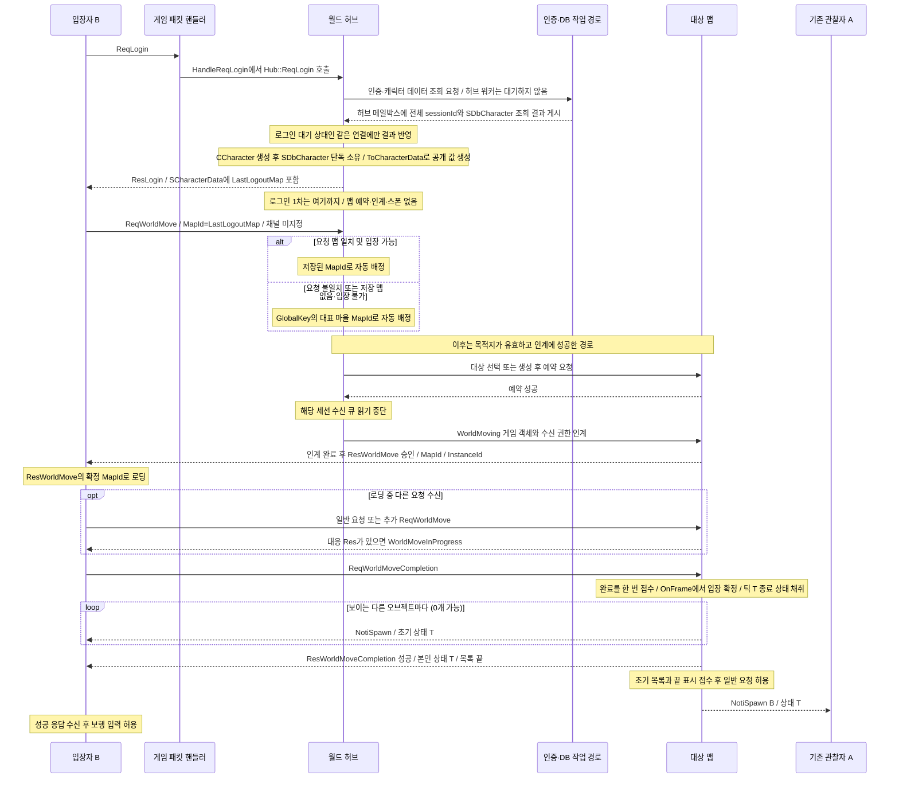

# 014 월드 이동과 초기 동기화

설계 계약이며 아직 제품 패킷이 아니다. `WorldMove`는 같은 맵에서의 보행이 아니라 **맵 소속 전환**이다. 최초 접속도 `맵 없음 → 시작 맵`으로 같은 계약을 쓴다. 1차 네트워크 구현은 최초 입장까지이며 다른 맵 간 캐릭터 이관은 후속이다.

## 첫 게임 서버 로그인

이 절은 로그인 이후 월드 입장과 실제 DB 연동까지의 경계를 설명한다. 숫자 아이디를 사용하는 첫 시험의 패킷·클래스·화면 범위는 [게임 로그인 계획](../Common/002_게임_로그인_계획.md)을 따른다. 현재 게임 서버에는 로그인 패킷과 DB 조회가 연결되어 있지 않다. MySQL 저장 구조와 YAML 기반 생성 범위는 [캐릭터 저장 구조와 DBGenerator 계획](015_캐릭터_저장_구조와_DBGenerator_계획.md)에서 정한다.

1. **`ReqLogin`:** 게임 패킷의 `HandleReqLogin()`은 전체 `sessionId`와 요청 값을 `CWorldHubContents::ReqLogin()`에 넘긴다. 허브 워커에서 처리 중이면 직접 호출하고, 다른 실행 경계에서 들어오면 기존 콘텐츠 메일박스로 넘긴다. 허브는 미로그인 세션을 로그인 대기 상태로 바꾼 뒤 인증·DB 조회를 요청하고 워커에서 결과를 기다리지 않는다. 완료 결과를 허브 워커에 게시하고, 요청 당시의 **전체 `sessionId`**가 여전히 로그인 대기 중일 때만 반영한다. 단절됐거나 로그인 대기가 끝난 세션의 결과는 버린다. 같은 세션이 조회 중이나 로그인 성공 뒤에 다시 보낸 `ReqLogin`은 거절하고 기존 조회·캐릭터를 유지한다. 성공하면 허브가 `CCharacter`를 한 번만 만들어 단독 소유한다. `CCharacter`가 조회 결과 `SDbCharacter`를 인수하며, `LastLogoutMap`은 이 저장 구조체에만 보관한다. 실패 시 캐릭터나 입장 예약을 만들지 않고 실패 `ResLogin`으로 끝낸다.
2. **`ResLogin`:** 응답은 상태와 `ISerializable`을 상속한 `Game::SCharacterData`를 값으로 담는다. 서버 실행 객체인 `CCharacter` 자체를 보내지 않는다. 저장된 맵은 구조체의 `LastLogoutMap`으로 전달하고 없으면 `0`을 사용한다(`Map` 테이블의 실제 ID는 1 이상). 최종 로그인 응답 범위에는 클라에 공개하는 본인 스탯, 장비·인벤토리, 재화, 스킬, 퀘스트 등이 포함된다. DB 내부 필드나 현재 맵의 실행 상태는 보내지 않는다. 이 응답은 로그인 완료일 뿐 맵을 예약하거나 승인하지 않는다.
3. **첫 `ReqWorldMove`:** 클라는 `ResLogin`에서 받은 `LastLogoutMap`을 요청 `MapId`로 그대로 보내고 채널(`InstanceId`)은 지정하지 않는다. 첫 입장에서 채널을 지정한 요청은 거절한다. 허브는 요청 `MapId`와 `CCharacter`의 `LastLogoutMap`을 비교한다. 저장값이 있고 일치하며 입장 가능한 맵이면 사용한다. 불일치하거나 저장값 없음·맵 삭제·입장 불가라면 `GlobalKey` 테이블에 대표 마을로 등록된 `MapId`를 사용한다. 임의의 `Town` 행이나 하드코딩한 ID를 대체로 쓰지 않는다. 대표 마을 지정이 없거나 대상이 유효하지 않으면 이동을 거절한다. 이 대체는 **로그인을 마치고 아직 맵에 소속되지 않은 캐릭터의 최초 입장**에만 적용하며, 첫 요청이 진행 중이면 중복 요청을 받지 않는다. 채널 만석은 맵을 바꿀 이유가 아니라 해당 맵의 자동 배정으로 처리한다.
4. **`ResWorldMove` 이후:** 아래 공통 경로에서 대상 맵 예약과 캐릭터·수신 권한 인계를 마친 뒤 확정 `MapId`와 `InstanceId`를 회신한다. 클라는 `LastLogoutMap`으로 미리 로딩하지 않고 성공 `ResWorldMove`의 `MapId`를 로딩한다. 준비가 끝나면 대상 맵에 `ReqWorldMoveCompletion`을 보낸다.

### 로그인·DB 연동 구현 순서

1. **선행 완료 — 저장 구조체 헤더 생성:** `GameDB`의 캐릭터 YAML에서 `SDbCharacter` 헤더와 저장 집계 `IncludeDbAll.h`를 생성하고 컴파일했다. 초기 DDL과 실제 DB 연결은 4차 마일스톤으로 분리한다.
2. **변환·중첩 시험 완료 · 다음 작업 — 게임 패킷 확정:** `ToCharacterData`의 반환값을 시험용 `ResLogin`에 담아 왕복을 확인했다. [게임 패킷 계약](../Common/002_게임_로그인_계획.md#게임-패킷-계약)에 따라 `EResultCode`를 지원하고 실제 `ReqLogin`·`ResLogin`을 생성·검증한다.
3. **로그인 1차 — `ReqLogin`부터 `CCharacter` 생성과 `ResLogin`까지:** 게임 패킷 핸들러에서 허브의 `ReqLogin()`을 호출한다. 로그인 성공 시 허브가 `CCharacter`를 한 번 생성하고, `CCharacter`는 `std::unique_ptr<SDbCharacter>`로 조회 결과를 단독 소유한다. `ToCharacterData`가 만든 `SCharacterData`를 응답에 값으로 담는다. 성공 후에도 예약·인계·스폰은 0건이어야 한다. 실패·중복 요청이나 단절 뒤 늦은 결과로 캐릭터를 새로 만들지 않는다. 운영 인증·DB 연결 전에는 시험에서만 조회 결과를 준비하며 제품에 인증 우회 경로를 넣지 않는다. `ContentsRuntime` 기능이나 기존 채팅 시험 서버·`FixedMaps`의 패킷은 변경하지 않는다.
4. **후속 — 대표 마을 데이터와 맵 배정 연결:** 공통 게임 설정 항목을 모으는 `GlobalKey` 테이블에 숫자 키로 대표 마을의 `MapId`를 등록한다. 기존 Excel → CSV → 서버 바이너리 경로를 사용한다. 등록값이 실제 `Map` 행의 입장 가능한 마을을 가리키는지 확인한 뒤 사용한다. `ReqWorldMove()`는 새 캐릭터를 만들거나 이동 프로필 ID를 받지 않고 로그인에서 만들어 둔 캐릭터를 사용한다. 예약 거절 시 인계 전 캐릭터는 허브에 남고, 성공 시 같은 객체와 `NetEntityId`를 대상 맵에 넘긴다.
5. **후속 — 실제 MySQL과 게임 서버 루프백 검증:** 인증과 MySQL 접속 방식을 확정한 뒤 `ReqLogin`부터 스폰까지 검증한다. 상세 실패 사례는 [단계별 검증](#단계별-검증-미실행)을 따른다. 운영 인증·DB 연동은 1차 이동 검증의 선행 조건이 아니다.

**보류:** 최대 로그인 응답 크기와 한 프레임에 넘칠 때의 전송 방식은 나중에 정한다. 현재 프레임 상한은 헤더를 포함해 1,024바이트다. 이 기준을 적어 두되, 지금은 응답 분할이나 프레임 상한 변경을 결정하지 않는다.

## 맵 없는 접속과 대상 마을 확보

월드 허브는 플레이 가능한 맵이 아니므로 `MapId`·스폰·보행·관찰 목록이 없다. 접속 시 세션 경로를 월드 허브에 연결하고, 인증 전에는 월드 이동을 승인하지 않는다. 맵은 인계받은 캐릭터를 스폰할 뿐 다시 생성하지 않는다. 예약 이후의 공통 전환은 다음과 같다.

1. **조회 또는 생성:** `ReqWorldMove(MapId, InstanceId?)`에서 `MapId`는 필수이며 `InstanceId`는 채널 변경 때만 지정한다. 자동 배정은 해당 맵의 열린 인스턴스 중 자리가 있고 점유 인원(입주자 + 유효 예약)이 가장 많은 곳을 먼저 고른다. 빈자리가 있는 다른 인스턴스가 있으면 생성하지 않는다. 하나도 없거나 전부 찼으면 해당 `MapId`에 `Creating`을 먼저 기록하고 한 건만 생성 요청한다. 생성 중 도착한 자동 배정 요청은 같은 결과를 기다린다. 생성 성공 콜백에서 대기 요청의 예약을 진행하고, 남은 인원은 같은 규칙으로 다시 배정한다. 채널 지정 요청은 `MapId`와 실행 ID가 모두 일치하는 인스턴스만 대상으로 한다. 마감·만석·존재하지 않는 채널은 다른 채널로 바꾸지 않고 거절한다.
   - **정원:** `MaxUserCount`는 서버용 `Map` 데이터의 인스턴스당 정원이다. 허브가 후보를 고른 뒤에도 대상 맵 워커가 예약 직전에 정원을 다시 검사한다. 마지막 자리 경합에서 거절된 자동 배정 요청은 다른 후보를 찾는다. 예약이 입주로 바뀔 때는 한 사람으로만 센다.
   - **공통 요청과 결과:** 별도 전환·목적지·경로 구조체를 두지 않는다. 요청 인자는 `MapId`와 선택적 `InstanceId`, 배정 성공 콜백의 결과는 예약한 `InstanceId`다. 허브가 결정한 실제 `MapId`를 배정에 사용한다. 허브는 배정까지 관리하고, 인계가 끝나면 대상 맵이 전체 네트워크 `sessionId`를 키로 예약과 입장 상태를 관리한다. 실행 핸들은 런타임에서 조회하고 이동 프로필은 채널 선택에 쓰지 않는다.
2. **예약 → 인계 → 승인:** 대상 워커가 예약에 성공하면, 허브는 해당 세션의 수신 큐 읽기를 멈추고 `WorldMoving` 상태의 서버 게임 객체와 패킷 수신 처리 권한을 대상 맵에 넘긴다. 네트워크 `CSession`과 수신 큐는 NetworkLib에 그대로 둔다. 작업을 게시한 것만으로는 인계 완료가 아니다. 대상 맵이 객체와 수신 권한을 확보한 뒤에만 성공 `ResWorldMove`를 보낸다. 생성·등록·예약 실패는 거절로 응답하고 허브 소속을 유지한다. 인계 실패나 단절은 성공을 보내지 않고 예약과 남은 상태를 정리한다. 생성 도중 끊긴 세션은 예약하지 않는다. 생성 대기자가 전부 사라지거나 첫 예약이 전부 실패해 처음부터 빈 마을도 같은 폐쇄 절차에 넣는다.
3. **로딩 중(`WorldMoving`):** 대상 맵만 해당 세션의 수신 큐를 읽는다. `ResWorldMove` 성공 이후 `ReqWorldMoveCompletion`만 한 번 받아 입장 확정 대기 목록에 넣는다. 다른 요청은 게임 핸들러에 넘기거나 입장 후 실행하도록 보관하지 않는다. 대응하는 `Res`가 정의돼 있으면 `WorldMoveInProgress`로 거절한다.
4. **확정:** 대상 맵의 `CMap::OnFrame()` 시작에 대기 목록을 처리한다. 대상 워커는 전체 `sessionId`의 예약, 완료 접수 상태, 연결 생존을 재확인해 입주로 바꾸고 스폰을 확정한다. 초기 목록과 성공 `ResWorldMoveCompletion`이 송신 큐에 접수될 때까지 `WorldMoving`을 유지하며, 이후에만 서버에서 일반 요청을 허용한다. 클라는 성공 `ResWorldMoveCompletion`을 받은 뒤 입력을 연다. 공개 전에 단절되면 대상 맵은 미확정 예약이나 아직 공개되지 않은 입주를 정리한다. 최초 입장이므로 월드 허브에서 `NotiDespawn`을 내보내지 않는다.
5. **회수:** 예약(로딩·이관 중 포함)과 입주자가 모두 0이면 대상 워커가 폐쇄 후보를 알린다. 월드 허브의 같은 직렬 경로에서 신규 배정을 닫고(`Closing`), 앞서 전달한 예약 요청까지 처리한 뒤 대상이 다시 비었는지 확인한다. 비지 않았으면 폐쇄를 취소한다. 닫힌 동안 새 요청은 회수 결과를 기다린다. 해제 확인 후 같은 `MapId`에는 새 `ContentsInstanceId`로 생성한다. 늦은 취소·완료·해제 회신은 이전 실행 ID에만 해당한다. 재접속 후 새 `sessionId`의 예약에는 이전 연결의 정리를 적용하지 않는다. 서버 종료 시 보류 요청은 내부 실패로 마무리하며 네트워크 응답 전송은 보장하지 않는다. 유예시간 최적화는 첫 구현의 조건이 아니다.

## 승인, 로딩, 공개

| 패킷 | 의미와 필수 정보 |
|---|---|
| `ReqLogin` → `ResLogin` | 게임 서버 인증과 본인 캐릭터 데이터 전달. 성공 응답의 `SCharacterData`에 `LastLogoutMap`을 담되 이 응답은 월드 이동을 시작하거나 승인하지 않는다. 기존 채팅 시험 서버의 패킷 범위를 변경하지 않는다. |
| `ReqWorldMove` → `ResWorldMove` | 인증된 세션의 전환 요청과 본인 전용 판정. 첫 입장에서는 허브가 `CCharacter`의 `LastLogoutMap`과 요청을 비교해 목적지를 정하고 자동 배정한다. 예약과 인계가 모두 끝난 뒤 대상 맵이 확정 `MapId`와 `InstanceId`를 돌려준다. 생성·예약에 실패하거나 추가 이동 요청이 들어오면 거절 사유를 돌려준다. 일반 채널 변경에 지정할 수 있는 것은 기존 실행 ID이며 새 실행 ID나 스폰 좌표를 정하지 않는다. |
| `ReqWorldMoveCompletion` | 승인을 받은 클라가 대상 맵에 보내는 수신 준비 완료 신호다. UE는 대상 월드에서 공통 수신 상태와 Actor 생성 경로가 준비된 뒤, 더미는 같은 수신 상태가 준비된 뒤 보낸다. 대상 맵은 유효한 완료를 한 번만 접수하고, 다음 `OnFrame()`의 입장 확정 대상으로 삼는다. |
| `WorldMoveInProgress` | `WorldMoving` 중 현재 허용되지 않는 요청을 거절하는 실패 코드. 추가 `ReqWorldMove`는 `ResWorldMove`에 이 코드를 담고, 다른 요청도 대응 `Res`가 있으면 그 응답으로 거절한다. 이미 접수한 완료를 다시 받더라도 입장이나 초기 목록을 재실행하지 않는다. |
| `NotiSpawn` | 수신자에게 새로 보이는 오브젝트의 `NetEntityId`, 종류, 표시 정의에 필요한 데이터 ID, `serverTick`, 권위 위치·방향·이동 상태. 이동 중이면 목적지와 남은 시간도 전달한다. 캐릭터·몬스터 공용이며 지형·벽·정적 에셋은 전송하지 않는다. |
| `ResWorldMoveCompletion` | 성공일 때 현재 세션의 초기 목록 끝을 뜻한다. 기준 틱 T와 **본인의 ID·초기 상태**를 전달한다. 본인은 초기 `NotiSpawn` 목록에서 제외해 이중 생성하지 않는다. 주변이 비어도 성공 응답을 한 번 보낸다. 실패 응답은 목록 끝으로 처리하거나 입력을 열지 않는다. |
| `NotiDespawn` | `NetEntityId`, `serverTick`. 해당 수신자의 관찰 목록에서 제거한다. 객체 자체의 파괴와 동일하지 않다. |

## 순서와 실패 계약

- 전체 `sessionId`당 진행 중인 전환은 요청 접수부터 한 건뿐이다. 수신 큐의 소비자는 같은 시점에 하나뿐이며, 허브와 대상 맵이 같은 세션의 큐를 동시에 읽지 않는다. 대상 맵이 수신을 맡기 전에는 성공 `ResWorldMove`를 보내지 않는다. 정상 흐름에 클라 취소·재시도는 없다.
- 승인만으로 대상 맵에 캐릭터를 노출하거나 입력을 받지 않는다. 완료를 처리하는 맵 틱 T에서 입장과 관찰 등록을 함께 확정한다. 신규 관찰자에게는 T의 **최종** 상태만 보낸다. 같은 틱에 퇴장한 대상은 목록에 없고 같은 틱의 이동은 스폰에 포함한다. 일반 변경은 T 이후부터다. 동시 입장한 두 사람은 서로를 각각 한 번만 본다.
- 초기 목록 → 끝 표시 → 후속 변경을 수신자별 한 송신 순서로 보장한다. 서로 다른 세션의 수신 순서는 전제하지 않는다. UE와 더미의 공통 핸들러는 끝 표시 전 입력을 열지 않는다. 도중 연결이 끊기면 불완전한 목록을 버린다. 초기 `NotiSpawn` 전부가 해당 세션의 송신 큐에 접수된 뒤에만 끝 표시를 넣는다. 하나라도 접수가 실패하면 끝 표시 없이 연결을 정리한다. 끝 표시 자체의 접수 실패도 연결 종료로 처리한다. **1.3.1 선행 조건:** `CServer::SendPacket()`의 반환형은 `bool`로 변경했다. `true`는 정상 송신 대상으로 접수했다는 뜻이지 송신 완료나 클라 수신 확인이 아니다. 세션 종료 중·ID 불일치·송신 큐 한도 초과는 `false`다. 반환값만 노출했고 기존 큐 처리·연결 종료·참조 카운트 흐름과 호출부는 그대로다. 게임 송신 경로에 결과를 연결해 초기 목록 실패 시 완료 응답을 넣지 않고, 완료 응답까지 접수되지 않으면 일반 요청을 열지 않는 동작을 검증해야 한다.
- 인계 전에 거절되면 기존 소속을 유지한다. 로그인 이후 인계 전에 단절되면 허브가 아직 보유한 캐릭터를 정리한다. 인계 도중 단절·실패하면 예약을 해제하고 객체를 갖고 있는 쪽이 정리한다. 최초 입장에서 로딩에 실패하면 클라는 완료를 보내지 않는다. 연결 종료·대기 시간 만료는 일반 패킷 처리와 별개다. 인계 후에는 대상 워커가 예약과 입장 대기, 넘겨받은 게임 객체를 정리한다. 입장 공개 전에는 스폰·디스폰을 보내지 않는다. 이미 공개한 뒤 끊기면 일반 퇴장으로 남은 관찰자에게 한 번 디스폰한다. 후속 맵 간 이관에서도 양쪽에 동시 공개하지 않는다. 출발 맵 이탈·복구 정책은 실제 이관 단계에서 정한다.

## 단계별 검증 (미실행)

- **1.2.3:** 시작 전에 등록한 맵 하나에서 데이터 기반 스폰과 한 틱 이동을 확인한 뒤, 소켓 없는 허브 예약과 캐릭터 인계를 연결해 검증한다. 이 맵 시험 자체에는 로그인·DB, 수신 권한 인계, 패킷 생성, UE 레벨 로딩을 넣지 않는다.
- **1.3.1~1.3.3:** 시험에서 준비한 로그인 완료 세션으로 월드 이동부터 검증한다. 운영 인증·DB를 이 단계에서 구현하거나 제품 코드에 비인증 승인 예외를 두지 않는다. 더미가 `ResWorldMove` 수신 직후 완료를 보내도 대상 맵만 읽는지, `WorldMoving` 중 다른 요청과 추가 이동 요청이 대응 `Res`에서 거절되고 재실행되지 않는지 확인한다. 완료 중복 시 입장·초기 목록은 한 번이어야 한다. 초기 목록 접수 전 요청 차단, 빈 목록의 끝 표시, 로딩 중 스폰 0건, 이동 중인 기존 대상의 초기 상태, 같은 틱 동시 입장, 대기 시간 만료·단절, 목록 도중 단절과 재접속도 확인한다. 대상별 스폰 횟수와 기준 틱 이후 변경 순서를 기록한다. 몬스터 구현은 이 시험의 선행 조건이 아니다.
- **1.4:** 실제 UE에서 완료 요청 전에 대상 월드가 준비됐는지, 본인·타인 Actor가 한 번만 생기고 디스폰으로 제거되는지 확인한다. UE API는 공통 패킷 핸들러 밖에 둔다.
- **로그인·DB 연동 시 별도 검증:** 인증·DB 조회 실패, 중복 로그인, 단절·재접속 후 늦은 DB 결과, 로그인 성공 후 이동 전 단절을 시험한다. 로그인 성공 뒤 `ReqWorldMove`까지는 예약이 0건이어야 한다. 일치하는 유효 맵, 요청 불일치, 저장값 없음(`0`)·맵 삭제·입장 불가, 대표 마을 무효, 첫 채널 지정 거절을 나눠 시험한다. 대표 마을로 배정되면 클라는 `ResWorldMove`의 실제 맵을 로딩해야 한다. 같은 세션의 일반 맵 이동에는 이 대체 규칙을 적용하지 않는다.
