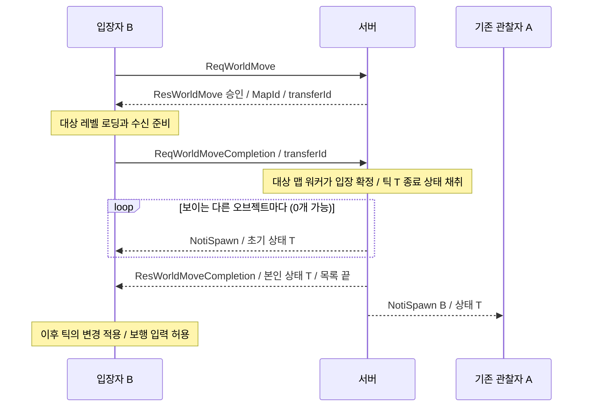

# 014 월드 이동과 초기 동기화

설계 계약이며 아직 제품 패킷이 아니다. `WorldMove`는 같은 맵에서의 보행이 아니라 **맵 소속 전환**이다. 최초 접속도 `맵 없음 → 시작 맵`으로 같은 계약을 쓴다. 1차 네트워크 구현은 최초 입장까지이며 다른 맵 간 캐릭터 이관은 후속이다.

## 승인, 로딩, 공개

| 패킷 | 의미와 필수 정보 |
|---|---|
| `ReqWorldMove` → `ResWorldMove` | 인증된 세션의 전환 요청과 본인 전용 판정. 최초 목적지는 서버 설정으로 정한다. 성공 시 서버가 정한 `MapId`와 전환 식별자 `transferId`, 거절 시 사유를 돌려준다. 클라가 실행 인스턴스나 스폰 좌표를 정하지 않는다. |
| `ReqWorldMoveCompletion` | 클라가 현재 승인 건의 `transferId`를 되돌려 보낸다. UE는 대상 월드에서 공통 수신 상태와 Actor 생성 경로가 준비된 뒤, 더미는 같은 수신 상태가 준비된 뒤 보낸다. 로그인 성공이나 로드 시작 신호가 아니다. |
| `NotiSpawn` | 수신자에게 새로 보이는 오브젝트의 `NetEntityId`, 종류, 표시 정의에 필요한 데이터 ID, `serverTick`, 권위 위치·방향·이동 상태. 이동 중이면 목적지와 남은 시간도 전달한다. 캐릭터·몬스터 공용이며 지형·벽·정적 에셋은 전송하지 않는다. |
| `ResWorldMoveCompletion` | 해당 `transferId`의 초기 목록 끝. 기준 틱 T와 **본인의 ID·초기 상태**를 전달한다. 본인은 초기 `NotiSpawn` 목록에서 제외해 이중 생성하지 않는다. 주변이 비어도 반드시 한 번 보낸다. |
| `NotiDespawn` | `NetEntityId`, `serverTick`. 해당 수신자의 관찰 목록에서 제거한다. 객체 자체의 파괴와 동일하지 않다. |

## 순서와 실패 계약

- 세션당 승인 대기는 한 건이다. 대상 맵 담당 워커가 대기 상태와 만료를 단독 소유한다. 완료·단절·만료를 이 워커로 전달하며, 입장 확정 직전에 연결 생존·세션 세대·현재 승인 건을 재확인한다. 대기 중 새 전환 요청은 거절한다. `transferId`는 같은 연결에서 재사용하지 않으며, 이전 연결의 작업은 새 연결에 적용하지 않는다. 현재 세션·대기 상태·승인 건이 모두 맞을 때만 완료를 한 번 소비한다. 중복·늦은 완료는 재입장이나 목록 재송신을 일으키지 않는다.
- 승인만으로 대상 맵에 캐릭터를 노출하거나 입력을 받지 않는다. 완료를 처리하는 맵 틱 T에서 입장과 관찰 등록을 함께 확정한다. 신규 관찰자에게는 T의 **최종** 상태만 보낸다. 같은 틱에 퇴장한 대상은 목록에 없고 같은 틱의 이동은 스폰에 포함한다. 일반 변경은 T 이후부터다. 동시 입장한 두 사람은 서로를 각각 한 번만 본다.
- 초기 목록 → 끝 표시 → 후속 변경을 수신자별 한 송신 순서로 보장한다. 서로 다른 세션의 수신 순서는 전제하지 않는다. UE와 더미의 공통 핸들러는 끝 표시 전 입력을 열지 않는다. 도중 연결이 끊기면 불완전한 목록을 버린다. 초기 `NotiSpawn` 전부가 해당 세션의 송신 큐에 접수된 뒤에만 끝 표시를 넣는다. 하나라도 접수가 실패하면 끝 표시 없이 연결을 정리한다. 끝 표시 자체의 접수 실패도 연결 종료로 처리한다. 큐 접수는 클라 수신 확인이 아니다. **1.3.1 선행 조건:** 현재 `CServer::SendPacket()`은 `void`이므로 이 결과를 확인할 수 없다. 접수 결과를 확인할 경로를 마련하기 전에는 이 조건을 통과한 것으로 보지 않는다. 네트워크 라이브러리 변경은 별도 승인 사항이다.
- 거절된 전환은 기존 맵에 영향을 주지 않는다. 최초 입장에서 로딩 실패·연결 종료·설정된 대기 시간 만료 시 대기를 정리하고 대상 맵에 스폰하지 않는다. 이미 공개한 뒤 끊기면 일반 퇴장으로 남은 관찰자에게 한 번 디스폰한다. 후속 맵 간 이관에서도 양쪽에 동시 공개하지 않는다. 출발 맵 이탈·복구 정책은 실제 이관 단계에서 정한다.

## 단계별 검증 (미실행)

- **1.2.3:** 소켓 없이 대상 맵의 입장 확정과 데이터 기반 스폰을 시험한다. 세션 상태기계, 패킷 생성, UE 레벨 로딩은 구현하지 않는다.
- **1.3.1~1.3.3:** 더미로 빈 목록의 끝 표시, 로딩 중 스폰 0건, 이동 중인 기존 대상의 초기 상태, 같은 틱 동시 입장, 잘못된·중복 완료, 대기 중 단절, 목록 도중 단절과 재접속을 확인한다. 대상별 스폰 횟수와 기준 틱 이후 변경 순서를 기록한다. 몬스터 구현은 이 시험의 선행 조건이 아니다.
- **1.4:** 실제 UE에서 완료 요청 전에 대상 월드가 준비됐는지, 본인·타인 Actor가 한 번만 생기고 디스폰으로 제거되는지 확인한다. UE API는 공통 패킷 핸들러 밖에 둔다.
