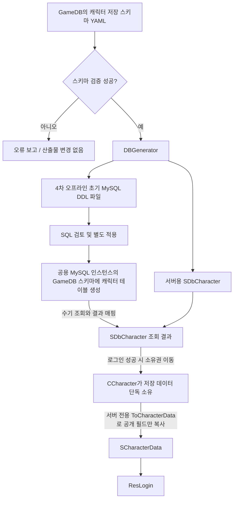
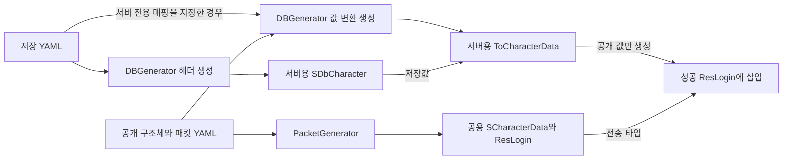
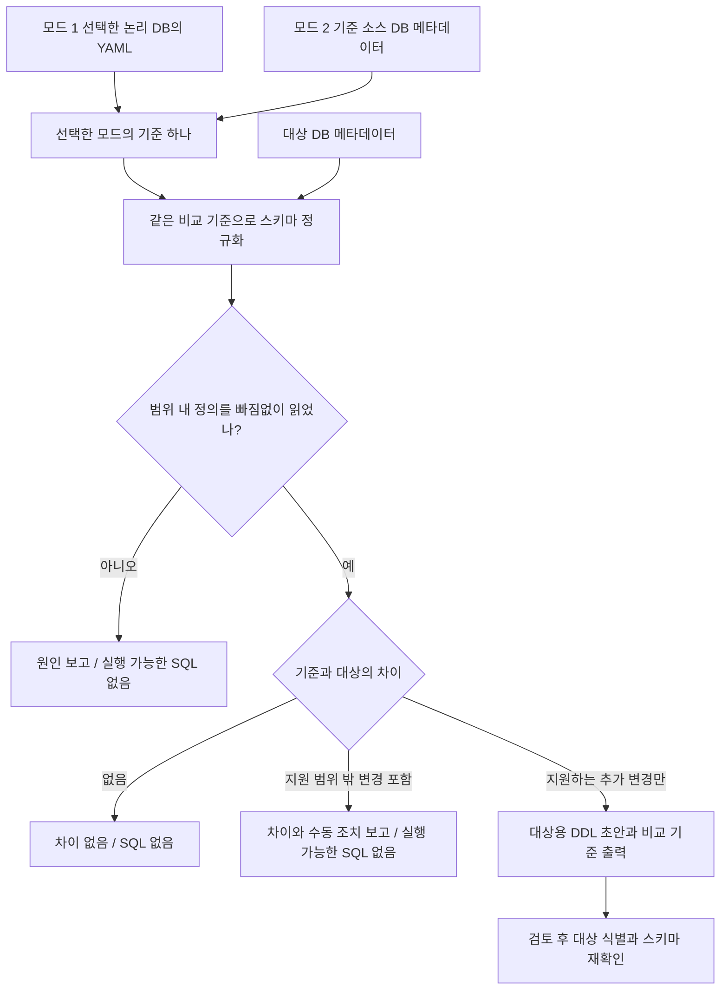

# 015 캐릭터 저장 구조와 DBGenerator 계획

## 범위와 결정 사항

- 1차부터 계정 데이터는 `AccountDB`, 캐릭터 등 게임 저장 데이터는 `GameDB`로 구분한다. 처음에는 **같은 MySQL 인스턴스에서 두 스키마로 분리**하고, 인스턴스를 따로 운영하지 않는다.
- 캐릭터의 영속 데이터는 **MySQL 관계형 테이블**에 저장한다. 첫 생성 대상은 `GameDB`의 캐릭터 테이블 하나다. `AccountDB`의 폴더·스키마 경계는 먼저 잡고, 계정 테이블 정의와 인증 연동은 별도 단계로 둔다. 캐릭터 전체를 담는 JSON 컬럼은 만들지 않는다. 이후 같이 읽고 저장하는 상태에 JSON이 필요하면 해당 기능에서 따로 검토한다.
- **저장 스키마와 패킷의 편집 원본은 각각의 YAML**로 둔다. 1차 마일스톤은 `DBGenerator`로 서버용 `SDbCharacter` 헤더를 생성하고 컴파일하는 데까지다. 2차에 `PacketGenerator`로 공개 타입과 패킷을 생성하고, `DBGenerator`는 두 YAML을 읽어서 서버용 값 변환 함수만 추가 생성한다. 초기 MySQL DDL 생성·적용과 실제 DB 연동은 4차다. DB 비교는 YAML을 수정하거나 C++ 구조체를 역생성하지 않는다. YAML에는 캐릭터 레코드, 접속 정보, 비밀번호를 넣지 않는다. Excel 기반 정적 게임 데이터의 생성 경로는 그대로 유지한다.
- 이 문서는 설계와 완료 기준이다. `main`에는 아직 DB 생성기, 캐릭터 DB 스키마, 운영 DB 연결이 없다. YAML 키의 정확한 형식, MySQL 대상 버전과 커넥터는 구현 전에 정한다.

## 디렉터리 배치

`13_MMO_Project/Database/`의 기존 `YamlSchema`, `Generated`, `Sql`을 사용한다. `AccountDB`, `GameDB` 등은 `YamlSchema` 바로 아래의 논리 DB 폴더 이름이다.

### 이름 규칙

| 구분 | 규칙 | 캐릭터 예시 |
|---|---|---|
| 저장 스키마 YAML | `YamlSchema/{논리DB}/{카테고리}/{파일}.yaml` | `YamlSchema/GameDB/Player/Character.yaml` |
| 생성 헤더 | `Generated/Server/{논리DB}/{카테고리}/{파일}.h` — YAML의 논리 DB·카테고리·파일명을 유지하고 확장자만 `.h`로 바꾼다. | `Generated/Server/GameDB/Player/Character.h` |
| 저장용 C++ 구조체 | `SDb{이름}` — YAML의 `record` 값을 헤더 내부의 타입 이름으로 사용한다. | `record: SDbCharacter` → `struct SDbCharacter` |

`SDb` 접두사는 **구조체 이름**에 붙이며, 생성 헤더의 파일명을 `SDbCharacter.h`로 바꾸지 않는다. 아래는 1차 배치 예시다.

```text
Database/
├── YamlSchema/
│   ├── AccountDB/                  # 계정 영역, 테이블 YAML은 후속 작업
│   └── GameDB/
│       └── Player/
│           └── Character.yaml      # 저장 스키마 편집 원본
├── Generated/
│   ├── Server/
│   │   └── GameDB/
│   │       └── Player/
│   │           └── Character.h     # SDbCharacter 선언
│   └── Sql/
│       ├── YYMMDD_HHMMSS_DDL.sql    # 오프라인 초기 DDL 초안
│       └── Patches/
│           └── <실행별 폴더>/       # 비교 보고서, 패치가 있을 때만 YYMMDD_HHMMSS_DDL.sql
└── Sql/                            # 사람이 작성하거나 검토 후 확정한 SQL
```

`DBGenerator`는 이 트리 안에서 `Generated/`에만 출력한다. `YamlSchema/` 원본과 `Sql/`의 확정 스크립트는 생성기가 덮어쓰지 않는다. 라이브 비교 결과는 실행별로 분리해, 이번 실행에서 SQL이 나오지 않았을 때 이전 패치를 새 결과로 오인하지 않게 한다. 클라이언트용 DB 구조체는 생성하지 않는다.

초기 DDL과 비교 패치 모두 생성 시각(UTC, 24시간제)을 파일명 `YYMMDD_HHMMSS_DDL.sql`에만 넣는다. 같은 출력 경로에 이름이 겹치면 기존 파일을 덮어쓰지 않고 오류로 종료한다.

## 저장·실행·전송 구조의 경계

| 타입 | 역할 | 포함하는 값 |
|---|---|---|
| `SDbCharacter` | MySQL 캐릭터 행을 C++ 값으로 표현하는 서버 전용 저장 구조체 | `CharacterId`, `AccountId`, `LastLogoutMap` 등 저장 필드 |
| `CCharacter` | Hub 또는 맵이 소유하는 게임 실행 객체 | `SDbCharacter` 단독 소유, 실행 ID·현재 좌표·이동 의도 등 실행 상태 |
| `SCharacterData` | `ResLogin`에 값으로 담는 공개용 데이터 | 클라가 필요한 캐릭터 정보와 `LastLogoutMap`; DB 전용 값과 맵 실행 상태는 제외 |

`CCharacter`는 `std::unique_ptr<SDbCharacter>`로 저장 데이터를 단독 소유한다. DB 조회 결과의 소유권을 로그인 성공 시 `CCharacter`로 넘기고, 이후 맵 전환은 같은 `CCharacter`를 인계한다. `LastLogoutMap` 등 저장값은 그 안의 `SDbCharacter`에만 보관한다. Hub나 `CCharacter`의 다른 멤버에 같은 값을 따로 유지하지 않는다. 비동기 저장을 붙일 때도 DB 작업에는 저장 시점의 값 복사본을 넘기고, 게임에서 수정 중인 객체를 공유하지 않는다.

`ISerializable`은 `SCharacterData`의 패킷 직렬화에 사용한다. `SDbCharacter`를 통째로 전송하거나 패킷 바이트를 MySQL 행에 그대로 저장하지 않는다. 첫 조회는 필요한 컬럼을 직접 작성한 파라미터화 SQL로 읽는다. 필수 컬럼 누락, 예상하지 않은 `NULL`, 범위 초과는 조회 결과를 캐릭터로 만들기 전에 실패로 처리한다. 패킷 필드의 변경이 DB DDL을 자동으로 바꾸거나 DB 필드를 클라에 노출하지 않아야 한다.



## 공개 구조체와 변환 함수 생성

- **`PacketGenerator`:** 현행 생성기는 `id`와 `kind`가 있는 패킷만 처리하고 독립 구조체 및 중첩 참조를 지원하지 않는다. 2차에 패킷 YAML에서 패킷 ID가 없는 `SCharacterData`를 별도로 선언하고, `ResLogin`이 이를 값 멤버로 참조하도록 확장한다. 공용 C++ 구조체는 `ISerializable`을 구현한다. 패킷 ID는 `ResLogin`에만 두며, 생성 코드는 중첩 값의 직렬화·역직렬화와 수신 `View` 직접 읽기를 지원하고 읽기 실패를 전파한다. 공용 패킷 헤더는 DB 헤더를 참조하지 않는다.
- **`DBGenerator`:** 값 변환을 명시적으로 요청한 경우에만 저장 YAML과 `SCharacterData`를 선언한 패킷 YAML을 함께 읽는다. `SDb{이름}` → `S{이름}Data` 규칙은 타입을 짝짓는 데만 사용한다. 저장 YAML의 서버 전용 매핑 선언에서 복사할 원본·대상 필드와 필요한 변환을 지정한다. 두 YAML을 수정하거나 패킷 타입을 다시 생성하지 않는다. 생성하는 것은 `ToCharacterData(const SDbCharacter&)`처럼 원본을 읽어 `SCharacterData`를 값으로 돌려주는 서버 전용 함수뿐이다.
- **첫 매핑:** `CharacterId`는 같은 타입으로 복사하고 `LastLogoutMap`은 저장값이 없을 때만 `0`으로 변환한다. `AccountId`는 복사하지 않는다. 이름이 같은 필드라도 명시된 매핑 없이는 내보내지 않는다. 선언되지 않은 필드, 빠지거나 중복된 대상 필드, 호환되지 않는 타입이나 미지정 `NULL` 변환은 생성 전에 거절한다. 실제 매핑 키 형식은 2차 작업에서 정한다.
- **의존 범위:** 1차 헤더 생성과 4차 초기 DDL 생성은 저장 YAML만 읽는다. 2차 변환 함수의 컴파일에만 두 생성 헤더가 필요하다. 성공한 로그인에서 생성된 함수를 호출해 공개 값을 만든 뒤 `ResLogin`에 담고, 저장 객체 자체는 패킷에 넣지 않는다.



## YAML 초안

아래는 `Database/YamlSchema/GameDB/Player/Character.yaml`의 설명용 예시다. 실제 키 이름은 1단계에서 확정한다. YAML에는 컬럼명, C++ 이름·타입, MySQL 타입, `NULL` 허용 여부와 기본값 정책, 숫자 PK를 명시한다. 테이블 엔진·문자셋·콜레이션은 명시한 값을 초기 DDL과 YAML 기준 비교에 똑같이 사용하고 배포 환경의 기본값에 의존하지 않는다. 보조 인덱스는 조회 요건이 있을 때 명시하며, 생략은 보조 인덱스가 없다는 뜻이다.

```yaml
table: characters
record: SDbCharacter
options: { engine: InnoDB, charset: utf8mb4, collation: utf8mb4_bin }
columns:
  - { name: character_id, field: m_characterId, cpp_type: uint64, mysql_type: "BIGINT UNSIGNED", nullable: false }
  - { name: account_id, field: m_accountId, cpp_type: uint64, mysql_type: "BIGINT UNSIGNED", nullable: false }
  - { name: last_logout_map, field: m_lastLogoutMap, cpp_type: uint32, mysql_type: "INT UNSIGNED", nullable: true, default: null }
primary_key: [character_id]
```

- `nullable: true`는 C++에서 `std::optional`로 대응한다. 이 예시에서 저장 맵 없음은 DB에서 `NULL`, `ResLogin`에서는 기존 입장 계약대로 `0`이다. MySQL 컬럼에는 별도 `0` 기본값을 넣지 않는다.
- 캐릭터 ID 발급 방식은 별도로 정한다. 1차에는 `AccountId`만 보관하고 `AccountDB`를 직접 참조하는 스키마 간 FK는 추가하지 않는다. 계정과 캐릭터의 소유 관계는 실제 로그인·DB 연동 단계에서 검증한다. `LastLogoutMap`이 실제로 입장 가능한지는 DB 제약이 아니라 Hub가 게임 데이터 `Map`으로 판단한다.
- 중복 YAML 키·컬럼명·C++ 필드명, 알 수 없는 키나 지원하지 않는 타입, C++/MySQL 범위 불일치, 필수 키 누락, 존재하지 않거나 nullable인 PK 컬럼, 잘못된 기본값을 거절한다. MySQL 타입은 지원 목록으로 해석하며 YAML 값을 임의 SQL 조각으로 붙이지 않는다. 오류가 있으면 어느 산출물도 바꾸지 않고, 동일 입력의 재생성 결과는 같아야 한다.

## SQL 생성과 적용

### 오프라인 초기 생성

- 4차에 저장 YAML만 읽어 DB에 접속하지 않고 **`CREATE TABLE`을 담은 `YYMMDD_HHMMSS_DDL.sql`**을 만든다. 한 실행은 논리 DB 하나만 다루고 실제 대상 스키마명을 별도로 명시한다. 초기 DDL에도 `스키마.테이블`을 써서 기본 스키마에 의존하지 않는다. 생성기는 스키마 자체를 생성하지 않는다. 테스트 MySQL 한 인스턴스에 두 스키마를 별도로 준비하고, 검토한 SQL을 `GameDB` 쪽에만 적용한다.
- 런타임 `SELECT`·`INSERT`·`UPDATE`와 트랜잭션 경계는 직접 작성한다. 파라미터 바인딩과 행 매핑 코드가 반복될 때 해당 코드의 생성을 다시 검토한다.

### 패치 비교 모드

두 모드의 차이는 **기준 스키마를 어디에서 읽느냐**다. 지원 범위와 패치 출력 규칙은 하나로 유지한다.

| 모드 | 입력과 방향 | 쓰는 경우 |
|---|---|---|
| **YAML 기준** | 선택한 논리 DB 폴더의 YAML이 기준, `접속 주소 + 스키마명`으로 지정한 MySQL 스키마 하나가 대상. | 스키마 코드 변경을 DB에 반영하는 기본 경로. 같은 인스턴스의 다른 스키마나 선택하지 않은 YAML 폴더는 비교하지 않는다. |
| **소스 DB 기준** | 소스와 타겟의 `접속 주소 + 스키마명`을 각각 명시한다. 소스가 기준이고 **타겟에 적용할** 패치 초안을 출력한다. | 검증 DB와 다른 환경의 구조 차이를 점검한다. 양쪽에 같은 테이블 목록을 명시하고, 목록 밖 객체는 건드리지 않는다. 소스 DB를 바꾸거나 레코드를 복제하지 않는다. |



1. **조회:** 연결은 메타데이터 조회 전용으로 사용한다. `INFORMATION_SCHEMA`에서 지정 스키마의 테이블·컬럼·키를 읽고 `SHOW CREATE TABLE`은 객체 정의 확인과 검토 근거에 사용한다. 객체가 안 보인다고 없다고 단정하지 않는다. 쓰기 권한이 없고 지정 스키마 전체를 조회할 수 있도록 검토한 계정만 사용한다. 가시성을 확인할 수 없거나, 조회 오류·버전 비호환·메타데이터 불일치가 있으면 패치를 내지 않는다. DB 식별은 접속 주소와 스키마명으로 지정하고 인증 비밀은 CLI·로그·SQL 파일에 남기지 않는다.
2. **비교:** DDL 문자열 전체를 그대로 비교하지 않는다. 엔진·문자셋·콜레이션, 컬럼 타입·부호·`NULL`·기본값, PK와 인덱스의 정의 및 컬럼 순서를 같은 형태로 정리한다. `AUTO_INCREMENT`의 현재 카운터와 출력 서식은 제외하되 컬럼의 자동 증가 속성은 보존한다. 소스 DB 모드에서 목록에 명시한 소스 테이블이 없거나 기초 테이블이 아니면 중단한다. YAML 기준 또는 소스 DB에 없는 대상 컬럼·보조 인덱스는 관리 범위 안에서만 차이로 보고한다. 모르는 속성은 무시하고 일치로 처리하지 않는다.
3. **출력:** 첫 비교 구현은 지원 범위의 누락 테이블 생성과 `DEFAULT NULL`인 nullable 컬럼 추가에만 SQL을 낸다. 두 모드 모두 검증한 타겟 스키마명을 `스키마.테이블`로 명시하고, DB 간 비교도 소스 DDL 원문을 그대로 실행하지 않는다. 기존 타입·기본값·PK·인덱스 변경, 타겟에만 있는 관리 대상 객체, 이름 변경·삭제·데이터 채우기, 지원하지 않는 제약·생성식 등은 보고만 한다. 처리할 수 없는 차이가 함께 있으면 부분 패치도 생성하지 않으며 이전 패치를 이번 결과로 재사용하지 않는다. 목록 밖 객체, 뷰·트리거·프로시저·계정, 데이터 복제는 동기화하지 않는다.
4. **검토와 적용:** 결과에는 비교 방향, DB 접속점·실제 서버 식별값(`server_uuid`)·스키마명, 버전, 범위, 두 입력의 스키마 지문과 차단 사유를 남긴다. DB 간 비교에서 같은 서버의 같은 스키마를 양쪽에 지정한 경우는 거절한다. 동일 입력 스냅샷의 DDL 본문은 같아야 한다. 생성기는 DB를 수정하지 않으며 빌드나 서버 시작 시 적용하지 않는다. 적용 담당자가 실제 적용 세션의 서버와 스키마를 결과와 대조한다. 기준 DB는 최종 재비교 동안, 타겟 DB는 최종 재비교부터 적용 종료까지 다른 스키마 변경을 배제한다. 식별 정보 또는 기준·대상 스키마가 달라졌거나 다른 DDL을 배제할 수 없으면 적용하지 않는다. 이미 적용한 SQL은 덮어쓰지 않는다. 추가 DDL도 메타데이터 락을 기다릴 수 있으므로 무중단을 가정하지 않는다. MySQL DDL의 암묵적 커밋 때문에 여러 문장의 패치를 통째로 롤백할 수 있다고 가정하지 않는다. 중간 실패 시 즉시 중단하고 현재 상태에서 다시 비교한다.

MySQL 참고: [CREATE TABLE](https://dev.mysql.com/doc/refman/8.4/en/create-table.html), [정수 타입과 범위](https://dev.mysql.com/doc/refman/8.4/en/integer-types.html), [메타데이터 조회와 권한](https://dev.mysql.com/doc/refman/8.4/en/information-schema-introduction.html), [SHOW CREATE TABLE](https://dev.mysql.com/doc/refman/8.4/en/show-create-table.html), [서버 UUID](https://dev.mysql.com/doc/refman/8.4/en/replication-options.html), [암묵적 커밋](https://dev.mysql.com/doc/refman/8.4/en/implicit-commit.html), [온라인 DDL 제약](https://dev.mysql.com/doc/refman/8.4/en/innodb-online-ddl-limitations.html). 링크의 문서 버전은 운영 버전 선택을 의미하지 않는다.

## 구현 순서와 완료 기준

한 항목을 확인한 뒤 다음으로 넘어간다. 아래 검증은 아직 실행하지 않았다.

1. [ ] **1차 — 저장 구조체 헤더 생성:** `AccountDB`·`GameDB`로 입력 경로를 나눈다. `Database/YamlSchema/GameDB/Player/Character.yaml`에서 `Database/Generated/Server/GameDB/Player/Character.h`를 생성해 C++에서 컴파일한다. 같은 입력이면 헤더 바이트가 같고 잘못된 입력은 기존 산출물을 바꾸지 않아야 한다. 패킷 YAML, DDL 생성·적용, DB 접속은 필요하지 않다.
2. [ ] **2차 — 캐릭터 공개 데이터의 패킷 왕복:** `SCharacterData`를 별도 선언하고 `ResLogin`에 값으로 담도록 `PacketGenerator`를 확장한다. 독립 구조체에 패킷 ID가 없고, 정상 맵 값과 없음(`0`)이 송신과 수신 `View`에서 일치하며, 중첩 값이 잘린 입력은 거절하는지 확인한다. 기존 채팅·고정 맵 패킷의 생성 결과는 그대로여야 한다. 이 시험은 저장 구조체나 DB에 의존하지 않는다.
3. [ ] **2차 — 공개 값 변환 함수 생성:** 두 YAML에서 `ToCharacterData`를 생성한다. 정상 맵 값과 `NULL → 0`, `AccountId` 제외를 확인한다. 저장 필드를 추가해도 패킷이나 변환 결과가 자동으로 바뀌지 않아야 한다. 매핑 누락·중복·타입 불일치 또는 `NULL` 규칙 누락은 거절하고 기존 변환 산출물을 보존한다.
4. [ ] **2차 — 로그인 성공 시 소유권 인수:** [첫 게임 서버 로그인](014_월드_이동과_초기_동기화.md#첫-게임-서버-로그인)에 따라 시험에서 준비한 `SDbCharacter` 조회 결과를 Hub가 받아 `CCharacter`를 한 번 생성한다. `CCharacter`가 저장 구조체를 단독 소유한 뒤 생성한 함수로 만든 공개 값만 응답에 담는다. 중복·실패·단절 뒤 늦은 결과는 객체를 추가 생성하지 않으며 로그인만으로 맵을 예약하지 않는다. 제품 인증 우회는 넣지 않는다.
5. [ ] **4차 — 초기 DDL 생성·적용:** `Database/Generated/Sql/YYMMDD_HHMMSS_DDL.sql`을 생성한다. 파일명의 시각이 달라도 같은 입력이면 SQL 내용이 같고, 오류 입력이나 파일명 충돌은 기존 산출물을 그대로 둔다. 테스트 MySQL에서 검토한 DDL을 적용해 게임 스키마에만 `characters`가 생기고 계정 스키마가 그대로인지 확인한다. 컬럼 타입·`NULL`·기본값·숫자 PK를 대조한다. `NULL` 맵과 정상 맵은 허용하며 중복 PK와 필수 컬럼의 `NULL`은 거절해야 한다.
6. [ ] **4차 — 실제 MySQL 조회·저장 연동:** 접속 방식·대상 버전·커넥터를 확정한 뒤 검토한 SQL로 테스트 DB의 행을 읽어 위 로그인 경로에 연결한다. 소유 계정과 캐릭터가 일치하지 않거나 결과가 잘못되면 거절한다. 저장은 변경 필드·실패 처리·동일 캐릭터에 대한 쓰기 순서를 정한 뒤 별도 검증한다. 운영 인증·배포, 거래·재화·인벤토리는 초기 생성 작업에 포함하지 않는다.

**DDL 비교는 오프라인 초기 생성 이후의 별도 작업이다.** 로그인 1차를 막는 선행 조건으로 추가하지 않는다.

1. [ ] **YAML 기준 비교:** 빈 대상에서 `CREATE TABLE`, 예전 대상에서 허용된 컬럼 추가, 초기 DDL로 만든 동일 대상에서 SQL 없음이 나와야 한다. DB 기본 문자셋이 달라도 명시한 테이블 옵션으로 생성한 결과는 일치해야 한다. 접속 실패, 일부 객체가 숨겨진 권한, 타겟에만 있는 컬럼, 허용 변경과 미지원 변경이 섞인 경우는 모두 SQL을 내지 않는다. 동일 스냅샷의 DDL 본문은 같고 결과에 인증 비밀은 없어야 한다. 격리 타겟에 검토한 패치를 적용한 뒤 재비교하면 차이가 없어야 한다.
2. [ ] **소스 DB 기준 비교:** YAML 기준 비교에서 쓴 규칙을 재사용한다. 다른 스키마명의 소스·타겟에서 생성 SQL이 타겟만 가리키고, 동일한 구조의 다른 서버를 실제 적용 대상으로 잘못 지정하면 중단해야 한다. 카운터 차이는 SQL을 내지 않으며, 동일 서버·스키마를 양쪽에 지정하거나, 소스 테이블 누락·비호환 버전·미지원 객체·비교 후 스키마 변경은 차단한다. 비교만으로 양쪽 DB가 바뀌지 않아야 한다. 검토한 패치를 격리 타겟에 적용한 후 재비교하면 SQL이 없고, 소스에 행이 있어도 타겟에 복제되지 않으며 YAML·C++ 산출물은 그대로여야 한다.
