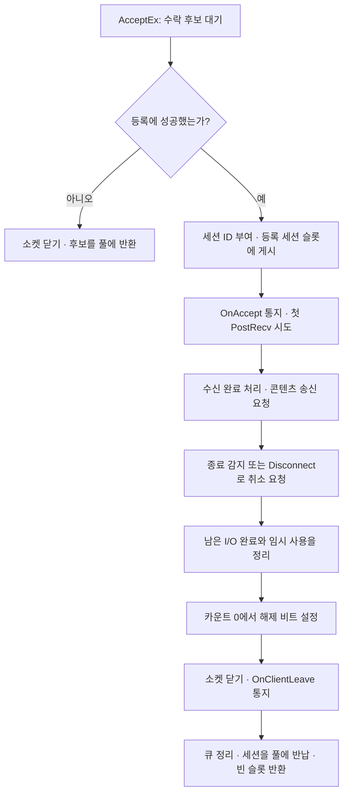
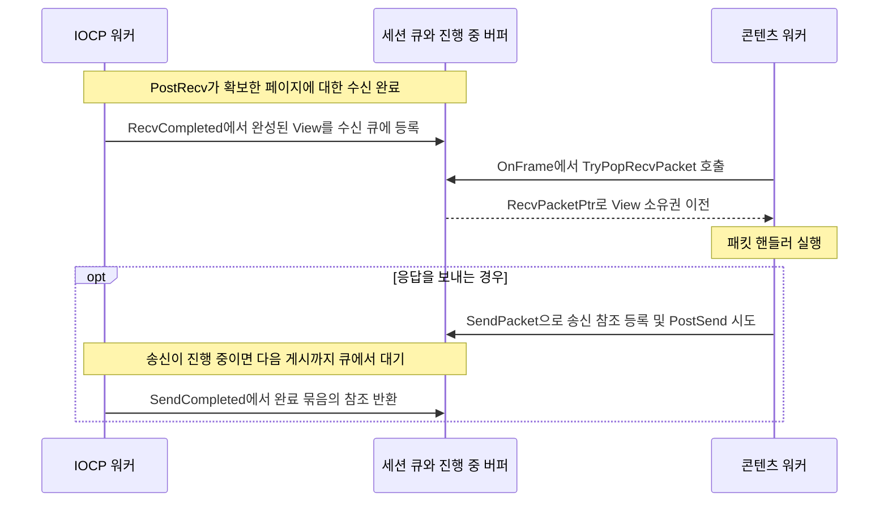

# 서버 IOCP와 세션 수명

`ServerNetworkLib`의 현재 구현을 기준으로, 접속을 수락한 뒤 패킷을 주고받고 세션 슬롯을 반환하기까지의 흐름을 정리한다. 채팅은 네트워크와 콘텐츠가 만나는 예제로만 사용한다. 로그인부터 채팅 응답까지는 [채팅 패킷 송수신 흐름](002_채팅_패킷_송수신_흐름.md)을 참고한다.

## 세션 수명 한눈에 보기

등록 세션의 대표 경로다. 등록 전에 실패한 후보는 `OnClientLeave()`나 등록 세션 슬롯 반환을 거치지 않는다. 등록된 세션은 `Disconnect()` 호출 여부와 관계없이 남아 있던 카운트가 0이 되어야 해제 단계에 들어간다.

## 1. 역할과 실행 스레드

| 구성 | 역할 |
| --- | --- |
| `CServer` | 리슨 소켓, IOCP와 워커, 수락 대기 배열과 등록 세션 배열을 관리한다. 완료 통지를 분기하고 세션의 등록·해제를 담당한다. |
| `CSession` | 연결 하나의 소켓, `OVERLAPPED`, 수신 페이지와 미완성 프레임, 송수신 큐와 진행 중 송신 묶음을 관리한다. |
| 콘텐츠 | 세션 ID로 수신 큐에서 패킷을 꺼내 처리하고, 응답 송신이나 연결 종료를 요청한다. 세션 객체를 직접 보관하거나 반환하지 않는다. |

IOCP 워커는 `GetQueuedCompletionStatus()`에서 꺼낸 수락·수신·송신 완료를 처리한다. 채팅의 `OnAccept()`와 `OnClientLeave()`는 콘텐츠의 입장·퇴장 작업을 `PostCompletion()`으로 게시한다. 실제 입장·퇴장 작업과 `OnFrame()`의 패킷 처리는 콘텐츠 워커가 실행한다. 콘텐츠가 `SendPacket()`을 요청할 때 송신 큐 등록과 첫 `PostSend()` 시도는 호출한 스레드에서 할 수 있다. **모든 소켓 요청이 IOCP 워커에서만 시작되는 구조는 아니다.**

## 2. 수락 대기 → 세션 등록

1. `CServer::Start()`는 리슨 소켓을 준비하고 IOCP에 연결한 뒤 초기 `AcceptEx`를 건다. IOCP 워커를 만든 뒤 `OnServerReady()`를 호출하고, `Start()`를 호출한 스레드는 워커 종료를 기다린다.
2. `PostAcceptEx()`는 풀에서 수락 후보 `CSession`을 가져와 `m_pAcceptExSessions`에 넣는다. 이때는 아직 등록 세션이 아니다. 수락 대기 인덱스는 `OVERLAPPED`에서 찾고, 등록 세션 인덱스는 별도로 빈 슬롯 스택 `m_stackDisconnectIndex`에서 꺼낸다. **`ACCEPTEX_COUNT`는 수락 게시를 시도할 슬롯 수, `MAX_SESSION_COUNT`는 등록 세션 슬롯 수**다. 초기 게시 루프는 개별 실패로 중단하지 않으므로 `OnServerReady()`가 모든 슬롯의 게시 성공을 뜻하지는 않는다.
3. 완료를 받은 워커는 `AcceptExCompleted()`에서 수락 소켓 컨텍스트를 갱신하고 IOCP 연결을 요청한 뒤, `OnConnectionRequest()`와 빈 슬롯 확보를 거친다. 등록할 때 상위 16비트의 슬롯 인덱스와 증가 ID를 조합해 `sessionId`를 만들고 `m_pSessions`에 세션을 게시한다. 슬롯을 재사용해도 같은 슬롯의 이전 ID와 새 ID를 구분한다.
4. 등록에 성공하면 워커가 `OnAccept()`를 호출한 뒤 첫 `PostRecv()`를 시도한다. 중단 중이 아니면 같은 수락 대기 인덱스에 다음 `AcceptEx`를 건다. 등록 전 완료 처리에서 실패하면 소켓을 닫고 후보를 직접 반환한다. 등록·카운트한 뒤 중단 상태를 감지하면 `AcceptExCompleted()`가 `Disconnect()`를 먼저 요청하고도 성공을 반환한다. 워커는 `OnAccept()`와 첫 `PostRecv()` 시도까지 진행하며, 후보 직접 반환이 아닌 등록 세션 해제 경로로 정리한다.

## 3. 수신 페이지와 `RecvPacketPtr`

정상 요청 하나를 받고 응답을 보내는 예시다. 화살표는 IOCP 워커와 콘텐츠 워커 사이에서 패킷의 소유권이 어떻게 넘어가는지 보여 준다.

- **수신 요청:** `PostRecv()`가 `CRecvBuffer` 페이지를 확보하고 완료 통지까지 그 참조를 유지한다. 완료 통지가 오지 않는 즉시 게시 실패는 요청한 쪽에서 정리한다. 워커가 실패 또는 0바이트 수신 완료를 받으면 페이지와 미완성 프레임을 정리하고, 해당 요청의 카운트를 내린다.
- **프레임 완성:** `RecvCompleted()`는 헤더 코드·길이를 확인하고 `Net`에서는 복호화·체크섬까지 검사한다. 한 수신 페이지에 온전히 들어 있는 프레임은 페이지 참조와 오프셋을 가진 `CSerializableBufferView`로 만든다. 헤더나 본문이 나뉜 프레임은 `m_pDelayedBuffer`에 이어 붙이고, 완성된 뒤에야 큐에 넣는다. 수신 완료가 잘 처리되면 다음 `PostRecv()`를 걸고, 검증 실패면 연결 종료를 요청한다.
- **콘텐츠 인계:** `TryPopRecvPacket()`은 기존 출력 핸들을 비운 뒤 슬롯 범위와 후보 포인터를 확인한다. 세션 카운트를 잠깐 올려 얻은 값에서 해제 비트를 확인하고, 전체 세션 ID가 일치할 때만 큐에서 한 건을 꺼내 `RecvPacketPtr`로 넘긴다. 큐 접근이 끝나면 임시 카운트를 내린다. 핸들러에는 View를 호출 중에만 빌려준다.
- **반환:** 전송 계층의 세션 수명과 이미 꺼낸 패킷의 수명은 별개다. 큐에서 꺼낸 View는 `RecvPacketPtr`가 소유하고, 페이지를 참조하는 View는 자신이 가진 페이지 참조로 데이터를 유지한다. 수신 요청 쪽 참조와 마지막 View 참조가 모두 사라져야 페이지가 풀로 돌아간다. 세션에 남은 큐 항목은 `CSession::Clear()`가 반환한다.

## 4. 송신 큐와 `SendPacketPtr`

1. 콘텐츠는 `MakePacket()`으로 만든 `SendPacketPtr`를 가지고 송신을 요청한다. 등록해 둔 세션 ID에 대한 요청이 유효 경로를 통과하면 `CSession::SendPacket()`이 버퍼 참조를 올리고 송신 큐에 넣는다. 큐에 들어간 참조는 호출자가 가진 핸들과 별개다. 현재 큐 상한 검사는 삽입 뒤에 하므로, 상한 초과 시에는 연결 종료를 요청하고 큐에 남은 참조를 정리 경로에서 반환한다.
2. `PostSend()`는 `m_sendFlag`로 동시에 두 송신을 걸지 않도록 한다. 큐에서 꺼낸 버퍼를 프레이밍하고 `m_pSendBuffers`에 보관하며, 최대 `kWsasendMaxBufferCount`개의 `WSABUF`를 한 번의 `WSASend()`에 넘긴다. 같은 알림을 여러 세션에 공유하는 채팅 경로에서는 큐에 넣기 전에 한 번 프레이밍한다.
3. `SendCompleted()`는 완료 묶음의 참조를 내리고 플래그를 풀어 다음 송신을 시도한다. 완료 처리에서 빠진 남은 묶음과 대기 큐는 `Clear()`에서 반환한다. **송신 요청이나 완료는 상대 앱이 패킷을 처리했다는 뜻이 아니다.**

## 5. 연결 종료와 슬롯 반환

| 구분 | 코드가 추적하는 것 |
| --- | --- |
| `m_ioCountAndRelease` | 진행 중인 I/O와 세션을 사용하는 코드의 임시 카운트, 그리고 해제 진입을 표시하는 `sm_releaseFlag`. `ReleaseSession()`은 값이 `0`일 때만 CAS로 해제 비트를 세운다. |
| 패킷·수신 페이지 참조 | 큐, 진행 중 송신 묶음 또는 콘텐츠가 버퍼를 얼마나 오래 사용할 수 있는지. 세션 카운트가 아님. |

`SendPacket()`과 `Disconnect()`는 `TryPopRecvPacket()`과 달리 슬롯 범위와 `nullptr`을 검사하지 않는다. 앱은 `OnAccept()`로 받은 세션 ID를 사용한다. `Stop()`의 순회는 비어 있지 않은 슬롯을 `Disconnect()`에 넘기며, 현재 연결인지 확인하는 것은 그 함수의 해제 비트·전체 ID 비교다.

1. `Disconnect()`는 ID와 해제 상태를 확인하고 `m_cancelIoCalled`를 세운 뒤 `CancelIoEx()`를 호출한다. 이 시점은 **취소 요청**이며 세션 반환은 아니다. 완료 소비 또는 임시 사용 종료로 카운트가 0이 된 쪽에서 `ReleaseSession()`을 시도한다.
2. 해제 비트를 얻은 경로는 직접 정리하거나, `isPqcs`가 전달된 해제 진입이라면 IOCP에 `ReleaseSession` 완료 항목을 게시해 워커의 `ReleaseSessionPqcs()`로 넘긴다. `Disconnect(..., TRUE)`를 호출해도 그 호출에서 해제에 진입하지 못하면, 이후 실제 완료에 의한 해제는 일반 경로를 탈 수 있다.
3. 두 해제 경로 모두 **소켓 닫기 → 이전 ID로 `OnClientLeave()` 호출 → `CSession::Free()`의 `Clear()`와 풀 반납 → 세션 수 감소 → 빈 슬롯 인덱스 반환** 순서다. `OnClientLeave()` 호출은 콘텐츠의 퇴장 작업이 끝났다는 뜻이 아니다. 슬롯은 새 세션에 재사용할 수 있게 되며, 현재 코드는 슬롯 포인터를 `nullptr`로 지우는 대신 다음 등록 때 덮어쓰므로 슬롯 포인터가 있다는 사실만으로 살아 있는 연결로 판단하지 않는다.
4. `CServer::Stop()`은 중단 표시를 세우고 리슨 소켓을 닫은 뒤 세션 배열을 훑으며 종료를 요청한다. 등록 세션 수가 0이 되면 워커 실행 플래그를 내리고 종료 통지를 넣는다. 이 수치가 0이어도 수락 대기 후보나 그 완료 통지까지 모두 회수했다는 뜻은 아니다. 현재 `ChatServer`의 `/exit`는 이 경로를 호출하지 않고 콘텐츠를 정리한 뒤 프로세스를 종료한다. **채팅의 `/exit` 결과는 `CServer::Stop()`의 전체 정리를 검증한 결과가 아니다.**

## 코드와 검증 범위

- [CServer.cpp](../../Server/NetworkLib/CServer.cpp): `Start()` → `PostAcceptEx()` → `AcceptExCompleted()` → `WorkerThread()` → `Disconnect()`와 두 해제 함수.
- [CSession.h](../../Server/NetworkLib/CSession.h), [CSession.cpp](../../Server/NetworkLib/CSession.cpp): 큐 등록과 `PostRecv()` / `RecvCompleted()`, `PostSend()` / `SendCompleted()`, `Clear()`.
- [CChatServer.cpp](../../Tests/Chatting/Server/CChatServer.cpp), [CChatContents.cpp](../../Tests/Chatting/Server/CChatContents.cpp): 접속·퇴장 통지, 콘텐츠에서의 수신 큐 소비와 공용 알림 송신.
- [채팅 루프백](../../Tests/Chatting/test_server_event_input.py)의 `chat`·`chat-lan`은 두 클라이언트 사이의 실제 왕복을 본다. [고정 맵 루프백](../../Tests/WorldServer/test_fixed_maps.py)의 `migration_round_trip`은 분할 입력 중 응답이 없고 프레임을 완성한 뒤 순서대로 응답하는지 본다. 소켓에서 나눠 보냈다는 사실만으로 개별 IOCP 완료 경계, View 주소 동일성 또는 풀 반환 횟수까지 확인한 것은 아니다.
- 위 두 루프백은 세션이 남아 있을 때의 `Stop()` 전체 경로, 중단과 수락 완료의 경합, `AcceptEx` 즉시 실패·슬롯 포기, 슬롯 재사용 중 이전 ID 접근을 각각 검증하는 전용 시험은 아니다.
