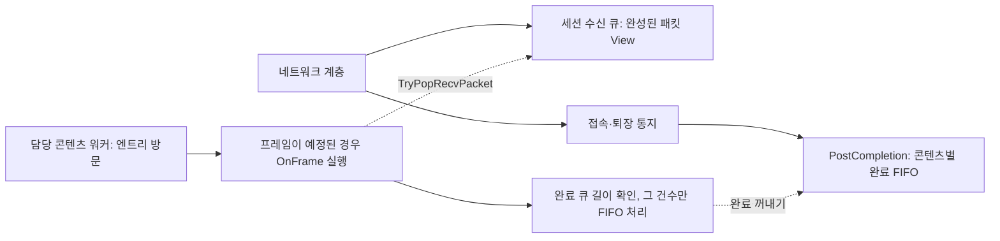
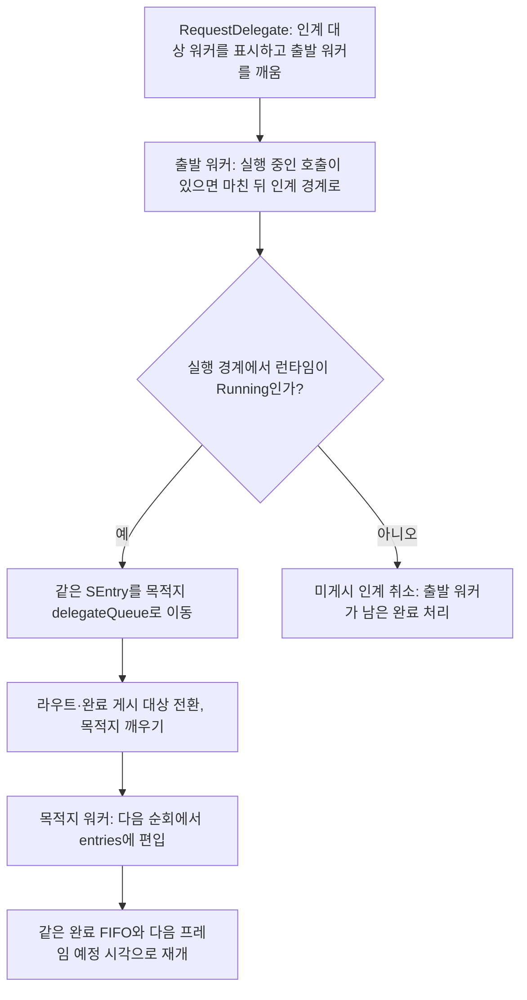
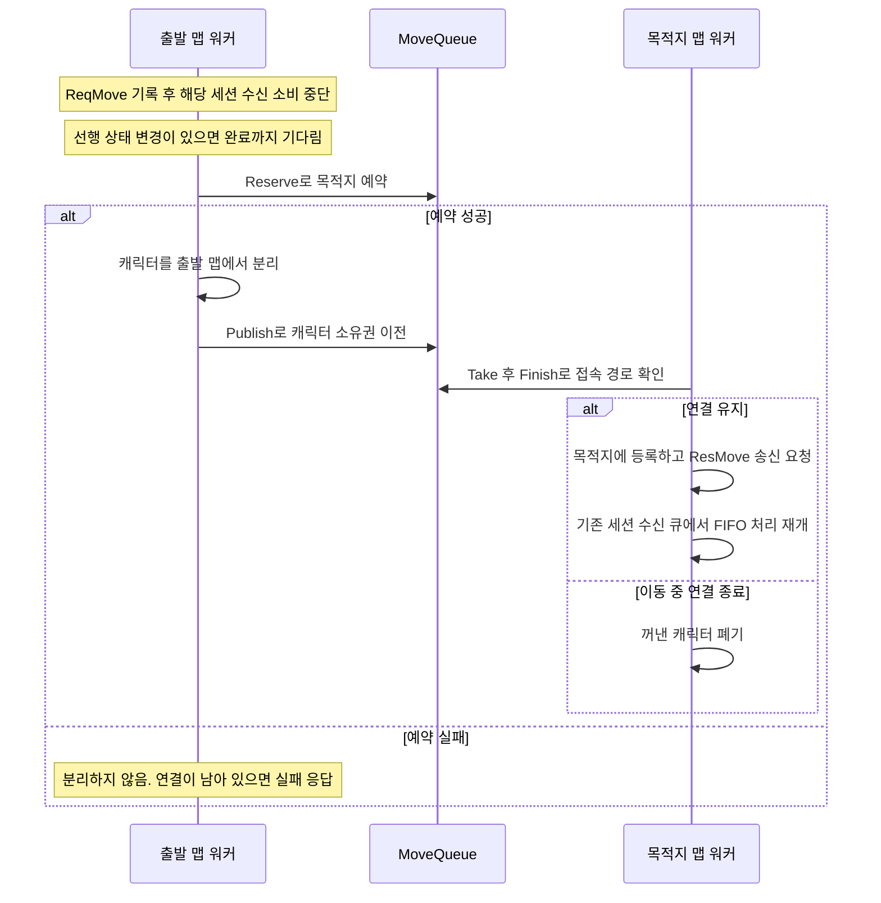

# 콘텐츠 런타임과 워커 인계

`ContentsRuntimeLib`의 현재 실행 경계와, `ChatServer`·테스트 서버 `FixedMaps`가 그 경계를 사용하는 방식을 정리한다. 네트워크의 연결·버퍼 수명은 [서버 IOCP와 세션 수명](003_서버_IOCP와_세션_수명.md)을 참고한다.

**캐릭터 맵 이동은 캐릭터의 소속을 바꾸고, Delegate는 같은 콘텐츠의 담당 워커를 바꾼다.** 둘 다 기존 네트워크 세션을 유지하지만 옮기는 대상과 처리 경로는 다르다.

| 구분 | 무엇을 옮기나 | 무엇을 유지하나 |
| --- | --- | --- |
| `FixedMaps`의 캐릭터 맵 이동 | 캐릭터 한 명의 `unique_ptr`와 맵 소속 | 세션 ID, 캐릭터 ID와 상태, 네트워크 세션의 수신 큐 |
| 런타임의 수동·자동 Delegate | `IContents`를 소유한 `SEntry` 전체의 실행권 | 콘텐츠 인스턴스와 ID, 세션·캐릭터 소속, 완료 큐와 Handle, 다음 프레임 예정 시각 |

## 1. 콘텐츠 등록과 담당 워커

- `CContentsRuntime`은 시작 전에 `RegisterContents()`로 전달된 `IContents`를 `SEntry` 안의 `unique_ptr`로 단독 소유한다. 워커를 지정하면 해당 워커에, 생략하면 등록 엔트리가 가장 적은 워커에 배정한다. 여기서 등록 수는 부하 실측값이 아니다.
- `IContents` 인스턴스마다 완료 메일박스가 하나 있다. 등록 후 `Start()` 전에 `GetContentsHandle()`로 Handle을 얻어 둔다. Handle은 메일박스의 약한 참조만 갖고 콘텐츠나 워커의 수명을 늘리지 않는다. `Start()`는 프레임 예정 시각을 초기화하고 메일박스에 담당 워커를 연결한 뒤 실행을 시작한다.
- 등록·시작·종료는 제어 스레드가 맡는다. 실행 중 라이브러리의 동적 등록·등록 해제나 동일 런타임 재시작은 지원하지 않는다. `FixedMaps`에서 게임플레이 맵 객체를 없애더라도 등록된 `CMapHost`는 남는다.

## 2. 네트워크 수신과 완료 콜백은 별도 경로다

아래 도식은 인계 중이 아닌 엔트리의 방문을 기준으로 한다. 점선은 워커가 큐를 읽는 방향이다.

`ChatServer`를 예로 들면 IOCP는 패킷을 세션 수신 큐에 넣을 뿐, 채팅 핸들러를 직접 부르지 않는다. `CChatContents::OnFrame()`이 자기 소속 세션의 패킷을 꺼낸다. 반면 `OnAccept()`와 `OnClientLeave()`는 `PostCompletion()`으로 입장·퇴장 콜백을 게시한다. 두 큐 사이에 공통 FIFO가 있는 것은 아니다.

- **게시는 실행이 아니다.** `PostCompletion()`은 Handle로 메일박스의 강한 참조를 잠시 얻어 해당 `completionLock` 아래에서 콜백을 넣고 그 시점의 담당 워커를 깨운다. 일반 게시에는 등록 락·워커 락·ID 조회가 없다. 빈 콜백, 다른 런타임의 Handle, 만료됐거나 아직 열리지 않았거나 닫힌 메일박스는 거절한다.
- **한 콘텐츠는 직렬 실행한다.** `runWorker()`는 프레임을 사용하는 엔트리의 예정 시각이 되면 `OnFrame()`을 먼저 호출한다. 예정 시각은 `now`로 덮지 않고 한 주기만 더하므로, 밀린 프레임은 다음 순회에서 한 번씩 따라잡는다. 이어 완료 큐 길이를 한 번 읽고 그때 확인한 범위만 FIFO로 처리한다. 고정 건수 상한은 없다. `OnFrame()` 중에 게시되어 길이를 읽을 때 이미 큐에 있던 완료는 같은 방문에서 처리할 수 있고, 길이를 읽은 뒤 들어온 완료는 다음 방문으로 넘긴다. 인계 요청이 잡히면 현재 실행 중인 호출은 마치고 아직 꺼내지 않은 완료는 큐에 남긴다.
- **콜백은 락 밖에서 실행한다.** 워커는 완료 큐 락 안에서 한 건을 꺼낸 뒤 락을 풀고, `workLock`도 놓은 상태에서 콜백을 부르고 캡처를 해제한다. 프레임 호출도 워커 락 밖이다. 할 일이 없으면 다음 프레임 시각 또는 세마포어 신호까지 기다린다.

## 3. Delegate: 같은 콘텐츠를 다른 워커에서 재개

1. `RequestDelegate(instanceId, destinationWorkerIndex)`의 `true`는 **접수 성공**이다. 호출자가 노드를 옮기는 것이 아니다. 잘못된 ID·목적지, 현재와 같은 워커, 이미 인계 중인 인스턴스는 거절한다.
2. 현재 담당 워커만 실행 경계에서 `std::list::splice()`로 같은 엔트리를 목적지 `delegateQueue`에 옮긴다. 등록·라우트 락 → 출발 워커 락 → 목적지 워커 락 → 완료 큐 락 순으로 잡고, 엔트리 이동과 라우트·메일박스 담당 워커 변경을 함께 처리한다. Handle과 FIFO는 교체하지 않는다. 새로 게시된 콜백은 같은 큐에 들어간다.
3. 목적지 워커는 자기 순회 시작에 인계 표시를 지우고 엔트리를 실행 목록에 편입한다. 그전에는 같은 엔트리를 다시 인계할 수 없다. 출발 워커가 이미 목록에서 뺀 노드를 목적지가 이어받으므로 두 워커가 같은 콘텐츠를 동시에 실행하지 않는다.
4. `Stop()`은 상태를 `Stopped`로 바꿔 새 인계를 막고, 메일박스의 접수를 하나씩 닫은 뒤 각 워커에 종료를 요청한다. 완료 게시는 해당 메일박스가 닫힐 때까지 가능하다. `isStopping`을 확인한 워커는 새 프레임을 선택하지 않고 이미 접수한 완료를 처리한 뒤 종료하며, 제어 스레드가 `join`한다. 인계가 큐에 게시되기 전에 종료가 먼저라면 출발 워커가, 게시된 뒤라면 목적지 워커가 남은 완료를 처리한다. 종료는 콘텐츠 런타임의 종료이며 네트워크 세션 종료와 별개다.

## 4. 캐릭터 맵 이동: FixedMaps의 콘텐츠 정책

`FixedMaps`에서는 `CMapHost`가 소유한 맵의 `RunFrame()`이 세션별 수신을 처리한다. 목적지 접수 종료와 이동 예약은 `CMoveQueue`의 같은 락으로 순서를 정한다. 예약을 얻은 출발 맵만 캐릭터를 떼어 낼 수 있다. 예약은 목적지가 `Take()`한 후에도 `Finish()`까지 유지하며, 그 사이 연결이 닫혀 경로가 사라졌다면 목적지는 캐릭터를 등록하지 않는다. 네트워크 수신 큐를 다른 곳에 복사하지 않는다. 성공 응답은 목적지 등록 후 **송신을 요청**하는 것이고, 그 다음에 기존 큐의 입력 처리를 이어 간다.

이 경로는 테스트 앱의 맵 정책이며 `CContentsRuntime::RequestDelegate()`를 호출하지 않는다. 반대로 Delegate의 워커 전환은 캐릭터를 떼거나 새 맵으로 옮기지 않는다.

## 5. 자동 Delegate: 판단과 실행의 분리

| 구성 | 책임 |
| --- | --- |
| `CContentsRuntime` | 엔트리 방문 누계를 제공하고, 접수된 요청을 실행 경계에서 처리한다. 자동 판단 규칙은 모른다. |
| `CContentsScheduler` | 평가 주기에 `TakeEntryTimings()`로 표본을 얻어 주입된 정책을 부른다. 후보가 있으면 기존 `RequestDelegate()` 경로로 제출하고, 직전 제출 결과를 다음 평가에 한 번 전달한다. 자기 자신은 제출하지 않는다. |
| `CPersistentOverloadDelegatePolicy` | 표본으로 지속 과부하·회복·목적지 여유를 평가하고 `instanceId`와 목적지 워커를 후보로 반환한다. 라우트를 고치거나 스레드를 직접 옮기지 않는다. |

- `CScopedExecutionTimer timer(entry.timing);`는 엔트리 방문 블록을 잰다. 그 안의 프레임·완료·큐 처리와 락 재획득은 포함하지만 블록 뒤의 인계와 세마포어 대기는 제외한다. 실행한 콜백이 없어도 끝난 방문은 1회다. `TakeEntryTimings()`는 전체 워커 수와 배정, 인계 표시, 완료된 방문 시간·횟수를 반환하고 누계를 초기화한다.
- 정책이 보는 부하는 **워커의 엔트리 방문 시간 합 ÷ 실제 평가 간 경과 시간**이다. CPU 사용률이 아니다. 엔트리가 없는 워커와 엔트리는 있지만 완료 방문 표본이 없는 워커는 구분한다. 인계가 걸린 구간은 이전·이후 배정이 섞일 수 있어 판단에 쓰지 않는다.
- 현재 정책은 80% 이상이 두 구간 연속인 워커를 발견한 뒤 별도 기간을 관찰한다. 65% 이하가 두 번 연속이거나 출발지가 미관측이면 관찰을 접는다. 관찰이 충분하고 출발지의 최근·누적 부하가 모두 80% 이상일 때, 목적지의 최근·누적 부하가 50% 이하이고 인계 후 예상 부하가 75% 이하인 조합을 비교한다. 두 워커 중 더 높은 예상 부하가 최소 10%p 낮아지는 조합만 후보가 된다.
- **후보 반환 → 접수 → 목적지 편입 → 영향 재관찰**은 별개다. 접수 후에는 목적지 편입을 확인할 때까지 새 후보를 내지 않는다. 편입 뒤 전환과 섞이지 않은 새 표본으로 양쪽을 확인한다. 직전 엔트리를 다시 후보로 검토할 때 원래 워커로 되돌리는 조합은 한 차례 제외한다. 정책 기본 관찰값은 10초·5구간이다. `FixedMaps`의 자동 인계 시험은 600ms·3구간을 지정하고 첫 번째 맵만 인계 대상으로 허용한다. 시험 설정은 운영 기준이 아니다.

## 코드와 검증 범위

- [CContentsRuntime.cpp](../../Server/ContentsRuntimeLib/CContentsRuntime.cpp), [ContentsHandle.h](../../Server/ContentsRuntimeLib/ContentsHandle.h): 등록·Handle 게시·프레임·인계·종료. [CContentsScheduler.cpp](../../Server/ContentsRuntimeLib/CContentsScheduler.cpp), [ContentsDelegatePolicies.cpp](../../Server/ContentsRuntimeLib/ContentsDelegatePolicies.cpp): 정책 호출과 후보 선정.
- [CChatServer.cpp](../../Tests/Chatting/Server/CChatServer.cpp), [CChatContents.cpp](../../Tests/Chatting/Server/CChatContents.cpp): 네트워크 통지의 게시와 콘텐츠 워커의 패킷 처리. [FixedMaps.cpp](../../Tests/WorldServer/FixedMaps.cpp), [FixedMapsMoveQueue.h](../../Tests/WorldServer/FixedMapsMoveQueue.h): 맵 소속과 캐릭터 이동.
- [WorldServer 런타임 시험](../../Tests/WorldServer/Main.cpp)은 프레임 따라잡기, 완료 FIFO와 Handle, 인계 중 게시·편입·종료 경계, 합성 표본의 정책 판단을 확인한다. [FixedMaps 루프백](../../Tests/WorldServer/test_fixed_maps.py)은 맵 이동 후 기존 수신 처리, 수동 Delegate에서 동일 세션·캐릭터의 다른 워커 실행, 자동 Delegate에서 단발 지연 미인계와 지속 지연 후 빈 워커 편입·처리 재개를 확인한다.
- 기존 결과와 후속 범위는 [런타임 1차 계획](../Plan/Server/009_ContentsRuntime_1차_계획.md), [완료 Handle 전환](../Plan/Server/010_콘텐츠_완료_핸들_전환_계획.md), [자동 Delegate 정책 계획](../Plan/Server/011_자동_Delegate_정책_계획.md)에 둔다. 실제 게임 서버 연결과 동일 부하에서의 고정 배정 대비 성능 개선은 별도 운영 검증 대상이다.
- 자동 인계 루프백은 그 시나리오에서 실제 계측과 워커 편입이 이어지는지 본다. 단발 지연의 미인계만으로 어느 정책 조건이 인계를 막았는지 분리할 수 없고, 임계값 근처의 판정이 모든 실행 타이밍에서 동일하다는 보장도 아니다.
