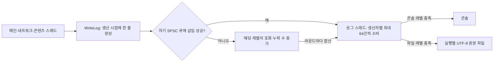
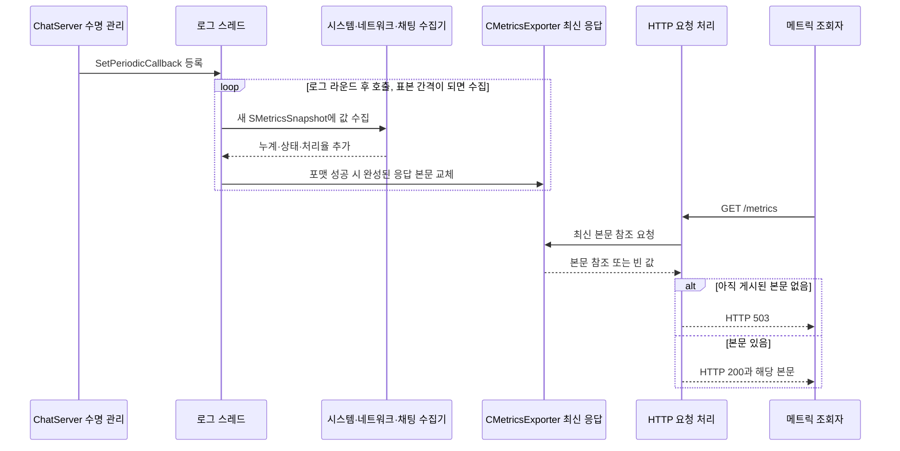

# 서버 비동기 로그와 메트릭

현재 `ChatServer`를 기준으로 로그가 기록되는 경로, 메트릭이 수집·게시되는 경로, 그리고 각 경로의 수명 경계를 설명한다. **로그는 무슨 일이 있었는지 한 줄씩 기록하고, 메트릭은 그 시점까지의 누계와 상태를 표본으로 보여 준다.** 같은 로그 스레드를 쓰지만 메트릭은 로그 줄을 파싱해서 만들지 않는다.

## 1. 로그 생산자와 단일 출력 스레드

아래 도식은 비동기 모드에서 등록된 생산자가 한 줄을 만드는 데 성공해 큐 삽입을 시도하는 경로다.

- `CLogger::Start()`는 원본 파일을 연 뒤 출력 스레드를 시작한다. 메인과 네트워크 시작 스레드·IOCP 워커는 각자 `RegisterLogProducer()`를 호출한다. 채팅 콘텐츠 워커는 `OnEnter()`에서 등록한다. 등록된 스레드는 TLS에 자기 생산자 포인터를 보관하고, 로거가 생산자와 고정 용량 SPSC 큐를 소유한다.
- 이벤트용 `WriteLog()`는 생산 시점의 UTC 시각, 레벨, 프로젝트, 생산자 스레드 ID, 세션 ID와 호출 위치를 포함한 한 줄을 만든다. 종료 요청·미등록·서식화 실패로 큐 삽입 전에 반환한 건은 포화 누락에 포함하지 않는다. 큐가 꽉 차면 생산자는 출력이나 빈 슬롯을 기다리지 않고 그 로그를 버린다. 로그 스레드는 레벨별 누락 건수를 합산해 `event=log_queue_dropped`를 Error로 출력한다. 이 값은 **큐 포화로 잃은 로그 수**이지 패킷 손실 수가 아니다.
- 로그 스레드는 한 라운드에 생산자당 최대 64건을 처리한다. 생산자별 FIFO는 유지하지만 여러 큐의 로그를 시각순으로 합치지는 않는다. 평상시에는 라운드와 등록된 주기 콜백 실행 뒤 `LOG_POLL_INTERVAL_MS`만큼 대기한다. 샘플은 10 ms이며 처리 시간을 포함한 정확한 주기를 뜻하지 않는다.
- 소비 단계에서 `CONSOLE_LOG_LEVEL`과 `FILE_LOG_LEVEL`을 각각 적용한다. 콘솔 `Info`·파일 `Debug`이면 세션 입장·퇴장, 로그인·섹터·채팅 진단은 파일에만 남는다. 두 출력에서 모두 걸러질 레벨도 큐에 들어갈 수 있다. `server_ready`는 운영 상태를, `chat_processed`는 처리한 섹터를 기록하며 서버 이벤트에 채팅 본문이나 인증값을 넣지 않는다.
- 원본 파일은 실행 작업 디렉터리의 `LogFile/run-<stamp>-<suffix>/<UTC 시각>-<실행 파일명에서 확장자 제외>.log`에 BOM 없는 UTF-8로 남긴다. 출력 스레드는 파일에 쓴 라운드마다 스트림을 플러시한다. 설정 오류처럼 로거 시작 전의 진단과 `WriteEmergencyLogToStderr()`는 이 큐 경로와 별개다.

## 2. 메트릭 수집과 HTTP 조회는 별도 경로다

`ChatServer`가 수집기를 조립해 `CMetricsExporter::CreatePublishCallback()`의 결과를 로그 스레드에 등록한다. 로그 라운드마다 콜백에 진입하지만 첫 수집 이후에는 **직전 수집 기준으로 1초 이상** 경과했을 때만 새 표본을 만든다. 첫 수집은 리스너 시작과 다른 시점이며 `server_ready`에 맞춰 기다리지 않는다. 이후 처리율의 분모는 로그 폴링 설정이나 Prometheus 수집 주기가 아니라 실제 표본 간 경과 시간이다. 수집과 포맷 처리도 로그 스레드의 일이므로 그 작업이 오래 걸리면 다음 로그 라운드가 늦어질 수 있다.

`CMetricsExporter`는 성공적으로 포맷한 전체 본문만 읽기 전용 문자열로 원자적으로 교체하며 게시 시각을 `observability_snapshot_timestamp_seconds`에 담는다. 수집 콜백이 표본 생성을 건너뛰거나 포맷이 실패하면 이전 정상 본문을 유지한다. **`GET /metrics`는 이미 게시된 본문을 읽을 뿐** Windows API 호출, 카운터 리셋, 새 포맷을 요청할 때마다 수행하지 않는다. 처음 게시되기 전에는 503을 반환한다.

## 3. `CMonitor` 제거 이후의 책임과 숫자의 의미

| 위치 | 수집·집계하는 값 |
| --- | --- |
| `MetricsLib::CSystemMetrics` | Windows 호스트·프로세스의 CPU와 메모리, 프로세스 페이지 폴트·이름, 호스트 NIC 송수신 합과 TCPv4 재전송. NIC는 인터페이스별 호스트 트래픽이지 ChatServer 전용 트래픽이 아니다. 유효하지 않은 표본을 0으로 채우지 않으며, 첫 수집의 NIC 속도는 생략한다. |
| `SNetworkCounters` → `ServerMetrics::CServerMetrics` | IOCP와 세션 경로가 원시 카운터를 올린다. 수집기가 수락 완료·수신 패킷·송신 완료 경로의 패킷·송신 배치 한도 도달의 구간값을 0으로 교환하고 별도 누계에 더한다. 등록 세션 누계와 `WSASend` 호출·pending 누계는 리셋하지 않고 읽는다. `net_sessions`는 현재 등록 세션 수다. |
| `Chatting::CChatMetrics` | 수신 처리 시작, 로그인·섹터 이동·채팅 메시지 요청, 메시지 응답·피어 알림 송신 요청의 누계를 리셋하지 않고 읽는다. 송신 요청 수는 상대의 수신·처리 완료 수가 아니다. `chat_content_frames_total`은 완료한 채팅 프레임 누계다. |
| `MetricsLib::CMetricsExporter` | 수집기가 붙인 값을 Prometheus 본문으로 변환·게시하고 최신 응답을 제공한다. 게임 세션이나 채팅 상태를 직접 수집하지 않는다. |

- 위 네트워크 구간 지표와 채팅 요청 계열은 첫 표본에 `_total`을 싣고, 해당 `_per_second`만 생략한다. 이후 네트워크는 **이번에 교환한 증가분 ÷ 경과 초**, 채팅은 **직전 누계와의 차이 ÷ 경과 초**를 사용한다. 이 규칙을 Windows 지표 전체의 첫 표본 규칙으로 해석하지 않는다.
- `net_accept_completions_total`은 수락 완료 경로에 진입할 때, `net_sessions_accepted_total`은 접속 검사와 슬롯 할당을 지나 세션 등록 경로에 들어갔을 때 증가한다. 이 차이와 현재 세션 수가 서로 다른 이유는 [서버 IOCP와 세션 수명](003_서버_IOCP와_세션_수명.md)을 참고한다.
- `CMonitor`의 별도 수집·게시 경로와 구 콘텐츠 워커의 분배·스틸 지표는 제거됐다. 현행 콘텐츠 워커의 [Delegate 방문 계측](004_콘텐츠_런타임과_워커_인계.md)은 스케줄링 정책 입력이며, 이 메트릭 경로로 옮긴 구 워커 지표와 다르다.

## 4. 기동과 종료 경계

- `ServerConfig.conf`에서 로그 옵션은 `Logging:`, 메트릭 주소·포트는 `Server:`에 둔다. `ChatServer`에서 `METRICS_PORT = 0`은 비활성이고, 이때도 구체적인 IPv4 bind 주소를 파일에 명시한다. 0이 아니면 지정 주소·포트만 시도한다. 유효한 설정의 포트가 이미 사용 중이면 메트릭 시작 실패를 기록하고 채팅 서버 기동은 계속한다. 비활성 또는 시작 실패 시 수집 콜백을 등록하지 않는다.
- 콜백 등록·해제는 수명 관리 스레드가 맡는다. 콜백 안에서는 `SetPeriodicCallback()`이나 로거의 `Stop()`을 호출하지 않는다. 종료할 때 앱은 `SetPeriodicCallback({})`로 먼저 해제한다. 콜백 실행과 해제가 같은 락을 쓰므로 해제가 반환될 때는 실행 중이던 호출까지 끝나 있다. 그 뒤 exporter의 리스너를 닫고 수집기를 정리한다. 로그 생산자가 이 콜백 락을 잡지는 않는다.
- 로거의 정상 `Stop()`은 **생산자의 등록·제출이 끝난 뒤** 호출한다. 출력 스레드가 잔여 큐를 비우고 종료하면 `join`한 뒤 생산자를 해제한다. `ChatServer`의 `/exit`는 콘텐츠·메트릭을 정리하고 프로세스를 종료하며, 로거의 정상 `Stop()`이나 네트워크 `Stop()`을 호출하지 않는다. 네트워크 `Start()`가 반환한 경로에서도 `HasStartedBackgroundWork()`가 참이면 로거의 `Stop()`을 건너뛴다. 따라서 `/exit`나 일부 부분 기동 실패에서 종료 직전 로그까지 정상 배출됐다고 보장할 수 없다.

서버 밖에서는 **메트릭은 Prometheus가 `/metrics`에서 읽고, 로그는 Alloy가 원본 파일을 읽어 Loki에 보낸다.** Grafana 조회와 배포 설정은 [채팅 서버 모니터링 연동](../Infra/002_채팅서버_모니터링.md)을 따른다.

## 코드와 검증 범위

- [CLogger.h](../../Server/MHLib/includes/MHLib/utils/CLogger.h)와 [ChatServer Main.cpp](../../Tests/Chatting/Server/Main.cpp): 생산자 등록, 출력, 주기 콜백 연결·해제. [시스템 수집기](../../Server/MetricsLib/CSystemMetrics.cpp), [서버 수집기](../../Server/ServerMetrics/ServerMetrics.cpp), [채팅 수집기](../../Tests/Chatting/Server/ChatMetrics.cpp), [HTTP 게시](../../Server/MetricsLib/CMetricsExporter.cpp): 표본 수집과 조회.
- [AsyncLoggerTests](../../Tests/AsyncLogger/AsyncLoggerTests.cpp)는 생산자별 순서·포화 누락·출력 필터·큐 배출과 실행 중 콜백 해제 대기를 본다. [MetricsTests](../../Tests/Metrics/MetricsTests.cpp)는 첫 게시 전 503, 포맷 실패·수집 건너뛰기 후 기존 응답 유지, 동시 조회에서 완성된 본문 반환을 본다.
- [채팅 통합 시험](../../Tests/Chatting/test_server_event_input.py)의 `metrics`는 실제 로그 스레드 게시, 트래픽 이후 누계와 양의 처리율, 주소 설정·포트 충돌·비활성을 확인한다. HTTP 첫 읽기가 첫 게시와 일치한다고 가정하지 않으며, `WSA_IO_PENDING`을 강제로 유도하거나 처리율 공식을 정밀 계측하는 시험은 아니다. 기존 결과는 [로그 검증 기록](../Plan/Server/005_서버_비동기_로그_설계.md)과 [모니터 이관 기록](../Plan/Server/012_구버전_콘텐츠_런타임과_모니터_제거_계획.md)에 남겨 둔다.
