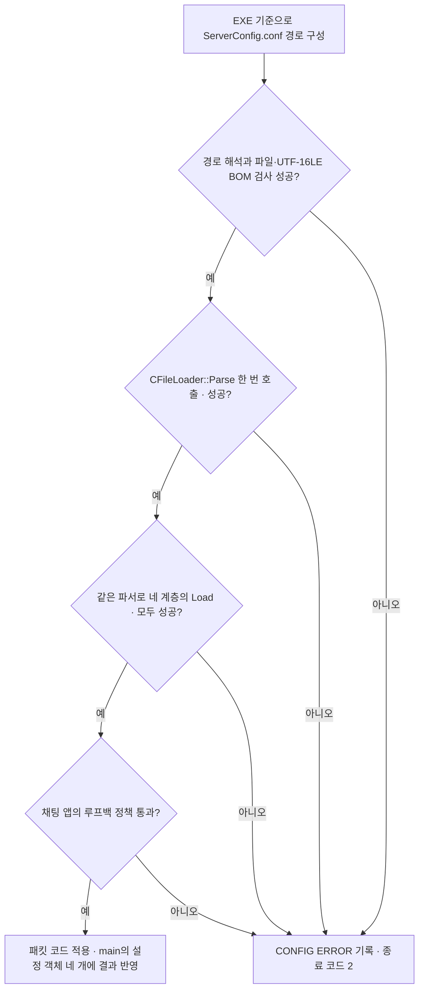
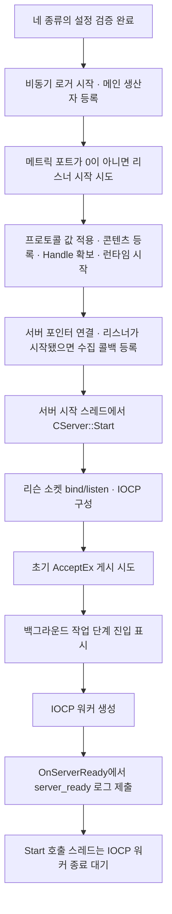

# 서버 설정 소유권과 기동 순서

현재 `ChatServer`의 설정 계약과 시작 경로를 정리한다. **앱은 파일을 찾아 한 번 파싱하고 기동 순서를 정한다. 각 계층은 자기 설정의 키·타입·검증을 소유한다.** 검증을 마친 뒤 실행 코드에는 필요한 값만 전달하며, 실행 중에 설정 파일을 다시 읽지 않는다.

## 1. 한 파일에서 계층별 설정까지

각 단계에서 실패하면 즉시 돌아가며, 뒤 단계는 실행하지 않는다.

1. 입력은 현재 작업 디렉터리가 아니라 **EXE 디렉터리의 `ServerConfig.conf`**다. 빌드의 `CopyChatConfig`가 샘플을 출력 디렉터리에 복사한다. `CheckConfigFile()`은 파일 열기, 최소 크기와 짝수 바이트 길이, UTF-16LE BOM을 확인한다. 이 사전 확인은 설정이 해석됐다는 뜻이 아니다.
2. 사전 검사를 통과하면 `LoadConfigFile()`이 `CFileLoader::Parse()`를 한 번 호출한다. 이때 파서는 파일을 다시 열어 내용을 읽는다. `Parse()`는 파일을 열거나 읽지 못했거나 등록할 항목이 없으면 `false`를 반환한다. 파서는 직접 로그를 남기지 않는다. 파일·파싱 오류는 앱이 파일명과 사유를 콘솔에 기록한다. `Parse()`의 성공은 문법 전체나 필수 키의 유효성을 보장하지 않는다.
3. `LoadServerConfig()`는 파싱 결과를 **네트워크 → 콘텐츠 런타임 → 로깅 → 메트릭** 순으로 전달한다. 각 `Load()`는 해당 섹션의 값과 범위를 검사해 임시 객체에 담는다. 실패하면 첫 실패 사유를 앱이 기록한다. 모두 통과한 뒤 채팅 앱의 루프백 정책을 확인하고 패킷 코드를 채운 다음에만 호출자의 네 출력 객체를 갱신한다. 따라서 실패한 파일에서 일부 설정만 적용되지 않는다.

| 소유자 | 설정 타입과 책임 | 실행 시 받는 값 |
| --- | --- | --- |
| `ServerNetworkLib` | `SServerNetworkSettings.h/.cpp`: 리슨 주소·포트, 패킷 모드, 세션과 IOCP 설정 | `CServer::Start(networkSettings)`; 패킷 코드·모드, 세션·수락 크기 등 이후에도 참조하는 값은 서버 인스턴스에 보관 |
| `ContentsRuntimeLib` | `SContentsRuntimeSettings.h/.cpp`: 워커 수와 FPS 검증, 프레임 간격 변환 | 콘텐츠 런타임 생성자에 워커 수와 프레임 간격 |
| `MHLib::utils` | 헤더 온리 `SLoggingSettings.h`: 콘솔·파일 레벨, 큐 용량, 폴링 간격 | `CLogger::Start()`에 로그 경로와 검증된 로깅 값 |
| `MetricsLib` | `SMetricsSettings.h/.cpp`: 메트릭 전용 주소·포트 검증 | 활성일 때 `CMetricsExporter::Start()`에 주소·포트 |
| `ChatServer` 앱 | 파일명·검증 순서·시작 순서, 채팅 테스트용 리슨 주소 제한과 프로토콜 선택 | 위 계층의 사용 순서와 설정 값 전달 |

채팅 앱은 리슨 IP를 `127.0.0.1`로 제한한다. 네트워크 라이브러리의 로더는 IPv4 형식을 검증하며 채팅의 루프백 정책은 알지 않는다. 앱이 파일에 없는 공용 프로토콜 코드와 키를 기존 방식으로 적용한다. `useZeroCopy`도 파일 키가 아니다. 파일에 없는 내부 값을 추가 설정으로 해석하지 않으며, 네트워크 런타임의 `g_pServer` 제거까지 포함하는 구조 변경은 아니다.

## 2. 샘플 15개 키와 검증 계약

아래 값은 [샘플 파일](../../Tests/Chatting/Server/ServerConfig.conf)의 값이다. **15개 모두 명시 필수**이며 누락 시 이 숫자로 자동 대체하지 않는다.

| 섹션 | 키 | 샘플 값 | 검증·의미 |
| --- | --- | --- | --- |
| `Server:` | `IP`, `PORT` | `127.0.0.1`, `6000` | IPv4와 `1..65535`; 채팅 앱은 루프백을 별도로 검사 |
| `Server:` | `PACKET_MODE` | `Net` | `Net` 또는 `Lan`; 전송 형식은 [채팅 패킷 송수신 흐름](002_채팅_패킷_송수신_흐름.md) 참조 |
| `Server:` | `MAX_SESSION_COUNT`, `ACCEPTEX_COUNT` | `256`, `4` | 각각 `1..65535`; 등록 세션 한도와 수락 게시를 시도할 슬롯 수는 별개 |
| `Server:` | `IOCP_WORKER_COUNT`, `IOCP_CONCURRENCY` | `2`, `2` | 워커 `1..64`, 동시성 `1..IOCP_WORKER_COUNT` |
| `Server:` | `METRICS_PORT`, `METRICS_BIND_ADDRESS` | `0`, `127.0.0.1` | 포트 `0..65535`; `0`은 명시적 비활성. 이때도 주소가 필요하며 `0.0.0.0`은 허용하지 않음 |
| `ContentsRuntime:` | `CONTENTS_WORKER_COUNT`, `CONTENTS_FPS` | `2`, `25` | 워커 `1..64`, FPS `1..1000`; 프레임 간격은 정수 나눗셈 `1000 / FPS` ms |
| `Logging:` | `CONSOLE_LOG_LEVEL`, `FILE_LOG_LEVEL` | `Info`, `Debug` | 각각 `Debug`, `Info`, `Error` 중 하나 |
| `Logging:` | `LOG_QUEUE_CAPACITY`, `LOG_POLL_INTERVAL_MS` | `1024`, `10` | 생산자당 `1..1048576`건, 폴링 `1..1000` ms |

메트릭 키는 네트워크 키와 같은 `Server:` 섹션을 쓰지만 소유자는 `SMetricsSettings`다. 콘텐츠나 로그 키를 구 위치인 `Server:`에 넣으면 각 로더에서 거절한다. 현재 채팅 서버 고유 설정 섹션은 따로 두지 않으며, 클라이언트의 최초 입장 좌표 `SECTOR_X/Y`는 이 파일의 값이 아니다. 빈 섹션·중복 키를 일반적으로 지원하는 문법 검증기로 `CFileLoader`를 사용하지 않는다. 샘플처럼 사용 키를 올바른 섹션에 한 번씩 명시한다.

Jenkins의 서버 실행 잡은 EXE와 함께 실행 디렉터리에 복사한 **설정 복사본**을 UTF-16LE로 읽고 다시 쓴다. 숫자 옵션은 기존 키를 찾아 교체하고, 없는 메트릭 키를 추가하는 경우에는 `Server:`에 넣는다. 전체 기동 계약을 대신 검증하거나 리포지토리 원본 설정을 수정하지 않는다. 실행 방법은 [채팅 서버 Jenkins 문서](../Infra/001_채팅서버_젠킨스.md)에 둔다.

## 3. 검증 성공 후의 기동 순서

아래는 네트워크 준비까지 진행한 경로다. 실패 시 분기는 아래 표에 따로 정리한다.

- 비동기 로거는 `LogFile`을 작업 디렉터리 기준으로 연다. EXE 기준인 설정 경로와 다르다. 메트릭 리스너가 먼저 열릴 수 있고, 콘텐츠 런타임과 수집 대상의 준비가 끝난 뒤에야 로그 스레드에 수집 콜백을 붙인다. 포트가 비활성이거나 메트릭 리스너 시작에 실패하면 콜백을 등록하지 않고 서버 시작을 계속한다. [로그와 메트릭](005_서버_비동기_로그와_메트릭.md)에 게시·종료 수명을 정리했다.
- `StartContents()`에서 채팅 콘텐츠를 워커 0에 등록하고 Handle을 얻은 뒤 런타임 워커를 시작한다. 이 단계가 네트워크보다 앞이므로 네트워크의 `OnAccept()`에서 입장 작업을 완료 큐로 넘길 수 있다. [콘텐츠 런타임과 워커 인계](004_콘텐츠_런타임과_워커_인계.md) 참조.
- `OnServerReady(settings.port)`는 초기 수락 게시를 시도하고 설정된 IOCP 워커 핸들을 모두 생성한 뒤 호출한다. 로그는 비동기 큐에 제출된다. **`server_ready`는 워커 함수가 모두 진입했거나 모든 수락 슬롯 게시가 성공했거나 `/metrics`가 첫 본문을 게시했다는 확인이 아니다.** `Start()`는 이 콜백 직후 반환하지 않고 워커 종료를 기다린다. [서버 IOCP와 세션 수명](003_서버_IOCP와_세션_수명.md) 참조.

| 실패 지점 | `ChatServer`의 동작 |
| --- | --- |
| 설정 경로·인코딩·파싱·필수 키 또는 앱 정책 | `CONFIG ERROR`를 콘솔에 기록하고 `2`로 종료. 비동기 로거는 시작하지 않음 |
| 비동기 로거 `Start()`가 `false`를 반환 | 콘솔에 오류를 기록하고 `2`로 종료 |
| 유효한 설정으로 메트릭 리스너 시작 실패 | 오류를 기록하되 채팅 서버 시작은 계속 |
| `StartContents()`가 `false`를 반환 | 메트릭과 로거를 정리하고 `1`로 종료 |
| 네트워크 `Start()`가 `false`를 반환 | 콘텐츠를 멈추고 시작 실패를 기록한 뒤 메트릭을 정리하고 `1`로 종료. 백그라운드 작업 단계에 들어가기 전 실패면 로거를 정상 종료한다. 워커 생성 단계에서 실패하면 앞서 시작한 워커나 수락 요청이 남아 있을 수 있어, 앱은 네트워크와 로거의 정상 `Stop()`을 호출하지 않고 프로세스를 종료한다. |

## 코드와 검증 범위

- [공용 파일 읽기](../../Tests/Chatting/Common/Config.cpp), [CFileLoader.h](../../Server/MHLib/includes/MHLib/utils/CFileLoader.h), [서버 설정 조립](../../Tests/Chatting/Server/ServerConfig.cpp), [ChatServer Main.cpp](../../Tests/Chatting/Server/Main.cpp) 순서로 읽으면 입력부터 실행 값 전달까지 확인할 수 있다.
- [채팅 회귀 시험](../../Tests/Chatting/test_server_event_input.py)에서 `server-options`는 비샘플 설정 로그와 IOCP 워커 3개 생성 로그 및 채팅 왕복, 필수 키 15개의 개별 누락·잘못된 값·빈 콘텐츠 섹션·파싱 실패 거부를 확인한다. 설정 로그의 수치만으로 실제 IOCP 동시성이나 큐 용량까지 측정한 것은 아니다. `bind`는 설정을 통과한 뒤 네트워크 포트 충돌이 코드 `1`임을, `metrics`는 별도 주소·포트와 충돌·비활성 분기를 확인한다. 구현 당시 결과는 [서버 설정 외부화 기록](../Plan/Server/004_DummyClient_검증.md)에 남겨 둔다.
