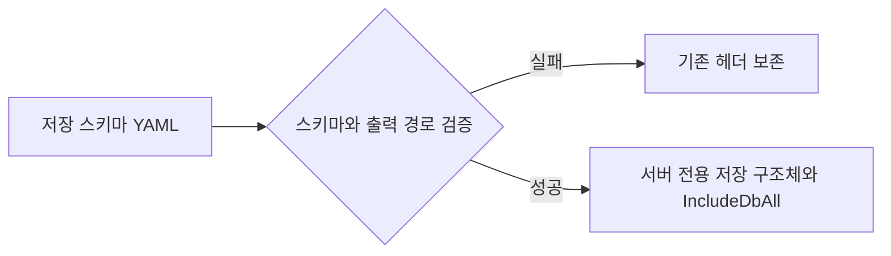

# DBGenerator

저장 스키마 YAML에서 서버용 C++ 저장 구조체를 생성한다. 명시적으로 요청하면 공개 패킷 YAML도 읽어 서버 전용 값 변환 함수를 생성한다. 빌드와 별도로 실행하며 DB 연결과 SQL 생성은 하지 않는다.



## 설정과 생성 모드

Windows 명령 프롬프트에서 프로젝트 루트로 이동해 실행한다. `DB_GENERATOR_PYTHON`을 지정하지 않으면 `PATH`의 `python`을 쓴다. 설치와 실행에 같은 인터프리터를 사용한다.

```bat
if not defined DB_GENERATOR_PYTHON set "DB_GENERATOR_PYTHON=python"
"%DB_GENERATOR_PYTHON%" -m pip install -r Tools\DBGenerator\requirements.txt
call Tools\DBGenerator\GenerateDb.bat
```

| `GenerateDb.bat` 인수 | 입력 | `Database/Generated/Server/` 출력 |
|---|---|---|
| 없음 | `Database/YamlSchema`의 전체 저장 YAML | 개별 저장 헤더와 [IncludeDbAll.h](../../Database/Generated/Server/IncludeDbAll.h) |
| `GameDB/Player/Character.yaml` | 지정한 저장 YAML 한 개 | [GameDB/Player/SDbCharacter.h](../../Database/Generated/Server/GameDB/Player/SDbCharacter.h)만 갱신 |
| `--projection` | 저장 YAML과 `projection`이 지정한 공개 YAML | 변환 함수 전체를 [DbPacketConversions.h](../../Database/Generated/Server/DbPacketConversions.h) 한 파일에 생성 |

스키마 인수는 `Database/YamlSchema` 기준으로 실제 이름의 대소문자를 맞추고 `/`로 구분한다. 개별 생성은 집계 헤더를 바꾸지 않으므로 스키마를 추가하거나 이름을 바꾼 뒤에는 인수 없이 실행한다.

- `record`는 `SDb`로 시작하는 C++ 타입명이며 `{record}.h`의 파일명이 된다. 논리 DB·카테고리는 경로와 `Database::{논리DB}::{카테고리}` 네임스페이스로 구분한다.
- 현재 `uint32`/`INT UNSIGNED`, `uint64`/`BIGINT UNSIGNED`, `InnoDB`·`utf8mb4`·`utf8mb4_bin`, 단일 non-null 숫자 PK만 지원한다. nullable 컬럼은 `default: null`을 명시하고, non-null 컬럼은 `default`를 생략한다.
- [프로젝트 헤더 규칙](../../Docs/Rule/002_Cpp_코딩컨벤션.md#포맷헤더)에 따라 개별 저장 헤더와 변환 헤더에는 `#include`를 쓰지 않는다. 집계 헤더 `IncludeDbAll.h`는 표준 타입 헤더와 개별 저장 헤더를 제공한다.
- 같은 입력은 같은 바이트를 생성한다. 다른 원본의 헤더나 수기 파일을 덮어쓰지 않는다. 한 경로에 생성기를 동시에 실행하지 않는다. YAML 경로나 `record`를 바꿨을 때 더 이상 쓰지 않는 헤더는 검토 후 직접 정리한다.

## 공개 값 변환 생성

[패킷 생성기 환경](../PacketGenerator/README.md#초기-설정과-실행)을 사용하는 터미널에서 아래 순서로 실행한다. 두 도구에 같은 Python을 쓰려면 다음처럼 지정한다. `--projection`에는 개별 스키마 인수를 주지 않는다.

```bat
if defined PACKET_GENERATOR_PYTHON set "DB_GENERATOR_PYTHON=%PACKET_GENERATOR_PYTHON%"
call Tools\DBGenerator\GenerateDb.bat
call Tools\PacketGenerator\GeneratePackets.bat Game
call Tools\DBGenerator\GenerateDb.bat --projection
```

`projection.schema`는 `<프로토콜>/<카테고리>/<파일>.yaml`로, `Common/Packet/<프로토콜>/Schema/<카테고리>/<파일>.yaml`을 가리킨다. `projection.fields`에 복사할 `column`과 `field`를 명시한다. 대상 필드는 빠짐없이 한 번씩 매핑하고 같은 고정폭 정수 타입끼리만 복사한다. nullable 컬럼에는 `null_to: 0`을 지정한다.

`ToCharacterData`는 `CharacterId`와 `LastLogoutMap`만 복사한다. 저장 맵이 없으면 결과의 `LastLogoutMap`을 `0`으로 채우며 `AccountId`는 공개하지 않는다. 매핑 하나라도 잘못되면 기존 `DbPacketConversions.h`를 보존한다. 두 생성기는 공개 구조체 YAML의 해석을 공유하지만 서로의 BAT를 호출하지 않는다.

### C++에서 사용

**저장 구조체만 쓸 때**는 기존 PCH 뒤에 `IncludeDbAll.h`만 포함한다. 패킷 헤더는 필요 없다.

```cpp
#include "pch.h"
#include "Database/Generated/Server/IncludeDbAll.h"
```

**공개 값으로 변환할 때**는 저장 타입과 공개 타입을 먼저 포함하고, 변환 헤더를 마지막에 포함한다. 아래 경로는 `13_MMO_Project` 루트, `Common/NetworkCommon`, `Server/MHLib/includes`를 프로젝트의 추가 포함 디렉터리에 지정한 기준이다.

```cpp
#include "pch.h"
#include "NetworkCommonLibPch.h"
#include "MHLib/serialization/ISerializable.h"

#include "Database/Generated/Server/IncludeDbAll.h"
#include "Common/Packet/Game/Generated/Common/Player/CharacterData.g.h"
#include "Database/Generated/Server/DbPacketConversions.h"
```

서버 함수 안에서 `SDbCharacter`를 넘기면 별도의 `SCharacterData` 값이 반환된다. 예제 값은 DB 조회 없이 직접 채운다.

```cpp
using Database::GameDB::Player::SDbCharacter;
using Database::GameDB::Player::ToCharacterData;

const SDbCharacter dbCharacter{
	.m_characterId = 1001,
	.m_accountId = 42,
	.m_lastLogoutMap = std::nullopt,
};

const Game::SCharacterData characterData = ToCharacterData(dbCharacter);
// characterData.m_characterId == 1001
// characterData.m_lastLogoutMap == 0
// 공개 타입에는 m_accountId가 없다.
```

저장 맵이 있으면 그 값이 그대로 복사된다. 변환 함수는 DB 조회나 `ResLogin` 전송을 하지 않는다. 독립 실행 예제는 [변환 시험 소스](../../Tests/DBGenerator/CharacterProjectionTests.cpp)를 참고한다.

### 실패했을 때

- Python 실행 또는 `yaml` import 실패: `DB_GENERATOR_PYTHON`과 의존성을 설치한 인터프리터가 같은지 확인한다.
- 스키마 오류·이름 충돌: 진단에 나온 경로를 확인한다. YAML의 필드명·타입·`null_to`나 동일 이름의 출력 파일을 확인한 뒤 원인을 고친다.
- 헤더 교체 실패: 해당 파일의 읽기 전용 속성이나 다른 프로세스가 열고 있는지 확인한 뒤 다시 실행한다. 생성물을 직접 수정하지 않는다.

## 검증

Visual Studio x64 Native Tools 명령 프롬프트에서 프로젝트 루트 기준으로 실행한다.

```bat
if not defined DB_GENERATOR_PYTHON set "DB_GENERATOR_PYTHON=python"
"%DB_GENERATOR_PYTHON%" -B -m unittest discover -s Tests\DBGenerator -v
cl /nologo /std:c++20 /permissive- /W4 /WX /utf-8 /Zs Tests\DBGenerator\CompileDbCharacter.cpp
```

값 변환 실행 검증은 기존 x64 Release `NetworkCommonLib.lib`가 필요하다. 아래 명령은 생성된 함수를 호출할 뿐 패킷을 전송하지 않는다.

```bat
cl /nologo /std:c++20 /permissive- /W3 /WX /utf-8 /EHsc /MD /DNDEBUG /DUNICODE /D_UNICODE ^
  /I Common\NetworkCommon /I Server\MHLib\includes ^
  /Fo"%TEMP%\CharacterProjectionTests.obj" /Fe"%TEMP%\CharacterProjectionTests.exe" ^
  Tests\DBGenerator\CharacterProjectionTests.cpp Build\Common\Release\NetworkCommonLib\NetworkCommonLib.lib
"%TEMP%\CharacterProjectionTests.exe"
```

마지막 실행이 종료 코드 `0`이면 값 변환 검증 통과다. 이 검증은 `ResLogin` 왕복 시험이 아니다.

[저장 구조체와 후속 단계 설계](../../Docs/Plan/Server/015_캐릭터_저장_구조와_DBGenerator_계획.md)
