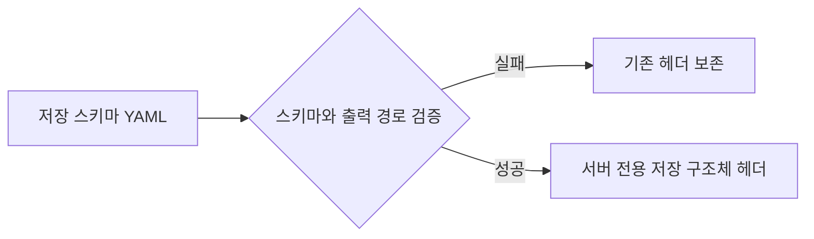

# DBGenerator

저장 스키마 YAML 한 개에서 서버용 C++ 저장 구조체 헤더 한 개를 생성한다. 빌드와 별도로 실행하며 MySQL, SQL 생성, 패킷은 1차 범위가 아니다.



## 생성

프로젝트 루트에서 다음 명령을 실행한다. 패킷 생성기와 동일한 PyYAML 버전을 사용하며 도구끼리 코드를 참조하지 않는다.

```bat
python -m pip install -r Tools\DBGenerator\requirements.txt
Tools\DBGenerator\GenerateDb.bat
```

인수를 생략하면 `Database/YamlSchema/GameDB/Player/Character.yaml`에서 `Database/Generated/Server/GameDB/Player/SDbCharacter.h`를 생성한다. 다른 스키마 한 개를 지정할 때는 `GameDB/Player/Character.yaml`처럼 `Database/YamlSchema` 기준의 경로를 실제 이름의 대소문자 그대로 `/` 구분자로 전달한다. 다른 Python 실행 파일을 쓰려면 `DB_GENERATOR_PYTHON`을 지정한다.

- `record`는 `SDb`로 시작하는 C++ 타입명이며 `{record}.h`의 파일명이 된다. 논리 DB·카테고리는 경로와 `Database::{논리DB}::{카테고리}` 네임스페이스로 구분한다.
- 1차는 `uint32`/`INT UNSIGNED`, `uint64`/`BIGINT UNSIGNED`, `InnoDB`·`utf8mb4`·`utf8mb4_bin`, 단일 non-null 숫자 PK만 지원한다. nullable 컬럼은 `default: null`을 명시하고, non-null 컬럼은 `default`를 생략한다.
- [프로젝트 헤더 규칙](../../Docs/Rule/002_Cpp_코딩컨벤션.md#포맷헤더)에 따라 생성 헤더에는 `#include`를 쓰지 않는다. 사용하는 `.cpp`의 PCH 또는 선행 include에서 `<cstdint>`, nullable 필드가 있으면 `<optional>`을 제공한다.
- 같은 입력은 같은 바이트를 생성한다. 다른 원본의 헤더나 수기 파일을 덮어쓰지 않는다. 한 경로에 생성기를 동시에 실행하지 않는다. YAML 경로나 `record`를 바꿨을 때 더 이상 쓰지 않는 헤더는 검토 후 직접 정리한다.

## 검증

Visual Studio x64 Native Tools 명령 프롬프트에서 프로젝트 루트 기준으로 실행한다.

```bat
python -B -m unittest discover -s Tests\DBGenerator -v
cl /nologo /std:c++20 /permissive- /W4 /WX /utf-8 /Zs Tests\DBGenerator\CompileDbCharacter.cpp
```

[저장 구조체와 후속 단계 설계](../../Docs/Plan/Server/015_캐릭터_저장_구조와_DBGenerator_계획.md)
